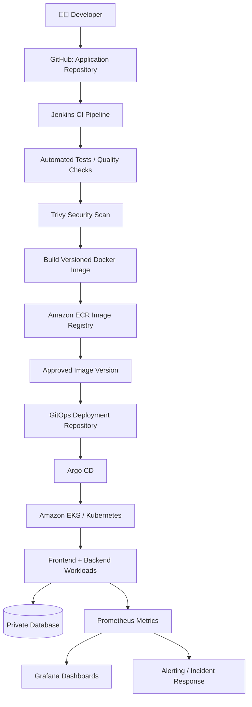
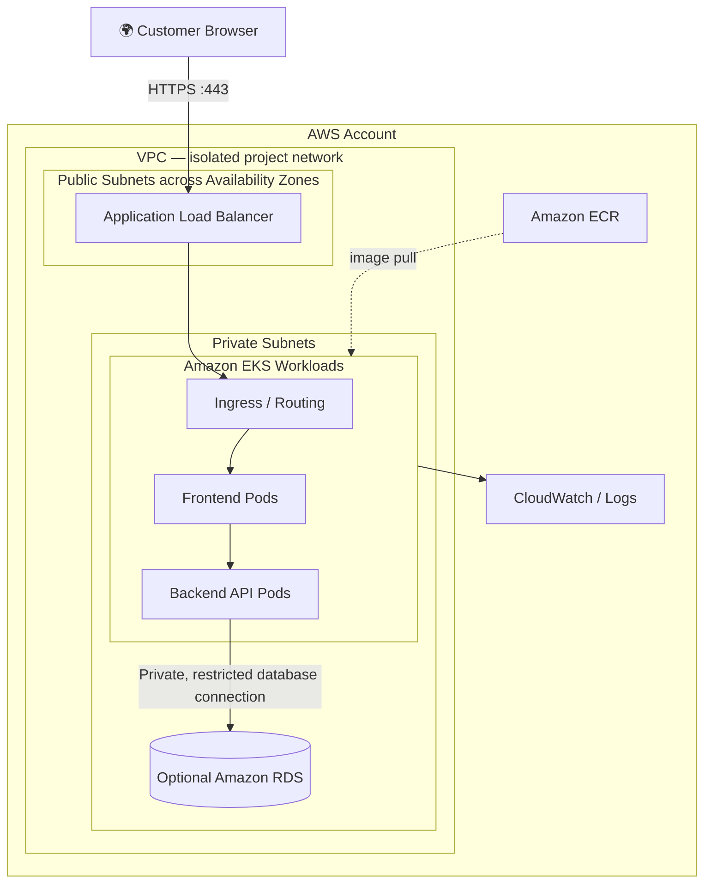
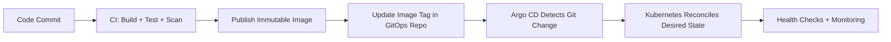

# 🚀 PROJECT 01 — END-TO-END DEVSECOPS ON AWS EKS


### A Real-World Three-Tier Application — From Code to Cloud

**Beginner-friendly • Step-by-step • Architecture • Troubleshooting • Interview-ready**


> **Simple ga cheppalante:** Developer code push chestadu → Jenkins test and security checks run chestundi → Docker image build ayi Amazon ECR lo store avutundi → Argo CD Git nunchi Kubernetes deployment ni sync chestundi → customers application use chestaru → Prometheus/Grafana system health ni monitor chestayi.

</div>

---

## 📚 Contents

- [1. Project ante enti?](#-1-project-ante-enti)
- [2. Real-time business example](#-2-real-time-business-example)
- [3. Problem vs solution](#-3-problem-vs-solution)
- [4. Three-tier application](#-4-three-tier-application-ante-enti)
- [5. Architecture diagrams](#-5-architecture-diagrams)
- [6. Tools: why, what, when](#-6-tools-enduku-vadali)
- [7. User request ela travel avutundi?](#-7-user-request-ela-travel-avutundi)
- [8. DevOps Engineer em chestadu?](#-8-devops-engineer-em-chestadu)
- [9. CI/CD and GitOps](#-9-cicd-and-gitops-flow)
- [10. Repository structure](#-10-repository-structure)
- [11. Prerequisites](#-11-prerequisites)
- [12. Step-by-step implementation plan](#-12-step-by-step-implementation-plan)
- [13. AWS infrastructure design](#-13-aws-infrastructure-design)
- [14. Security checks](#-14-devsecops-security)
- [15. Monitoring and alerting](#-15-monitoring-and-alerting)
- [16. Verify deployment and rollback](#-16-deployment-verification-and-rollback)
- [17. Troubleshooting guide](#-17-real-time-troubleshooting-guide)
- [18. Screenshots and evidence](#-18-screenshots-and-evidence)
- [19. Cost and cleanup](#-19-cost-safety-and-cleanup)
- [20. Interview explanation](#-20-interview-lo-project-ni-ela-explain-cheyyali)
- [21. Definition of done](#-21-project-complete-ayyindi-ani-ela-telustundi)
- [22. Official documentation](#-22-official-documentation)

---

# 🧠 1. Project ante enti?

Ee project lo manam oka **sample online product-store application** ni AWS cloud lo run chestam. Customer website open chesi products chustadu. Frontend request ni backend API ki pampistundi. Backend database nunchi product details retrieve chesi response pampistundi.

Application ni manual ga servers meeda install cheyyadam badulu:
- **Terraform** AWS infrastructure create/manage chestundi.
- **Docker** application and required dependencies ni image ga package chestundi.
- **Amazon EKS** managed Kubernetes control plane provide chestundi; Kubernetes workloads ni manage chestundi.
- **Jenkins** build, test, scan, image-publish stages automate chestundi.
- **Amazon ECR** container images store chestundi.
- **Argo CD** Git repository lo unna desired deployment configuration ni Kubernetes tho sync chestundi.
- **Prometheus** metrics collect chestundi.
- **Grafana** metrics ni dashboards lo visualize chestundi.
- **Trivy** container images and supported code/dependency artifacts lo known vulnerabilities scan cheyyadaniki use avutundi.

## 🎯 Project objective

1. Repeatable AWS infrastructure provision cheyyadam.
2. Frontend, backend, database responsibilities separate ga design cheyyadam.
3. Build, automated tests and security scanning automate cheyyadam.
4. Kubernetes lo application deploy and update cheyyadam.
5. Deployment changes Git lo track cheyyadam.
6. Application/infrastructure health monitor cheyyadam.
7. Common failures troubleshoot chesi safe ga recover avvadam.

> **Reality check:** Ee README implementation blueprint. Mee AWS account lo deploy chesi outputs, pipeline results, dashboard screenshots add chese varaku “tested”, “production-ready”, “highly available” ani claim cheyyakandi. First learning/lab environment lo validate cheyyali.

---

# 🛍️ 2. Real-time business example

Oka online store lo 500 customers normal day lo website use chestaru. Festival sale roju 5,000 customers visit chestunnaru. App release kuda cheyyali.

### ❌ Automation lekunda

1. Developer code complete chesi operations team ki pampistadu.
2. Engineer manually server ki login ayi files copy chestadu.
3. Server lo library/version mismatch valla app start kakapovachu.
4. Security vulnerabilities check cheyyadam miss avvachu.
5. New release error isthe previous version restore cheyyadam slow avvachu.
6. CPU/memory high ayina team ki alert late ga ravachu.

### ✅ Ee project lo

1. Developer code ni GitHub ki push chestadu.
2. Jenkins pipeline trigger avutundi.
3. Automated tests run avutayi.
4. Trivy configured policy prakaram image vulnerabilities scan chestundi.
5. Docker image unique tag tho build ayi Amazon ECR ki push avutundi.
6. Approved image tag deployment-config Git repository lo update chestaru.
7. Argo CD Git change ni detect chesi EKS lo desired state apply chestundi.
8. Kubernetes rollout status and readiness probes dwara new pods ready ayyayo check chestundi.
9. Prometheus metrics collect chestundi; Grafana dashboards lo latency, errors, CPU, memory observe chestaru.
10. Release unhealthy ga unte engineer rollout stop/rollback procedure follow chestadu.

**Key difference:** Jenkins application build/test/security automation kosam. Argo CD GitOps-based deployment synchronization kosam. CI pipeline image ni create/publish chestundi; GitOps repository approved image version ni declare chestundi.

---

# 🧯 3. Problem vs solution

| Real-world problem | Project solution | Enduku useful? |
|---|---|---|
| Environments manually create cheyyadam | Terraform | Repeatable infrastructure |
| “Na laptop lo work ayyindi” | Docker | App dependencies image lo package avutayi |
| Manual testing miss avvadam | Jenkins + automated tests | Repeatable quality checks |
| Vulnerable image release avvadam | Trivy scan + policy | Known risks early ga detect cheyyachu |
| Cluster changes track kakapovadam | Argo CD + GitOps | Desired state and history Git lo untayi |
| Database public ga expose avvadam | Private networking + restricted access | Attack surface taggutundi |
| Secret accidentally Git lo commit avvadam | Secret manager/CI credentials + IAM | Secret exposure risk taggutundi |
| App down ani late ga telustundi | Prometheus + Grafana + alerts | Faster detection and diagnosis |
| Bad release taruvata recovery slow | Versioned images + rollout/rollback plan | Controlled recovery |

**DevOps ante tools install cheyyadam matrame kaadu.** Software ni safely and reliably deliver cheyyadam, systems ni observe cheyyadam, failures ni diagnose and recover cheyyadam kuda.

---

# 🏗️ 4. Three-tier application ante enti?

“Tier” ante application lo oka responsibility ni handle chese layer. Ee project lo 3 main layers untayi.

## 🟦 Tier 1 — Frontend (User interface)

**Example:** Product cards, search bar, login button.

- Browser lo user ki kanipinche part.
- React/Next.js lanti frontend technology use cheyyachu.
- Backend API ni call chestundi.
- Database password ni frontend code lo eppudu pettakudadhu.
- Kubernetes Deployment ga run cheyyachu; external access kosam Ingress/Load Balancer design use cheyyachu.

**Simple analogy:** Shop entrance and display shelves. Customer ikkada products chustadu.

## 🟩 Tier 2 — Backend API (Business logic)

**Example:** `GET /api/products` request ki product list return cheyyadam.

- Frontend nunchi API requests receive chestundi.
- Input validation and business rules process chestundi.
- Database nunchi data read/write chestundi.
- Database credentials ni secure secret source nunchi retrieve chestundi.
- Database port ni public internet ki open cheyyakudadhu.

**Simple analogy:** Shop sales assistant. Customer request ni process chesi stock-room information teesukostadu.

## 🟨 Tier 3 — Database (Persistent data)

**Example:** Product name, price, inventory quantity.

- Application data store chestundi.
- Backend nunchi matrame access allow cheyyali.
- Learning demo lo containerized database use cheyyachu.
- Production-oriented design lo backups, restore tests, patching, availability and data durability plan tho managed database (e.g. Amazon RDS) consider cheyyachu.
- Database password Git/source code lo undakudadhu.

**Simple analogy:** Shop stock room and records. Authorized staff matrame access cheyyali.

### Tiers madhya communication

| From | To | Example | Access rule |
|---|---|---|---|
| Customer browser | Frontend endpoint | HTTPS request | Public HTTPS only |
| Frontend | Backend API | `GET /api/products` | Approved API route |
| Backend | Database | SQL query | Private network, restricted port |
| Prometheus | App/exporter | Metrics scrape | Monitoring access only |
| Engineer | Kubernetes API | `kubectl get pods` | Authenticated, least privilege |

> **Important:** Three-tier ante three EC2 servers compulsory ani kaadu. Frontend/backend EKS pods ga run avvachu; database Amazon RDS lo undavachu. “Tier” logical responsibility ni describe chestundi, physical server count ni kaadu.

---

# 🗺️ 5. Architecture diagrams

## 5.1 End-to-end DevSecOps flow



### Diagram ni ela chadavali?

- **Left/top:** Code change, build, test, security scan.
- **Middle:** Image registry and approved release version.
- **Deployment side:** Argo CD Git configuration ni Kubernetes tho sync chestundi.
- **Application side:** Frontend/backend database tho communicate chestayi.
- **Monitoring side:** Metrics dashboards/alerts ki velthayi.

## 5.2 AWS network architecture



**Network principle:** Public entry point ni limited ga unchali. Worker nodes and database private subnets lo undela design cheyyachu. Exact EKS networking, NAT, load balancer, endpoints and routing configuration implementation lo verify cheyyali.

## 5.3 CI vs CD vs GitOps



**Desired state** ante Git lo “app version X, replicas Y, settings Z” ani declare chesina intended configuration. Argo CD cluster actual state ni aa configuration ki match cheyyadaniki work chestundi.

---

# 🧰 6. Tools enduku vadali?

| Tool | Simple meaning | Ee project lo role | Eppudu use chestam? |
|---|---|---|---|
| Git/GitHub | Code history and collaboration | Source code + deployment config store | Code/config change appudu |
| Linux | Server/CLI operating environment | Commands, logs, scripts, troubleshooting | Daily operations |
| Terraform | Infrastructure as Code (IaC) | VPC, IAM, EKS-related resources define cheyyadam | Environment create/update appudu |
| AWS VPC | Private network boundary | Subnets, routes, network separation | AWS network design lo |
| IAM | Identity and permissions | Evaru ye AWS action cheyyagalaro control | Every AWS access path lo |
| Docker | App packaging format/runtime | Container image build cheyyadam | Build/test/deploy mundu |
| Amazon ECR | Container image registry | Images store and version cheyyadam | Image publish/pull appudu |
| Jenkins | Automation server | Build, test, scan, publish pipeline | Code change taruvata |
| Kubernetes | Container orchestration | Pods, rollout, services, probes manage | App cluster lo run avvadaniki |
| Amazon EKS | AWS managed Kubernetes | Kubernetes control plane service | AWS lo Kubernetes run cheyyadaniki |
| Helm | Kubernetes package templating | Reusable release configuration | Multiple environments/release versions |
| Argo CD | GitOps controller | Git desired state cluster ki sync | Deployment config update appudu |
| Trivy | Security scanner | Image/filesystem/dependency checks | Build/release gates lo |
| Prometheus | Metrics collection/query | CPU, memory, request metrics collect | Runtime monitoring lo |
| Grafana | Dashboards | Metrics visualize cheyyadam | Health/performance review lo |
| CloudWatch | AWS observability service | AWS metrics/logs and supported integrations | AWS resource troubleshooting lo |

### Oka easy memory trick

- **Terraform:** “Cloud lo em create cheyyali?”
- **Docker:** “Application ni ela package cheyyali?”
- **Kubernetes/EKS:** “Containers ekkada/how run avvali?”
- **Jenkins:** “Code ni test chesi image ela build/publish cheyyali?”
- **Argo CD:** “Git lo approved deployment version ni cluster lo ela maintain cheyyali?”
- **Prometheus/Grafana:** “Application healthy ga unda? Slow ga unda?”
- **Trivy:** “Known security risks unnaya?”

---

# 🔄 7. User request ela travel avutundi?

Customer browser lo `https://your-store.example` open chesadu anuko.

1. **DNS:** Domain ni correct endpoint ki resolve chestundi.
2. **HTTPS Load Balancer:** Incoming encrypted web request ni receive chestundi.
3. **Ingress/routing:** Request correct frontend service ki route avutundi (design batti).
4. **Frontend:** Product page render chestundi.
5. **Backend API:** Frontend `GET /api/products` request pampistundi.
6. **Database:** Backend private connection dwara product records retrieve chestundi.
7. **Backend response:** JSON response return chestundi.
8. **Frontend response:** Browser lo product cards display avutayi.
9. **Metrics:** App/cluster monitoring components request count, latency, errors lanti supported metrics collect chestayi.
10. **Alert:** Error rate/latency configured threshold cross aithe alerting system notify cheyyagaladu.

### Example API response

```json
{
  "products": [
    { "id": 101, "name": "Keyboard", "price": 1499 },
    { "id": 102, "name": "Mouse", "price": 699 }
  ]
}
```

Idi **illustrative example** matrame; actual response mee app API implementation batti untundi.

---

# 👷 8. DevOps Engineer em chestadu?

| Work area | Engineer action | Example |
|---|---|---|
| Infrastructure | Terraform plan review/apply | New test environment create cheyyadam |
| CI/CD | Pipeline build/test stages maintain | Failing test ni diagnose cheyyadam |
| Containerization | Dockerfile and image optimize | Large image size reduce cheyyadam |
| Kubernetes | Deployment, Service, probes, resources configure | Pod crash ayithe reason identify cheyyadam |
| Cloud security | IAM and network access review | Public database access prevent cheyyadam |
| GitOps | Argo CD sync/health status check | Git config and cluster state compare cheyyadam |
| Monitoring | Dashboards and alerts maintain | Latency spike identify cheyyadam |
| Incident response | Logs, metrics and events analyze | Bad release rollback cheyyadam |
| Reliability | Backup/recovery and runbooks test | Restore drill run cheyyadam |
| Cost | Resource usage and cleanup review | Unused test cluster delete cheyyadam |
| Collaboration | Developers/security teams tho work | Release readiness review |

**Real-time daily example:** Morning ki alert vachindi: backend `5xx` errors perigayi. Engineer first impact check chestadu, Grafana lo time range compare chestadu, Kubernetes pods/events/logs inspect chestadu, recent deployment identify chestadu. Root cause fix chesi test chestadu; required aithe previous known-good version ki rollback chestadu. Tarvata incident notes and preventive action document chestadu.

---

# 📁 9. CI/CD and GitOps flow

## CI — Continuous Integration

Code changes merge/push ayinappudu pipeline:
1. Repository checkout.
2. Dependencies install.
3. Lint/static checks.
4. Unit tests.
5. Docker image build.
6. Security scan.
7. Policy pass ayithe image ni unique tag tho ECR ki publish.

## CD/GitOps — Deployment

1. Build stage produce chesina immutable image tag ni select chestaru.
2. Deployment repository lo image tag update chestaru.
3. Change review/approval process pass avutundi.
4. Argo CD Git state ni observe chestundi.
5. Argo CD Kubernetes resources ni sync chestundi (configured policy prakaram).
6. Kubernetes desired replicas create chesi rollout manage chestundi.
7. Health checks and post-deployment verification run chestaru.

### Sample pipeline pseudocode

```groovy
pipeline {
  agent any

  stages {
    stage('Checkout') {
      steps { checkout scm }
    }

    stage('Test') {
      steps {
        sh 'echo "Replace with real lint and unit-test commands"'
      }
    }

    stage('Build Image') {
      steps {
        sh 'echo "Replace with docker build command"'
      }
    }

    stage('Security Scan') {
      steps {
        sh 'echo "Replace with Trivy scan and agreed policy"'
      }
    }

    stage('Publish') {
      steps {
        sh 'echo "Authenticate securely and push versioned image to ECR"'
      }
    }
  }
}
```

> [!CAUTION]
> Paina pipeline **template/pseudocode**, ready-to-run production pipeline kaadu. Mee language/framework, Dockerfile, ECR repository, AWS authentication, Jenkins agent tools and security policy ki taggattu real commands implement cheyyali. Credentials ni pipeline file lo hard-code cheyyakandi.

## Image tagging best practice

Avoid `latest` meeda matrame depend avvadam. Unique version tag use cheyyandi, for example:

- `store-api:git-a1b2c3d`
- `store-frontend:1.0.4`

Tag examples illustrative. Release strategy batti commit SHA, semantic version or immutable digest use cheyyachu. Deployment repository lo exact approved version record cheyyali.

---

# 🗂️ 10. Repository structure

Suggested Git repository layout:

```text
aws-eks-devsecops-platform/
├── README.md
├── application/
│   ├── frontend/
│   │   ├── src/
│   │   ├── tests/
│   │   └── Dockerfile
│   └── backend/
│       ├── src/
│       ├── tests/
│       ├── requirements.txt
│       └── Dockerfile
├── database/
│   ├── migrations/
│   └── seed/
├── terraform/
│   ├── modules/
│   │   ├── networking/
│   │   ├── iam/
│   │   ├── eks/
│   │   └── ecr/
│   ├── environments/
│   │   └── dev/
│   ├── versions.tf
│   ├── providers.tf
│   ├── variables.tf
│   └── outputs.tf
├── jenkins/
│   └── Jenkinsfile
├── kubernetes/
│   ├── base/
│   └── overlays/
│       └── dev/
├── helm/
│   └── store/
├── argocd/
│   └── application.yaml
├── monitoring/
│   ├── prometheus/
│   ├── grafana/
│   └── alerts/
├── security/
│   └── trivy/
├── tests/
│   ├── smoke/
│   └── integration/
├── docs/
│   ├── architecture/
│   ├── runbooks/
│   └── screenshots/
└── .gitignore
```

**Folder meaning:**
- `application/`: actual frontend/backend source code.
- `terraform/`: AWS infrastructure definitions.
- `jenkins/`: CI pipeline.
- `kubernetes/` and `helm/`: deployment manifests/templates.
- `argocd/`: GitOps application definitions.
- `monitoring/`: metrics, dashboards and alert rules.
- `security/`: scan policy/configuration notes.
- `tests/`: automated tests and smoke checks.
- `docs/`: architecture, verified screenshots, runbooks.

**Note:** Idi recommended structure. Files and folders create cheyyadam matrame saripodu; actual configuration, valid references, tests and environment-specific values implement cheyyali.

---

# 🧰 11. Prerequisites

Before deployment, ee checklist complete cheyyandi.

| Requirement | Enduku? |
|---|---|
| Git and GitHub repository | Source/configuration version control |
| AWS account with billing access | AWS resources create cheyyadaniki |
| AWS CLI | AWS commands and authentication |
| Terraform | Infrastructure provisioning |
| Docker | Container image build/test |
| `kubectl` | Kubernetes cluster manage |
| Helm (if using Helm) | Chart install/template |
| Jenkins environment/agent | Pipeline execute cheyyadaniki |
| Argo CD installed/configured | GitOps deployment |
| Trivy | Security scanning |
| Prometheus/Grafana plan | Metrics/dashboard |
| IAM permissions reviewed | Least-privilege access |
| Budget and cleanup plan | Unwanted cloud costs avoid cheyyadaniki |

## Verify local tools

```bash
git --version
aws --version
terraform version
docker --version
kubectl version --client
helm version
```

Commands installed and PATH configured unte version output vastundi. Jenkins, Argo CD, Prometheus, Grafana and EKS actual environment setup separate steps.

## AWS authentication

AWS CLI identity check cheyyandi:

```bash
aws sts get-caller-identity
aws configure list
```

Use a secure, approved authentication method (for example AWS IAM Identity Center for local access, and an appropriate role-based/OIDC setup for CI where supported). **Access keys ni README, source code, Docker image or Git repository lo commit cheyyakandi.** Shared/production accounts lo admin permissions tho blindly work cheyyakandi.

---

# 🪜 12. Step-by-step implementation plan

Project ni one shot lo build cheyyakandi. Each phase verify chesi next phase ki vellandi.

## Phase 1 — Application first

1. Simple frontend create cheyyandi: product list page.
2. Backend API create cheyyandi: `/health` and `/api/products`.
3. Unit tests add cheyyandi.
4. Local machine lo app run chesi test cheyyandi.
5. README lo actual run commands document cheyyandi.

**Success criteria:** Browser/API nunchi expected response ravali; tests pass avvali.

## Phase 2 — Docker

1. Frontend and backend Dockerfiles create cheyyandi.
2. `.dockerignore` add cheyyandi.
3. Local images build cheyyandi.
4. Containers run chesi health endpoints test cheyyandi.
5. Container lo unnecessary tools/root privileges avoid cheyyandi where practical.

**Success criteria:** Containers local ga run avvali; app logs and health endpoint check cheyyagalagali.

## Phase 3 — Terraform and AWS foundation

1. AWS region, naming and budget decide cheyyandi.
2. Terraform provider/version constraints define cheyyandi.
3. VPC, subnets, routes and required security boundaries design cheyyandi.
4. IAM roles/policies least privilege tho define cheyyandi.
5. ECR and EKS resources configure cheyyandi.
6. `terraform fmt` and `terraform validate` run cheyyandi.
7. `terraform plan` review chesi, correct lab account lo matrame apply cheyyandi.
8. State storage/locking and access permissions secure ga configure cheyyandi.

**Success criteria:** Terraform plan understood and reviewed; expected resources create ayyayi; access restricted ga undi.

## Phase 4 — Kubernetes basics

1. EKS cluster credentials configure cheyyandi.
2. `kubectl get nodes` run cheyyandi.
3. Frontend/backend Deployments and Services create cheyyandi.
4. Readiness/liveness probes configure cheyyandi.
5. Resource requests/limits set cheyyandi.
6. `kubectl get pods`, `kubectl get svc`, `kubectl describe pod` practice cheyyandi.

**Success criteria:** Expected pods `Running` and `Ready`; service routing works; logs accessible.

## Phase 5 — Jenkins CI

1. Jenkins controller/agent setup and access secure cheyyandi.
2. Repository checkout configure cheyyandi.
3. Lint and tests run cheyyandi.
4. Docker images build cheyyandi.
5. Trivy scans and agreed policy gates add cheyyandi.
6. Secure AWS auth use chesi image ni ECR ki push cheyyandi.
7. Pipeline failure logs and artifacts preserve cheyyandi.

**Success criteria:** Commit/PR ki pipeline result trace cheyyagalagali; failed tests/scans expected ga release block cheyyali.

## Phase 6 — Argo CD GitOps

1. Deployment manifests or Helm chart create cheyyandi.
2. Deployment configuration ni separate GitOps repo/folder lo maintain cheyyandi.
3. Argo CD Application configure cheyyandi.
4. Image tag update chesi reviewed commit push cheyyandi.
5. Argo CD sync/health status check cheyyandi.
6. Git desired state and cluster actual state compare cheyyandi.

**Success criteria:** Git change valla intended deployment update avutundi; sync and health status clear ga observe cheyyagalagali.

## Phase 7 — Monitoring

1. Prometheus and Grafana deploy/configure cheyyandi.
2. Cluster/application metrics source configure cheyyandi.
3. CPU, memory, request rate, latency and error metrics available unnayo verify cheyyandi.
4. Dashboard create cheyyandi.
5. One harmless test alert trigger chesi delivery verify cheyyandi.
6. Logs and metrics links runbook lo document cheyyandi.

**Success criteria:** Metrics actually scrape avutunnayi; dashboard real data chupistundi; alert test evidence undi.

## Phase 8 — Operations and proof

1. Healthy release verification run cheyyandi.
2. Controlled failure test in non-production lab lo perform cheyyandi.
3. Logs/events/metrics tho root cause identify cheyyandi.
4. Rollback procedure test cheyyandi.
5. AWS resources and estimated cost review cheyyandi.
6. Test resources cleanup cheyyandi.
7. Screenshots and lessons learned add cheyyandi.

**Success criteria:** Healthy deploy, failure diagnosis, recovery and cleanup evidence documented.

---

# ☁️ 13. AWS infrastructure design

## Core components

| AWS component | Purpose | Design note |
|---|---|---|
| VPC | Project network boundary | CIDR plan and routing carefully choose cheyyali |
| Public subnets | Internet-facing load balancer path (if required) | Only required entry points expose cheyyali |
| Private subnets | Worker nodes / private workloads | Internet exposure minimize cheyyali |
| IAM roles | AWS permissions | Least privilege; avoid long-lived credentials where possible |
| ECR | Container image registry | Image access policies and scanning configure cheyyali |
| EKS | Managed Kubernetes control plane | Cluster version, node capacity and access plan |
| Load Balancer / Ingress | External HTTP(S) traffic routing | TLS and allowed ports configure cheyyali |
| RDS (optional recommended production design) | Managed relational database | Private access, backup and restore plan |
| CloudWatch | AWS logs/metrics | Retention and cost review |
| Terraform state backend | State storage and coordination | Encrypt/restrict access; locking strategy use cheyyali |

## Terraform workflow

```bash
terraform fmt -recursive
terraform init
terraform validate
terraform plan -out=tfplan
terraform show tfplan
# Plan ni review chesaka, correct environment ani confirm chesi:
terraform apply tfplan
```

**Important:** `terraform apply` AWS resources create cheyyachu and charges incur avvachu. Plan ni chadavakunda apply cheyyakandi. Existing/shared resources ni destroy/replace cheyyabothunnada ani review cheyyandi. `terraform destroy` ni production/shared environment lo blindly run cheyyakandi.

## Terraform state gurinchi

Terraform state actual infrastructure resources and configuration mapping maintain chestundi. State file ni public GitHub repository lo commit cheyyakandi. Team usage kosam encrypted remote state, access controls and supported locking approach configure cheyyali. Backend details Terraform version and backend choice batti implement cheyyali.

---

# 🔐 14. DevSecOps security

DevSecOps ante security ni deployment end lo matrame kaakunda development/build/deploy lifecycle lo integrate cheyyadam.

## Security gates

| Stage | Check | Failure appudu |
|---|---|---|
| Source code | Secret detection and code review | Secret leak unte stop, revoke/rotate, history impact assess |
| Dependencies | Known vulnerable packages scan | Severity/policy prakaram update or exception review |
| Docker image | Trivy image scan | Policy threshold exceed aithe publish/release block |
| AWS access | IAM least privilege | Unnecessary permissions remove |
| Kubernetes | RBAC, network policies where appropriate | Over-broad access reduce |
| Secrets | Secret manager / protected CI credentials | Secret ni code, logs, image lo pettakandi |
| Runtime | Logs, metrics, alerts | Suspicious behavior investigate |
| Release | Approval and immutable version | Unknown/unreviewed image deploy cheyyakandi |

## Trivy scan example

Image build ayyaka:

```bash
trivy image --severity HIGH,CRITICAL your-registry/your-image:your-tag
```

Ee command example lo `your-registry/your-image:your-tag` ni actual image reference tho replace cheyyali. Ee command scan run chestundi; **automatic ga build fail cheyyadu** unless CI stage exit-code/policy behavior explicitly configure chestaru. Actual gate requirements team policy batti set cheyyali.

## Security rules

- AWS access keys, passwords, tokens ni source code lo hard-code cheyyakandi.
- `.env` secrets file ni Git lo commit cheyyakandi.
- `.gitignore` lo secret/local files cover cheyyandi.
- CI logs lo secrets print avvakunda chudandi.
- ECR repository and cluster access restrict cheyyandi.
- Kubernetes ServiceAccounts/RBAC ni least privilege tho configure cheyyandi.
- Database public access disable cheyyandi unless explicit reviewed requirement exists.
- TLS use cheyyandi; certificate renewal process plan cheyyandi.
- Security scan findings ni ignore cheyyakunda severity, exploitability and approved exceptions document cheyyandi.

---

# 📈 15. Monitoring and alerting

Monitoring ante “server running unda?” ani matrame kaadu. Application customer ki useful ga work chestunda ani observe cheyyadam.

## Important signals

| Signal | Meaning | Example question |
|---|---|---|
| Availability | Service reachable/healthy unda? | Health endpoint success avutunda? |
| Request rate | Requests entha vastunnayi? | Sale traffic periginda? |
| Error rate | Failed requests entha? | `5xx` errors sudden ga perigaya? |
| Latency | Response ki entha time padutundi? | API slow ga unda? |
| CPU | Compute usage | CPU saturation unda? |
| Memory | RAM usage | Memory limit/OOM kills unnaya? |
| Pod restarts | Containers repeatedly crash avutunnaya? | Config/dependency issue unda? |
| Database health | Connections/latency/storage | DB bottleneck unda? |

## Example dashboard layout

```text
┌────────────────────────────┬────────────────────────────┐
│ Application Availability   │ Request Rate               │
│  Health endpoint status    │ Requests / second          │
├────────────────────────────┼────────────────────────────┤
│ HTTP Error Rate            │ Request Latency            │
│  4xx / 5xx trends           │ p50 / p95 / p99             │
├────────────────────────────┼────────────────────────────┤
│ Kubernetes CPU / Memory    │ Pod Restarts / Readiness   │
│  usage and limits           │ unhealthy workload count   │
└────────────────────────────┴────────────────────────────┘
```

Ee box layout conceptual example; actual Grafana screenshot kaadu. Actual dashboard lo real metrics configure chesi screenshot add cheyyali.

## Example alert ideas

- Application health endpoint repeatedly fails.
- HTTP 5xx error rate agreed threshold exceed avutundi.
- p95 latency agreed threshold kanna ekkuva.
- Pod restart count sudden ga increase avutundi.
- CPU/memory usage sustained ga high.
- Prometheus target down.

Thresholds arbitrary ga copy cheyyakandi. Baseline, traffic, service objective and false-positive risk batti set cheyyandi. Alert ki **owner, severity, response steps** define cheyyandi.

---

# 🚦 16. Deployment verification and rollback

## Before release

- [ ] Tests pass ayyayi.
- [ ] Security policy pass ayyindi or approved exception documented.
- [ ] Correct image tag/digest selected.
- [ ] GitOps change reviewed.
- [ ] Database changes backward-compatible ga unnayo check chesaru.
- [ ] Monitoring and rollback plan ready ga unnayi.

## Kubernetes verification commands

```bash
kubectl get nodes
kubectl get namespaces
kubectl get deployments -A
kubectl get pods -A
kubectl get services -A
kubectl get events -A --sort-by=.lastTimestamp
```

Specific namespace/deployment kosam:

```bash
kubectl -n <namespace> get pods
kubectl -n <namespace> describe pod <pod-name>
kubectl -n <namespace> logs deploy/<deployment-name>
kubectl -n <namespace> rollout status deployment/<deployment-name>
```

`<namespace>`, `<pod-name>`, `<deployment-name>` ni mee actual values tho replace cheyyandi.

## Rollback concept

Bad release detect ayithe:

1. Customer impact and error scope confirm cheyyandi.
2. Recent change/image version identify cheyyandi.
3. Team release procedure follow chesi known-good version ki return avvandi.
4. GitOps setup lo deployment repo ni previous approved image/config version ki revert chesi Argo CD sync/health observe cheyyadam common approach.
5. Kubernetes Deployment direct `rollout undo` command konni setups lo work avvachu, kani Argo CD manage chestunna resources ki manual changes drift create cheyyachu. Team GitOps policy ni follow cheyyandi.
6. Health endpoint, error rate, latency and logs verify cheyyandi.
7. Root cause and prevention action document cheyyandi.

**Database caution:** Application rollback ante database data/schema automatic ga rollback avutundi ani kaadu. Destructive schema changes ki separate backup/restore and compatibility plan kavali.

---

# 🧯 17. Real-time troubleshooting guide

| Symptom | Possible cause | First checks | Possible next action |
|---|---|---|---|
| Jenkins build fails | Test, dependency or agent issue | Pipeline console output; exact failed stage | Reproduce failure; fix dependency/config/test |
| Docker build fails | Wrong path, missing file, dependency issue | Build context, Dockerfile, `.dockerignore` | Correct path/dependencies and rebuild |
| ECR push denied | IAM/auth/repository policy issue | AWS identity, login, ECR permissions | Correct role/policy; don't paste keys into logs |
| `ImagePullBackOff` | Wrong image tag or pull permissions | `kubectl describe pod`; image reference | Correct tag and ECR access |
| `CrashLoopBackOff` | App exits, config error, dependency unavailable | `kubectl logs --previous`; `describe pod` | Fix config/start command; validate dependency |
| Pod `Pending` | Insufficient capacity or scheduling constraint | `kubectl describe pod`; events | Check node capacity, requests, affinity and quotas |
| `OOMKilled` | Memory limit exceeded | Pod status, metrics, logs | Profile memory; adjust app or justified limits |
| Service unreachable | Service selector/port/network route mismatch | `kubectl get svc,endpoints`; pod labels | Fix selectors/ports and routing |
| Ingress gives 502/503 | Backend unhealthy or target routing issue | Ingress/controller logs; service endpoints | Fix readiness, port, health path or target config |
| Argo CD `OutOfSync` | Git and cluster differ | Argo CD diff and sync status | Review diff; update Git or sync per policy |
| Prometheus target down | Wrong scrape config/network/endpoint | Prometheus Targets page and pod/service | Fix target labels, port, path or access |
| Grafana has no data | Wrong datasource/query or no metrics | Datasource test; Prometheus query | Fix datasource and metric/query name |
| App slow | CPU, DB, network or dependency bottleneck | Latency dashboard, logs, DB metrics | Identify bottleneck before scaling |
| Terraform wants replacement | Changed immutable attribute or config drift | `terraform plan` diff | Review carefully; don't apply blindly |

## Troubleshooting method — 5 steps

1. **Observe:** Exact error, time, affected users and recent changes note cheyyandi.
2. **Scope:** Frontend, backend, database, cluster or network — issue ekkada?
3. **Collect evidence:** Logs, events, metrics, pipeline output.
4. **Test one hypothesis:** Oka change chesi result compare cheyyandi.
5. **Verify and document:** Service recover ayyinda? Root cause enti? Repeat avvakunda em change cheyyali?

---

# 🖼️ 18. Screenshots and evidence

Professional project README lo **real screenshots** chala useful. But fake/illustrative screenshots ni actual success proof la present cheyyakandi. Actual environment lo verify chesaka images ni `docs/screenshots/` folder lo save cheyyandi.

Recommended evidence:

| File name | Screenshot lo em undali? |
|---|---|
| `01-architecture.png` | Final architecture diagram |
| `02-terraform-plan.png` | Reviewed Terraform plan; sensitive data redact cheyyali |
| `03-jenkins-success.png` | Actual successful pipeline stages |
| `04-ecr-image.png` | ECR lo actual image tag/digest |
| `05-eks-workloads.png` | `kubectl get pods` and deployment status |
| `06-argocd-healthy.png` | Actual Argo CD sync/health status |
| `07-trivy-report.png` | Actual scan summary; secrets redact cheyyali |
| `08-grafana-dashboard.png` | Real collected metrics dashboard |
| `09-rollback-proof.png` | Non-production rollback and health verification |
| `10-cleanup-proof.png` | Test resources cleanup evidence |

Add screenshots like this:

```markdown
### Jenkins Pipeline — Verified Result


```

**Privacy:** AWS account IDs, public IPs, usernames, tokens, private hostnames and secret values ni public repo screenshot lo expose cheyyakandi. Screenshot lo sensitive information unte redact cheyyandi.

---

# 💸 19. AWS cost safety and cleanup

EKS, worker compute, load balancers, NAT gateways, disks, logging, databases and data transfer charges generate cheyyachu. Exact cost region, runtime, capacity and current pricing batti vary avutundi.

## Before creating resources

- [ ] Separate learning/test environment use chestunnara?
- [ ] Billing alerts/budget configure chesara?
- [ ] Region and instance/node sizing review chesara?
- [ ] Required resources list telusa?
- [ ] Cleanup owner and deadline decide chesara?
- [ ] Existing/shared resources ni accidentally touch cheyyakunda verify chesara?

## Cleanup approach

1. Application traffic stop/remove cheyyandi where appropriate.
2. Argo CD/Kubernetes-managed resources ni documented order lo remove cheyyandi.
3. Terraform state and ownership verify chesi, Terraform-managed infrastructure ni correct workspace/environment nunchi clean up cheyyandi.
4. ECR images, disks, load balancers, NAT gateways, logs and database snapshots lanti billable leftovers inspect cheyyandi.
5. AWS Console/CLI lo resources actually delete ayyayo verify cheyyandi.
6. Needed evidence and state backups preserve cheyyandi.

> **Danger:** `terraform destroy` or bulk deletion commands ni copy-paste chesi run cheyyakandi. Shared account/production environment lo data loss or outage avvachu. Resource ownership, state and plan ni review chesi explicit approval tho matrame cleanup cheyyandi.

---

# 🎤 20. Interview lo project ni ela explain cheyyali?

Below is a **sample explanation template**. Mee own implementation and results ki match ayye details matrame claim cheyyandi.

> “I am building an end-to-end DevSecOps platform for a three-tier application on AWS EKS. Terraform is used to define the cloud infrastructure. The application is containerized with Docker, and Jenkins automates checkout, testing, image build and security scanning. Approved images are stored in Amazon ECR. The deployment configuration is maintained in Git, and Argo CD synchronizes that desired state to Kubernetes. Prometheus and Grafana are used for monitoring, and I document health checks, troubleshooting and rollback procedures. I validate each stage and capture evidence from the actual environment.”

## Interview questions to practice

1. Why did you choose EKS instead of running containers directly on EC2?
2. Terraform state ante enti? Why should it not be committed to public Git?
3. Docker image and running container madhya difference enti?
4. Jenkins and Argo CD roles ela different?
5. GitOps ante enti? Git and cluster state differ ayithe em chestaru?
6. Kubernetes Deployment and Service enduku separate?
7. Readiness probe and liveness probe difference enti?
8. `CrashLoopBackOff` ni ela troubleshoot chestaru?
9. `ImagePullBackOff` ki possible causes enti?
10. ECR access ni secure ga ela configure chestaru?
11. Secrets ni Jenkins/Kubernetes lo ela handle chestaru?
12. Trivy scan fail ayithe release process em chestundi?
13. Prometheus and Grafana roles enti?
14. High latency and high CPU ni ela investigate chestaru?
15. Rollback chesetappudu database migrations enduku careful ga handle cheyyali?
16. AWS cost unexpected ga perigite first em check chestaru?
17. Production-ready ani claim cheyyadaniki additional ga em evidence kavali?

---

# ✅ 21. Project complete ayyindi ani ela telustundi?

Project “complete” ani cheppadaniki code files unnayi anedi okkate saripodu. Ee checklist ni actual evidence tho tick cheyyandi.

- [ ] Frontend and backend local tests pass.
- [ ] Docker images build and run.
- [ ] Terraform formatting/validation pass.
- [ ] Terraform plan reviewed; intended AWS resources created.
- [ ] IAM/networking permissions reviewed.
- [ ] EKS nodes/workloads healthy.
- [ ] Application endpoint accessible through intended route.
- [ ] Jenkins pipeline actual tests execute chestundi.
- [ ] Security scan actual image ni scan chestundi and policy behavior documented.
- [ ] Versioned image ECR lo undi.
- [ ] Argo CD GitOps sync/health verified.
- [ ] Prometheus targets healthy and real metrics visible.
- [ ] Grafana dashboard real data chupistundi.
- [ ] At least one safe alert test performed.
- [ ] Non-production rollback tested.
- [ ] Troubleshooting runbook and actual screenshots added.
- [ ] Cleanup performed and remaining billable resources checked.
- [ ] Limitations and unimplemented production requirements documented.

## Production readiness — additional work

Real production system kosam requirements batti further review avasaram: threat modeling, disaster recovery and restore drills, multi-AZ design, capacity testing, SLOs, incident response, audit logging, vulnerability remediation SLAs, access reviews, patching, backup retention, compliance and cost controls. Ee README okkate production readiness ni guarantee cheyyadu.

---

# 🔗 22. Official documentation

Official docs ni primary reference ga use cheyyandi:

- [AWS EKS](https://docs.aws.amazon.com/eks/latest/userguide/what-is-eks.html) — managed Kubernetes.
- [Amazon ECR](https://docs.aws.amazon.com/AmazonECR/latest/userguide/what-is-ecr.html) — container image registry.
- [Terraform AWS provider](https://registry.terraform.io/providers/hashicorp/aws/latest/docs) — AWS resource configuration.
- [Terraform tutorials](https://developer.hashicorp.com/terraform/tutorials) — IaC workflow.
- [Docker docs](https://docs.docker.com/) — image and container fundamentals.
- [Kubernetes concepts](https://kubernetes.io/docs/concepts/) — workloads, services, probes and configuration.
- [Jenkins Pipeline](https://www.jenkins.io/doc/book/pipeline/) — CI pipeline syntax.
- [Argo CD documentation](https://argo-cd.readthedocs.io/en/stable/) — GitOps delivery.
- [Trivy documentation](https://trivy.dev/latest/docs/) — security scanning.
- [Prometheus documentation](https://prometheus.io/docs/introduction/overview/) — metrics and queries.
- [Grafana documentation](https://grafana.com/docs/) — dashboards and alerting.
- [AWS Well-Architected Framework](https://docs.aws.amazon.com/wellarchitected/latest/framework/welcome.html) — reliability, security, operations and cost principles.

---

<div align="center">

## 🌟 Final thought

**Goal: tools names memorize cheyyadam kaadu.** Code commit nunchi deployment varaku flow ardham chesukovali; each tool enduku use chestamo explain cheyyali; failure vachinappudu evidence tho troubleshoot cheyyali; and actual results ni screenshots and runbooks tho prove cheyyali.

**Project 01 — End-to-End DevSecOps on AWS EKS**

