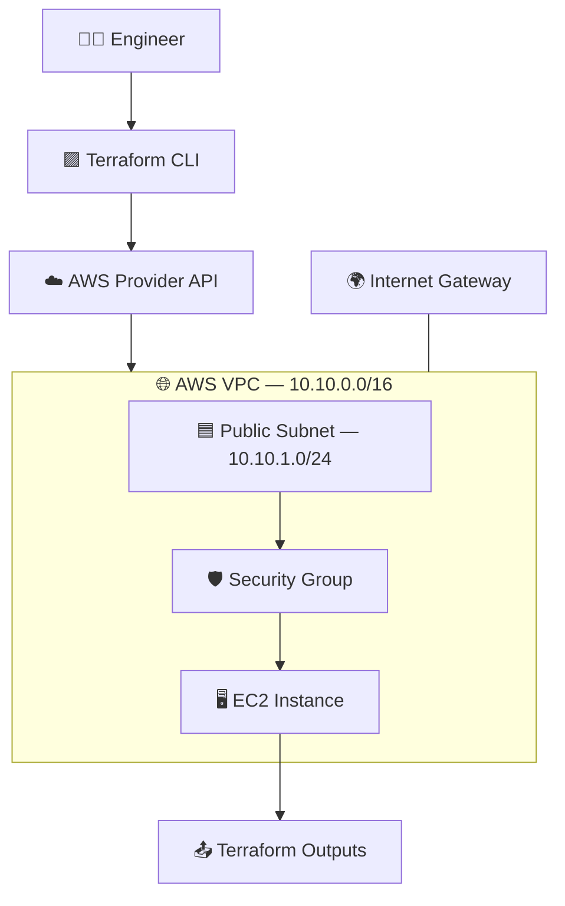

# ☁️ PROJECT 10 — AWS INFRASTRUCTURE AS CODE

### 🚀 Terraform · AWS · VPC · EC2 · IAM · Security

<p>
  
  
  
  
</p>

**Build repeatable AWS infrastructure using Terraform instead of creating every resource manually in the AWS Console.**

[📘 Terraform Docs](https://developer.hashicorp.com/terraform/docs) · [☁️ AWS Docs](https://docs.aws.amazon.com/) · [🧱 AWS Provider](https://registry.terraform.io/providers/hashicorp/aws/latest/docs)

</div>

---


## 🌈 Project dashboard

<table>
<tr>
<td width="50%" valign="top">

### 🟪 WHAT YOU BUILD
- 🌐 A dedicated AWS VPC
- 🧩 A public subnet and internet route
- 🔐 A security group with restricted ingress
- 🖥️ An EC2 virtual machine
- 🏷️ Standard resource tags
- 📤 Useful Terraform outputs

</td>
<td width="50%" valign="top">

### 🟦 WHAT YOU LEARN
- 🧠 Infrastructure as Code (IaC)
- 📝 Terraform HCL syntax
- 🔄 `init`, `validate`, `plan`, `apply`
- 📦 Variables, outputs, and state
- 🔒 AWS credentials and least privilege
- 🧹 Safe infrastructure cleanup

</td>
</tr>
</table>

> [!IMPORTANT]
> **Learning lab, not a claim of a live deployment.** The configuration below is a starting point. Validate it in your own AWS account and region before applying. AWS resources can incur charges, and `terraform destroy` can delete resources. Never commit AWS credentials, private keys, or Terraform state files to Git.

## 🧭 Contents

- [🎯 Scenario](#-scenario)
- [🏗️ Architecture](#️-architecture)
- [🗂️ Repository structure](#️-repository-structure)
- [⚙️ Prerequisites](#️-prerequisites)
- [🔐 Configure AWS credentials](#-configure-aws-credentials)
- [🧱 Build the Terraform configuration](#-build-the-terraform-configuration)
- [🚀 Deploy step by step](#-deploy-step-by-step)
- [🧪 Verify the deployment](#-verify-the-deployment)
- [🛡️ Security checklist](#️-security-checklist)
- [🛠️ Troubleshooting](#️-troubleshooting)
- [🧹 Cleanup](#-cleanup)
- [🎤 Interview preparation](#-interview-preparation)
- [📚 References](#-references)

---

## 🎯 Scenario

A team needs a predictable way to create the same basic cloud infrastructure across development and testing environments. Manually creating a VPC, subnet, route table, security group, and EC2 instance is repetitive and can lead to configuration drift.

Terraform lets the team describe the desired infrastructure in version-controlled files, review a plan, and apply approved changes.

### 🟩 Project goals

- Create a custom network in AWS.
- Add a public subnet with internet routing.
- Allow SSH only from an explicitly configured trusted CIDR.
- Launch an EC2 instance using a selected AMI and instance type.
- Output the created resource IDs and public IP.
- Keep changes reviewable and cleanup documented.

## 🏗️ Architecture



### 🔄 Resource flow

| Step | Resource | Purpose |
|---:|---|---|
| 1 | VPC | Isolated virtual network |
| 2 | Internet Gateway | Internet connectivity for eligible public subnet resources |
| 3 | Public subnet | Network segment with a public IPv4 address mapping option |
| 4 | Route table | Routes internet-bound traffic through the gateway |
| 5 | Security group | Controls allowed inbound and outbound traffic |
| 6 | EC2 instance | Compute resource created in the subnet |

## 🗂️ Repository structure

```text
project-10-aws-terraform-iac/
├── versions.tf
├── providers.tf
├── variables.tf
├── main.tf
├── outputs.tf
├── terraform.tfvars.example
├── .gitignore
└── README.md
```

## ⚙️ Prerequisites

| Tool | Purpose | Verify |
|---|---|---|
| 🧱 Terraform CLI | Provision resources | `terraform -version` |
| ☁️ AWS CLI | Configure and inspect AWS | `aws --version` |
| 🔑 AWS account | Own and authorize resources | AWS Console |
| 🧰 Git | Track configuration | `git --version` |

Install Terraform and AWS CLI using the official documentation for your operating system. This project requires AWS credentials with permissions for the resources you intend to create.

## 🔐 Configure AWS credentials

Use an AWS CLI profile or your organization's approved identity method. For a local learning machine, one option is:

```bash
aws configure
aws sts get-caller-identity
```

The second command should return the identity associated with the credentials currently in use.

> [!WARNING]
> Do not paste access keys into Terraform files, `terraform.tfvars`, source control, screenshots, or chat. Prefer IAM roles or short-lived credentials where available. Grant only the permissions required for the lab.

## 🧱 Build the Terraform configuration

Create a new folder named `project-10-aws-terraform-iac` and add the files below.

### 1️⃣ `versions.tf`

```terraform
terraform {
  required_version = ">= 1.5.0"

  required_providers {
    aws = {
      source  = "hashicorp/aws"
      version = "~> 5.0"
    }
  }
}
```

This pins the AWS provider to the 5.x minor line and specifies a minimum Terraform CLI version. Review and update version constraints deliberately when maintaining the project.

### 2️⃣ `providers.tf`

```terraform
provider "aws" {
  region = var.aws_region

  default_tags {
    tags = {
      Project     = "project-10-aws-terraform-iac"
      Environment = var.environment
      ManagedBy   = "Terraform"
    }
  }
}
```

### 3️⃣ `variables.tf`

```terraform
variable "aws_region" {
  description = "AWS region in which to create the lab."
  type        = string
  default     = "ap-south-1"
}

variable "environment" {
  description = "Environment label used for tagging."
  type        = string
  default     = "dev"
}

variable "vpc_cidr" {
  description = "CIDR block for the VPC."
  type        = string
  default     = "10.10.0.0/16"
}

variable "public_subnet_cidr" {
  description = "CIDR block for the public subnet."
  type        = string
  default     = "10.10.1.0/24"
}

variable "instance_type" {
  description = "EC2 instance type; check current pricing and eligibility."
  type        = string
  default     = "t3.micro"
}

variable "ami_id" {
  description = "A valid Linux AMI ID for the selected AWS region."
  type        = string
}

variable "ssh_allowed_cidr" {
  description = "Trusted public IPv4 CIDR allowed to connect over SSH, e.g. your public IP followed by /32."
  type        = string

  validation {
    condition     = can(cidrhost(var.ssh_allowed_cidr, 0)) && endswith(var.ssh_allowed_cidr, "/32")
    error_message = "For this learning lab, ssh_allowed_cidr must be a single IPv4 address with /32."
  }
}
```

### 4️⃣ `main.tf`

```terraform
resource "aws_vpc" "main" {
  cidr_block           = var.vpc_cidr
  enable_dns_support   = true
  enable_dns_hostnames = true

  tags = {
    Name = "${var.environment}-project10-vpc"
  }
}

resource "aws_internet_gateway" "main" {
  vpc_id = aws_vpc.main.id

  tags = {
    Name = "${var.environment}-project10-igw"
  }
}

resource "aws_subnet" "public" {
  vpc_id                  = aws_vpc.main.id
  cidr_block              = var.public_subnet_cidr
  map_public_ip_on_launch = true

  tags = {
    Name = "${var.environment}-project10-public-subnet"
  }
}

resource "aws_route_table" "public" {
  vpc_id = aws_vpc.main.id

  route {
    cidr_block = "0.0.0.0/0"
    gateway_id = aws_internet_gateway.main.id
  }

  tags = {
    Name = "${var.environment}-project10-public-rt"
  }
}

resource "aws_route_table_association" "public" {
  subnet_id      = aws_subnet.public.id
  route_table_id = aws_route_table.public.id
}

resource "aws_security_group" "ec2" {
  name        = "${var.environment}-project10-ec2-sg"
  description = "SSH only from the explicitly allowed trusted IPv4 address"
  vpc_id      = aws_vpc.main.id

  ingress {
    description = "SSH from trusted IPv4 address only"
    from_port   = 22
    to_port     = 22
    protocol    = "tcp"
    cidr_blocks = [var.ssh_allowed_cidr]
  }

  egress {
    description = "Outbound IPv4 traffic for this learning lab"
    from_port   = 0
    to_port     = 0
    protocol    = "-1"
    cidr_blocks = ["0.0.0.0/0"]
  }

  tags = {
    Name = "${var.environment}-project10-ec2-sg"
  }
}

resource "aws_instance" "web" {
  ami                         = var.ami_id
  instance_type               = var.instance_type
  subnet_id                   = aws_subnet.public.id
  vpc_security_group_ids      = [aws_security_group.ec2.id]
  associate_public_ip_address = true

  metadata_options {
    http_endpoint               = "enabled"
    http_tokens                 = "required"
    http_put_response_hop_limit = 1
  }

  root_block_device {
    encrypted = true
  }

  tags = {
    Name = "${var.environment}-project10-web"
    Role = "learning-lab"
  }
}
```

> [!NOTE]
> This example creates a public EC2 instance for a basic networking lab. It does **not** install an application, configure a key pair, or enable SSH login by itself. For production, prefer private instances accessed through Systems Manager or a controlled bastion pattern, and add application-specific controls.

### 5️⃣ `outputs.tf`

```terraform
output "vpc_id" {
  description = "ID of the created VPC."
  value       = aws_vpc.main.id
}

output "public_subnet_id" {
  description = "ID of the public subnet."
  value       = aws_subnet.public.id
}

output "security_group_id" {
  description = "ID of the EC2 security group."
  value       = aws_security_group.ec2.id
}

output "instance_id" {
  description = "ID of the EC2 instance."
  value       = aws_instance.web.id
}

output "instance_public_ip" {
  description = "Public IPv4 address assigned to the EC2 instance."
  value       = aws_instance.web.public_ip
}
```

### 6️⃣ `terraform.tfvars.example`

```terraform
aws_region         = "ap-south-1"
environment        = "dev"
vpc_cidr            = "10.10.0.0/16"
public_subnet_cidr  = "10.10.1.0/24"
instance_type       = "t3.micro"

# Replace with a real AMI ID available in the selected region.
ami_id = "ami-REPLACE_WITH_VALID_REGION_AMI"

# Replace with your trusted public IPv4 address, using /32.
ssh_allowed_cidr = "203.0.113.10/32"
```

Copy this template to `terraform.tfvars` and replace both example values with valid values for your environment. `203.0.113.10` is a documentation-only example address and will not work as your real public IP.

### 7️⃣ `.gitignore`

```gitignore
.terraform/
*.tfstate
*.tfstate.*
*.tfplan
crash.log
crash.*.log
terraform.tfvars
*.auto.tfvars
.terraform.lock.hcl.backup
```

Keep the provider lock file ` .terraform.lock.hcl` under version control for reproducible provider selections. Do not commit state files or secret values.

## 🚀 Deploy step by step

Run these commands from the project directory.

### 🟦 Step 1 — Initialize

```bash
terraform init
```

Downloads provider plugins and initializes the working directory.

### 🟪 Step 2 — Format and validate

```bash
terraform fmt -recursive
terraform validate
```

Formats Terraform files and checks the configuration for structural and syntax issues.

### 🟧 Step 3 — Review the plan

```bash
terraform plan -out=tfplan
```

Read the plan carefully. Confirm the region, AMI, instance type, network rules, and expected costs before proceeding.

### 🟩 Step 4 — Apply only after review

```bash
terraform apply tfplan
```

Terraform creates the resources described in the reviewed plan. The command requires valid AWS credentials and adequate IAM permissions.

### 📤 Step 5 — Read outputs

```bash
terraform output
terraform output -raw instance_public_ip
```

Use the resulting public IP only for your own authorized lab. Do not assume SSH will work until a suitable access method and operating-system credentials have been configured.

## 🧪 Verify the deployment

- [ ] `terraform validate` completes successfully.
- [ ] `terraform plan` shows only the resources you expect.
- [ ] AWS Console shows the VPC and public subnet in the selected region.
- [ ] The subnet route table points `0.0.0.0/0` to the Internet Gateway.
- [ ] The security group allows SSH only from the configured `/32` address.
- [ ] The EC2 instance uses the expected subnet and security group.
- [ ] `terraform output` returns the expected resource IDs.

Optional CLI checks:

```bash
aws sts get-caller-identity
aws ec2 describe-vpcs --region ap-south-1
aws ec2 describe-instances --region ap-south-1
```

Replace the region in these commands if you changed `aws_region`.

## 🛡️ Security checklist

- [ ] Never allow SSH from `0.0.0.0/0`.
- [ ] Prefer Systems Manager Session Manager instead of exposing SSH.
- [ ] Use short-lived credentials, roles, and least-privilege IAM policies.
- [ ] Keep Terraform state private; it can contain sensitive values.
- [ ] Enable encryption and appropriate logging for resources.
- [ ] Use remote state with locking for team workflows, following the backend's current supported locking method.
- [ ] Add cost budgets and tags before expanding the lab.
- [ ] Pin and review provider versions.
- [ ] Review `terraform plan` before every apply.
- [ ] Destroy lab resources when no longer required.

## 🛠️ Troubleshooting

<details>
<summary>🔴 <b>Invalid AMI ID</b></summary>

AMI IDs are regional. Find a suitable Linux AMI in the AWS Console for the same region configured in Terraform, then update `ami_id` in `terraform.tfvars`.

</details>

<details>
<summary>🟠 <b>AccessDenied / UnauthorizedOperation</b></summary>

Check `aws sts get-caller-identity`, the selected AWS profile, region, IAM policies, and any organization-level service control policies. Do not solve permission errors by granting unrestricted administrator access without a justified need.

</details>

<details>
<summary>🟡 <b>SSH connection times out</b></summary>

Check the instance state, public IPv4 address, subnet route table, Internet Gateway, network ACLs, security-group source CIDR, and whether the machine you are connecting from has a matching public IP. This template does not create an SSH key pair or user credentials.

</details>

<details>
<summary>🔵 <b>Terraform says resources will be replaced</b></summary>

Review the plan for `-/+` or replacement notes. Some AWS attributes cannot be changed in place. Confirm the impact before applying; replacement can interrupt services or delete data.

</details>

<details>
<summary>🟣 <b>State lock or state mismatch</b></summary>

For a shared project, use a supported remote backend and locking strategy. Do not delete state files or force-unlock a state without verifying that no other Terraform operation is running.

</details>

## 🧹 Cleanup

> [!CAUTION]
> Destroying resources is destructive. Confirm that you are in the correct project and AWS account, and that the resources are only for this lab.

First preview the deletion plan:

```bash
terraform plan -destroy
```

Then remove the resources created by this configuration:

```bash
terraform destroy
```

Type `yes` only after reviewing the resources Terraform proposes to delete. Confirm in the AWS Console that the lab resources have been removed.

## 🎤 Interview preparation

<details>
<summary><b>1. What is Infrastructure as Code (IaC)?</b></summary>

IaC means defining and managing infrastructure using version-controlled configuration files rather than relying only on manual console operations.

</details>

<details>
<summary><b>2. What is Terraform?</b></summary>

Terraform is an infrastructure automation tool that uses declarative configuration to plan and manage resources through provider plugins.

</details>

<details>
<summary><b>3. What is the difference between `terraform plan` and `terraform apply`?</b></summary>

`plan` previews proposed changes. `apply` executes changes after approval or according to the selected automation workflow.

</details>

<details>
<summary><b>4. What is Terraform state?</b></summary>

State maps Terraform-managed resource instances to real infrastructure and stores metadata Terraform needs to determine changes. Protect it as sensitive data.

</details>

<details>
<summary><b>5. What is a VPC?</b></summary>

A Virtual Private Cloud is a logically isolated network in AWS where you define IP ranges, subnets, routes, and network security controls.

</details>

<details>
<summary><b>6. What is a security group?</b></summary>

A security group is a stateful virtual firewall associated with supported network interfaces and resources. Its rules control allowed inbound and outbound traffic.

</details>

<details>
<summary><b>7. Why use variables and outputs?</b></summary>

Variables make configuration reusable across environments. Outputs expose useful values such as resource IDs and public IP addresses after provisioning.

</details>

<details>
<summary><b>8. Why should we not commit Terraform state?</b></summary>

State may contain sensitive infrastructure details or secret values. It should be stored securely with restricted access, encryption, and an appropriate backup/locking strategy.

</details>

## 📚 References

- [📘 HashiCorp — Create AWS infrastructure](https://developer.hashicorp.com/terraform/tutorials/aws-get-started/aws-create)
- [🧱 Terraform AWS Provider](https://registry.terraform.io/providers/hashicorp/aws/latest/docs)
- [🌐 AWS VPC documentation](https://docs.aws.amazon.com/vpc/latest/userguide/what-is-amazon-vpc.html)
- [🖥️ Amazon EC2 documentation](https://docs.aws.amazon.com/ec2/)
- [🔐 AWS IAM best practices](https://docs.aws.amazon.com/IAM/latest/UserGuide/best-practices.html)
- [🧰 AWS CLI documentation](https://docs.aws.amazon.com/cli/)

---

<div align="center">

### 💜 Learn it. Version it. Plan it. Review it. Deploy it safely.

**PROJECT 10 — AWS INFRASTRUCTURE AS CODE**

<sub>Terraform · AWS · VPC · EC2 · IAM · Security</sub>


