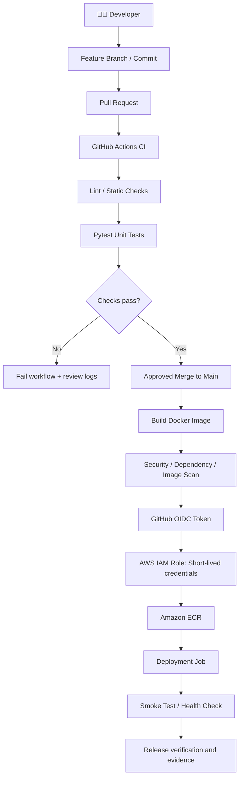
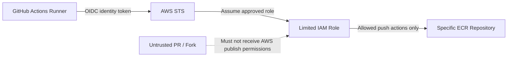
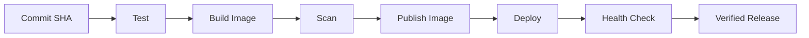

# ⚙️ PROJECT 02 — END-TO-END CI/CD WITH GITHUB ACTIONS


## Commit nunchi Automated Test, Docker Image, AWS Deployment varaku

**Beginner-friendly • Real-world workflow • Architecture • Security • Troubleshooting • Interview-ready**


> **Simple ga cheppalante:** Developer GitHub ki code push chestadu → GitHub Actions automatic ga tests run chestundi → Docker image build chestundi → security checks run chestundi → AWS ki secure authentication tho image publish/deploy chestundi → health check pass ayyindo verify chestundi → release problem ayithe documented rollback process follow chestaru.

</div>

---

## 📚 Table of Contents

1. [Project ante enti?](#-1-project-ante-enti)
2. [Real-time example](#-2-real-time-business-example)
3. [Problem vs solution](#-3-business-problem-vs-solution)
4. [CI/CD basics](#-4-ci-cd-ante-enti)
5. [Architecture diagrams](#-5-architecture-diagrams)
6. [Tools enduku vadali?](#-6-tools-enduku-vadali)
7. [GitHub Actions workflow ela work avutundi?](#-7-github-actions-workflow-ela-work-avutundi)
8. [Developer and DevOps responsibilities](#-8-developer--devops-engineer-em-chestaru)
9. [Repository structure](#-9-repository-structure)
10. [Prerequisites](#-10-prerequisites)
11. [Build a small Python API](#-11-small-python-api-example)
12. [Automated tests](#-12-automated-tests)
13. [Docker image](#-13-docker-image)
14. [GitHub Actions workflow](#-14-github-actions-workflow)
15. [Secure AWS authentication with OIDC](#-15-secure-aws-authentication-with-oidc)
16. [Publish image to Amazon ECR](#-16-publish-image-to-amazon-ecr)
17. [Deployment options](#-17-deployment-options)
18. [Health checks and rollback](#-18-health-checks-and-rollback)
19. [Security practices](#-19-security-practices)
20. [Troubleshooting](#-20-real-time-troubleshooting-guide)
21. [Screenshots and evidence](#-21-screenshots-and-evidence)
22. [Cost and cleanup](#-22-cost-safety-and-cleanup)
23. [Interview explanation](#-23-interview-lo-project-ela-explain-cheyyali)
24. [Definition of done](#-24-project-complete-ayyindi-ani-ela-telustundi)
25. [Official documentation](#-25-official-documentation)

---

# 🧠 1. Project ante enti?

Ee project lo oka small Python API ni GitHub Actions use chesi automatically test chesi, Docker image ga build chesi, security checks run chesi, AWS container registry ki publish chestam. Tarvata selected deployment target ki deploy chesi application health verify chestam.

Ee project focus **automated software delivery pipeline**. Project 1 lo full AWS EKS + GitOps platform overall architecture main focus. Project 2 lo GitHub Actions pipeline ela design cheyyali, tests ela fail/pass avuthayi, image ela publish cheyyali, AWS authentication ni secrets expose cheyyakunda ela handle cheyyali ane vishayalu detail ga nerchukuntam.

## 🎯 Objectives

- Code commit/pull request meeda automated workflow trigger cheyyadam.
- Python application lint/test run cheyyadam.
- Docker image reproducibly build cheyyadam.
- Security scanning and dependency checks add cheyyadam.
- AWS ki long-lived access keys lekunda OIDC role-based authentication configure cheyyadam.
- Amazon ECR lo versioned image publish cheyyadam.
- Deployment target health check cheyyadam.
- Release failure and rollback procedure document cheyyadam.

> [!IMPORTANT]
> Ee README learning blueprint and sample code. OIDC trust policy, AWS resources, GitHub repository secrets/settings, deployment target and health checks ni mee environment ki configure chesi verify chesina tarvata matrame “working end-to-end” ani claim cheyyali. Below sample app/workflow ni first GitHub lo CI-only ga run chesi, tarvata AWS publishing add cheyyandi.

---

# 🛒 2. Real-time business example

Oka company ki product inventory API undi. Developer product availability logic lo change chesadu.

### ❌ Manual release process

1. Developer local laptop lo code change chestadu.
2. Manual ga tests run cheyyadam marchipovachu.
3. Evaraina Docker image build chestaru; tag wrong avvachu.
4. AWS credentials laptop nunchi copy chesi use cheyyachu.
5. Image publish ayindo, correct version deploy ayyindo verify cheyyadam miss avvachu.
6. Deployment taruvata API down ayithe late ga telustundi.

### ✅ GitHub Actions pipeline

1. Developer branch create chesi code commit chestadu.
2. Pull request open chestadu.
3. GitHub Actions workflow automatically start avutundi.
4. Python dependencies install ayi automated tests run avutayi.
5. Tests fail ayithe pipeline fail avutundi; merge/release gate configured unte merge block avutundi.
6. Main branch lo approved change merge ayyaka Docker image build avutundi.
7. Security checks image/dependencies ni scan chestayi.
8. Workflow AWS OIDC dwara short-lived role credentials pondutundi.
9. Image unique tag tho Amazon ECR ki push avutundi.
10. Deployment stage configured environment ki release chestundi.
11. Health check pass ayithe deployment verified; fail ayithe pipeline alert/fail avutundi and runbook prakaram recovery chestaru.

**Business benefit:** Prathi release ki same checks run avuthayi; manual mistakes taggutayi; release history GitHub Actions lo trace cheyyachu.

---

# 🧯 3. Business problem vs solution

| Problem | Project solution | Benefit |
|---|---|---|
| Tests manually run cheyyadam marchipovadam | GitHub Actions automated tests | Consistent quality checks |
| Wrong code merge avvadam | Pull request checks + branch protection | Failed checks ni merge gate ga use cheyyachu |
| Image build different environments lo different ga undadam | Dockerfile and repeatable workflow | Consistent packaging |
| AWS access keys long-term store cheyyadam | GitHub OIDC + AWS IAM role | Long-lived AWS keys maintain cheyyalsina need reduce |
| Image version teliyakapovadam | Commit SHA/version tag and digest | Release traceability |
| Vulnerable dependencies/image | Security scanning | Known risks early ga identify cheyyachu |
| Deployment taruvata app broken | Health checks and smoke tests | Release issues fast ga detect cheyyachu |
| Previous version identify cheyyadam kashtam | Versioned artifacts and release history | Controlled recovery |
| Pipeline failure reason teliyakapovadam | Workflow logs and job summaries | Easier troubleshooting |

---

# 🔁 4. CI/CD ante enti?

## 🟦 CI — Continuous Integration

Developer changes repository lo push/pull request chesinappudu, automated workflow:
- Code checkout chestundi.
- Dependencies install chestundi.
- Lint/static checks run chestundi.
- Unit tests run chestundi.
- Results report chestundi.

**Example:** Python function price calculate chestundi. Expected output ₹100; actual output ₹110 vaste test fail avutundi. CI aa bug ni merge/release mundhe catch cheyyagaladu.

## 🟩 Continuous Delivery / Deployment

Tests pass ayyaka application release cheyyadaniki ready ga build artifact create chestaru. Deployment stage:
- Docker image build/publish chestundi.
- Target environment ki release chestundi.
- Health check run chestundi.
- Deployment status record chestundi.

**Continuous Delivery** lo production release ki manual approval undavachu. **Continuous Deployment** lo configured checks pass ayithe changes automatic ga production ki release avuthayi. Ee terms same kaavu.

## GitHub Actions key terms

| Term | Meaning | Example |
|---|---|---|
| Workflow | Complete automation file | `.github/workflows/ci.yml` |
| Event/trigger | Workflow eppudu run avvali | `push`, `pull_request` |
| Job | Runner meeda execute ayye group of steps | `test`, `build` |
| Runner | Job execute chese machine/environment | `ubuntu-latest` |
| Step | Job lo individual action/command | Install deps, run pytest |
| Action | Reusable workflow component | Checkout repository |
| Artifact | Workflow output file | Test report or build artifact |
| Environment | Deployment target/settings/approvals | `staging`, `production` |
| Secret/variable | Protected value or configuration | Non-public token, region |
| Cache | Reusable dependencies to save time | Python package cache |

---

# 🗺️ 5. Architecture diagrams

## 5.1 Complete pipeline architecture



### Diagram explanation

- Pull request stage code quality verify chestundi.
- Main branch lo approved code image build/publish stage ki velthundi.
- OIDC GitHub workflow identity ni AWS role tho federate chestundi.
- ECR image ni store chestundi.
- Deployment target project setup batti EKS, ECS or another supported environment avvachu.
- Health check successful ga undadam release proof lo important part.

## 5.2 Security boundary



**Important:** Untrusted pull request code ki AWS publish permissions ivvakandi. Forked PR workflows and untrusted code run ayye jobs lo secrets/privileged permissions exposure risk untundi. Trust policy and workflow permissions carefully design cheyyali.

## 5.3 One commit to release



---

# 🧰 6. Tools enduku vadali?

| Tool | Simple meaning | Project lo role |
|---|---|---|
| Git | Change history | Code version control |
| GitHub | Code hosting/collaboration | Pull requests and repository |
| GitHub Actions | Automation platform | CI/CD workflow execute cheyyadam |
| Python | Application language | Sample API |
| Pytest | Testing framework | Unit tests |
| Docker | Container packaging | App image build cheyyadam |
| Trivy | Security scanner | Image/dependency scan |
| AWS IAM | Permissions system | CI job ki limited AWS access |
| OIDC | Federated identity protocol | GitHub workflow identity tho AWS role assume cheyyadam |
| AWS STS | Temporary security credentials | Role assumption flow lo credentials |
| Amazon ECR | Container registry | Versioned images store cheyyadam |
| Terraform | Infrastructure as Code | AWS resources repeatably define cheyyadam |
| AWS ECS or EKS | Container deployment targets | Image run cheyyadam; target batti |
| CloudWatch | AWS logs/metrics | Supported AWS services and app logs observe cheyyadam |

### Easy memory trick

- **GitHub Actions:** “Eppudu, ye commands run cheyyali?”
- **Pytest:** “Code expected result istunda?”
- **Docker:** “App ni image ga ela package cheyyali?”
- **Trivy:** “Known security risks unnaya?”
- **OIDC + IAM:** “Workflow AWS access ela secure ga pondutundi?”
- **ECR:** “Image ekkada store avutundi?”
- **ECS/EKS:** “Image ni ekkada run cheyyali?”
- **Terraform:** “AWS resources ni code dwara ela create/manage cheyyali?”

---

# 👷 7. GitHub Actions workflow ela work avutundi?

GitHub repository lo `.github/workflows/ci.yml` file create chestam. GitHub ee YAML file ni read chesi triggers and jobs prakaram workflow run chestundi.

## Trigger example

```yaml
on:
  pull_request:
    branches: [main]
  push:
    branches: [main]
```

Meaning:
- `pull_request`: main branch ki target chesina pull request appudu run.
- `push`: main branch ki push/merge appudu run.

## Job execution

```text
Workflow
├── test
│   ├── Checkout code
│   ├── Setup Python
│   ├── Install dependencies
│   └── Run pytest
├── image
│   ├── Build Docker image
│   └── Run image scan
└── publish (trusted main branch only)
    ├── Request OIDC identity token
    ├── Assume AWS role
    └── Push image to ECR
```

Jobs parallel ga run avvacha or `needs:` dwara dependency define cheyyachu. Example: image publishing job tests success ayyaka matrame run avvali.

> [!NOTE]
> Workflow lo `permissions:` ni minimum required permissions ki set cheyyali. AWS OIDC use cheyyadaniki workflow ki `id-token: write` permission avasaram; repository read kosam `contents: read` avasaram avvachu. `id-token: write` ante automatic ga AWS admin access ani kaadu; AWS trust policy and IAM role permissions kuda required.

---

# 📁 8. Developer & DevOps Engineer em chestaru?

| Role/work area | Typical action | Example |
|---|---|---|
| Developer | API feature and tests write chestadu | New `/health` endpoint |
| Developer | Pull request raise chestadu | Code review request |
| DevOps/Platform Engineer | Workflow YAML maintain chestadu | Test/build/publish jobs |
| DevOps Engineer | Runner/dependency failures troubleshoot chestadu | Python version mismatch fix |
| Cloud Engineer | AWS IAM/ECR configuration | Restricted publish role |
| Security Engineer | Scan policy and risk review | High-risk dependency block |
| Release/Platform team | Deployment and health check | Staging release verify |
| On-call Engineer | Failure diagnose and recover | Previous image restore |

Oka real company lo ee responsibilities multiple teams madhya divide avvachu. Small team lo same engineer multiple tasks handle cheyyachu.

---

# 🗂️ 9. Repository structure

```text
github-actions-cicd/
├── README.md
├── app/
│   ├── __init__.py
│   └── main.py
├── tests/
│   └── test_main.py
├── requirements.txt
├── requirements-dev.txt
├── Dockerfile
├── .dockerignore
├── .gitignore
├── .github/
│   └── workflows/
│       ├── ci.yml
│       └── release.yml
├── terraform/
│   ├── main.tf
│   ├── variables.tf
│   ├── outputs.tf
│   └── README.md
├── deploy/
│   ├── ecs/
│   └── kubernetes/
└── docs/
    ├── architecture/
    ├── runbooks/
    └── screenshots/
```

- `app/`: Python application code.
- `tests/`: Automated test cases.
- `.github/workflows/`: GitHub Actions workflow files.
- `Dockerfile`: Image build instructions.
- `terraform/`: Optional AWS infrastructure configuration.
- `deploy/`: Target-specific deployment files.
- `docs/`: Architecture, troubleshooting and actual evidence.

Ee structure suggested layout. First phase lo application/tests/requirements/workflow matrame create chesi pass ayyaka migilina files add cheyyachu.

---

# 🧰 10. Prerequisites

| Requirement | Purpose |
|---|---|
| GitHub repository | Code and workflow store cheyyadaniki |
| Git | Commit/push/branch operations |
| Python 3.12 or compatible chosen version | Sample API and tests |
| Docker | Container build and local run |
| GitHub Actions enabled | Workflow execute cheyyadaniki |
| AWS account | Image publish/deployment target kosam |
| AWS IAM role configured for OIDC | Secure role assumption |
| Amazon ECR repository | Docker images store cheyyadaniki |
| Terraform (optional in initial phase) | AWS resources manage cheyyadaniki |
| AWS budget/cleanup plan | Unexpected charges avoid cheyyadaniki |

First **GitHub-only CI** complete cheyyandi. App tests and Docker build success ayyaka AWS OIDC/ECR add cheyyandi. AWS deploy target last stage lo add cheyyadam beginner ki easier and safer.

---

# 🐍 11. Small Python API example

Learning kosam Flask use chesina minimal API example.

## `requirements.txt`

```text
Flask==3.1.1
gunicorn==23.0.0
```

Pinned versions example kosam matrame; real project lo current supported versions, security advisories and compatible dependency set verify cheyyandi. Reproducible build kosam dependencies lock/pin cheyyadam useful.

## `app/main.py`

```python
from flask import Flask, jsonify

app = Flask(__name__)

PRODUCTS = [
    {"id": 1, "name": "Keyboard", "price": 1499},
    {"id": 2, "name": "Mouse", "price": 699},
]


@app.get("/health")
def health():
    return jsonify({"status": "ok"}), 200


@app.get("/api/products")
def products():
    return jsonify({"products": PRODUCTS}), 200


if __name__ == "__main__":
    app.run(host="0.0.0.0", port=8080)
```

### Endpoints meaning

| Endpoint | Purpose | Expected result |
|---|---|---|
| `/health` | App process health check | JSON status `ok` |
| `/api/products` | Product data API | JSON product list |

Local run:

```bash
python -m venv .venv
```

Windows PowerShell:

```powershell
.\.venv\Scripts\Activate.ps1
pip install -r requirements.txt
python -m app.main
```

Linux/macOS:

```bash
source .venv/bin/activate
pip install -r requirements.txt
python -m app.main
```

Browser lo `http://127.0.0.1:8080/health` open cheyyandi. Local development server production kosam kaadu; container example lo Gunicorn use chestam.

---

# 🧪 12. Automated tests

## `requirements-dev.txt`

```text
-r requirements.txt
pytest==8.4.1
```

Versions example values; actual project lo supported versions verify/pin cheyyandi.

## `tests/test_main.py`

```python
from app.main import app


def test_health_endpoint():
    client = app.test_client()
    response = client.get("/health")

    assert response.status_code == 200
    assert response.get_json() == {"status": "ok"}


def test_products_endpoint():
    client = app.test_client()
    response = client.get("/api/products")

    assert response.status_code == 200
    body = response.get_json()

    assert "products" in body
    assert len(body["products"]) == 2
    assert body["products"][0]["name"] == "Keyboard"
```

Run tests:

```bash
pytest -q
```

### Test fail ayithe?

Example: code lo product name `Keyboard` badulu `Keybord` ayithe assertion fail avvachu. Pipeline fail avvadam correct behavior — problem ni release mundhe identify chesindi.

**Important:** Ee tests sample API behavior ni test chestayi. Production app ki authentication, validation, error cases, integration tests and coverage requirements add cheyyali.

---

# 🐳 13. Docker image

## `Dockerfile`

```dockerfile
FROM python:3.12-slim

ENV PYTHONDONTWRITEBYTECODE=1
ENV PYTHONUNBUFFERED=1

WORKDIR /app

COPY requirements.txt .
RUN pip install --no-cache-dir -r requirements.txt

COPY app ./app

RUN useradd --create-home appuser
USER appuser

EXPOSE 8080

CMD ["gunicorn", "--bind", "0.0.0.0:8080", "app.main:app"]
```

## `.dockerignore`

```text
.git
.github
.venv
__pycache__
.pytest_cache
*.pyc
.env
.terraform
```

## Build and run

```bash
docker build -t inventory-api:local .
docker run --rm -p 8080:8080 inventory-api:local
```

Inko terminal lo:

```bash
curl http://127.0.0.1:8080/health
curl http://127.0.0.1:8080/api/products
```

Expected health response:

```json
{"status":"ok"}
```

### Docker concepts

- `FROM`: Base image.
- `WORKDIR`: Container working directory.
- `COPY`: Required application files copy chestundi.
- `RUN`: Image build time lo command execute chestundi.
- `USER`: App ni non-root user ga run cheyyadaniki.
- `EXPOSE`: Intended container port ni document chestundi; host/network port automatic ga publish cheyyadu.
- `CMD`: Container start ayinappudu default command.

---

# ⚙️ 14. GitHub Actions workflow

Create file: `.github/workflows/ci.yml`

Ee first workflow **CI-only**: Python tests and Docker build run chestundi. AWS secrets/permissions avasaram ledu. Idi first stage ga run cheyyandi.

```yaml
name: Inventory API CI

on:
  pull_request:
    branches: [main]
  push:
    branches: [main]

permissions:
  contents: read

jobs:
  test:
    name: Test Python application
    runs-on: ubuntu-latest

    steps:
      - name: Checkout repository
        uses: actions/checkout@v4

      - name: Set up Python
        uses: actions/setup-python@v5
        with:
          python-version: "3.12"
          cache: "pip"
          cache-dependency-path: |
            requirements.txt
            requirements-dev.txt

      - name: Install dependencies
        run: pip install -r requirements-dev.txt

      - name: Run tests
        run: pytest -q

  docker-build:
    name: Build Docker image
    runs-on: ubuntu-latest
    needs: test

    steps:
      - name: Checkout repository
        uses: actions/checkout@v4

      - name: Build image
        run: docker build -t inventory-api:${{ github.sha }} .
```

### YAML explanation

| YAML part | Meaning |
|---|---|
| `name` | Workflow display name |
| `on` | Trigger events |
| `permissions` | Workflow token permissions |
| `jobs` | Tasks to execute |
| `runs-on` | Runner type |
| `uses` | Reusable action |
| `with` | Action inputs |
| `run` | Shell command |
| `needs: test` | Docker build only after tests pass |
| `${{ github.sha }}` | Commit identifier used as image tag |

### Workflow result ela check cheyyali?

1. Files commit and push cheyyandi.
2. GitHub repository open cheyyandi.
3. **Actions** tab select cheyyandi.
4. `Inventory API CI` workflow run open cheyyandi.
5. `Test Python application` and `Build Docker image` jobs inspect cheyyandi.
6. Test failure unte logs lo exact failed assertion/command chudandi.

> **Version maintenance:** Sample uses `actions/checkout@v4` and `actions/setup-python@v5` for readability. Real repository lo current supported action versions, release notes and security guidance verify cheyyandi; organization policy unte full commit SHA pinning consider cheyyandi.

---

# 🔐 15. Secure AWS authentication with OIDC

## OIDC ante enti?

OIDC (OpenID Connect) identity federation mechanism. GitHub Actions job tana identity gurinchi token request chestundi. AWS IAM trust policy aa token claims ni validate chesi approved role assume cheyyadaniki allow chestundi. AWS STS temporary credentials issue chestundi.

### Traditional access key approach — risk

- Long-lived access key create cheyyali.
- Key secret store lo maintain/rotate cheyyali.
- Accidentally logs/repository lo leak ayithe misuse risk.

### OIDC role approach

- GitHub workflow identity token request chestundi.
- AWS trust policy repository/branch/environment identity ni validate chestundi.
- Approved workflow matrame specific IAM role assume cheyyagaladu.
- Temporary credentials use chestundi; static AWS access key ni repository secret ga store cheyyalsina need reduce avutundi.

**OIDC setup automatic ga secure avvadu.** Trust policy broad ga unte vere workflow/repository access pondachu. Repository, branch/environment and audience claims ni restrictive ga configure cheyyali.

## AWS configuration checklist

1. AWS IAM lo GitHub OIDC identity provider configure/verify cheyyandi as per current AWS guidance.
2. Trust policy lo approved GitHub repository and branch/environment subject ni restrict cheyyandi.
3. Role permissions ni target ECR repository ki required actions varake limit cheyyandi.
4. GitHub Actions job permissions lo required `id-token: write` and `contents: read` matrame enable cheyyandi.
5. Fork/untrusted PR jobs ki publish role access ivvakandi.
6. AWS CloudTrail or available audit records tho role assumption monitor cheyyandi.
7. Test chesaka actual role and repository claims correct ga match ayyayo verify cheyyandi.

Trust policy examples AWS/GitHub guidance nunchi mee exact repository, branch and AWS account ki adapt cheyyali. Generic sample ni review lekunda copy cheyyakandi.

---

# 📦 16. Publish image to Amazon ECR

Publishing step ni CI-only workflow pass ayyaka matrame add cheyyandi.

## ECR workflow requirements

- ECR repository already exists or approved IaC workflow create chesindi.
- GitHub workflow AWS OIDC role assume cheyyagalutundi.
- Role ki correct ECR repository push permissions unnayi.
- Image tag commit SHA/version based ga unique ga untundi.
- Pull request from untrusted fork ki publish permissions ivvaledu.

### Example release job (template)

Below job snippet shows the **shape** of a publish job. It assumes `AWS_REGION`, `AWS_ACCOUNT_ID`, and `ECR_REPOSITORY` are configured as appropriate repository/environment variables, and `AWS_ROLE_ARN` is a protected configuration value. It also assumes AWS OIDC trust and ECR repository permissions are already configured.

```yaml
  publish:
    name: Publish image to ECR
    runs-on: ubuntu-latest
    needs: [test, docker-build]
    if: github.event_name == 'push' && github.ref == 'refs/heads/main'

    permissions:
      contents: read
      id-token: write

    steps:
      - name: Checkout repository
        uses: actions/checkout@v4

      - name: Configure AWS credentials through OIDC
        uses: aws-actions/configure-aws-credentials@v4
        with:
          role-to-assume: ${{ vars.AWS_ROLE_ARN }}
          aws-region: ${{ vars.AWS_REGION }}

      - name: Log in to Amazon ECR
        id: login-ecr
        uses: aws-actions/amazon-ecr-login@v2

      - name: Build, tag and push
        env:
          REGISTRY: ${{ steps.login-ecr.outputs.registry }}
          REPOSITORY: ${{ vars.ECR_REPOSITORY }}
          IMAGE_TAG: ${{ github.sha }}
        run: |
          docker build -t "$REGISTRY/$REPOSITORY:$IMAGE_TAG" .
          docker push "$REGISTRY/$REPOSITORY:$IMAGE_TAG"
```

### Before using this snippet

- YAML indentation and job placement verify cheyyandi.
- `AWS_ROLE_ARN`, `AWS_REGION`, `ECR_REPOSITORY` values correct ga configure cheyyandi.
- AWS OIDC provider/trust policy and ECR push permissions set cheyyandi.
- Workflow/action versions current official guidance tho verify cheyyandi.
- `docker-build` job runner lo build chesina local image separate job runner ki automatically share avvadu. Anduke sample `publish` job lo image malli build chestundi. Alternative: securely transfer a built artifact or use a single build-and-publish job, with integrity/provenance considerations.
- ECR image scan policy and immutable tagging strategy configure cheyyandi.

**Image reference example:**

```text
123456789012.dkr.ecr.ap-south-1.amazonaws.com/inventory-api:<commit-sha>
```

Idi illustrative format only. Account ID, region and repository mee actual environment values tho replace cheyyali. Public README lo account identifiers expose cheyyadam avoid cheyyandi if unnecessary.

---

# 🚀 17. Deployment options

ECR ki image publish ayyaka, application ni run cheyyadaniki deployment target choose cheyyali.

| Target | Best for | What else must be configured? |
|---|---|---|
| Amazon ECS | AWS container deployment with less Kubernetes management | ECS cluster/service, task definition, networking, load balancer |
| Amazon EKS | Kubernetes skills and cluster-based workloads | EKS, nodes/capacity, Kubernetes manifests/Helm, RBAC, ingress |
| EC2 + Docker | Small learning lab or simpler host-based deployment | EC2 networking, host hardening, Docker runtime, service management |
| Another platform | Existing company platform | Platform-specific credentials, deployment workflow and health checks |

**Recommendation:** First GitHub Actions CI + Docker + ECR complete cheyyandi. Tarvata mee learning goal batti ECS or EKS choose cheyyandi. EKS choose chesthe Project 1 architecture and GitOps concepts tho integrate cheyyachu.

### Deployment stage lo verify cheyyalsinavi

- Correct image digest/tag use avutunda?
- Correct environment ki deploy avutunda?
- Secret/config source secure ga unda?
- Health endpoint success avutunda?
- Logs and metrics accessible ga unnaya?
- Rollback path documented and tested aa?

Ee README lo target infrastructure automatically create avvadu. Deployment job ni chosen target ki match ayye configuration tho implement cheyyali.

---

# 🩺 18. Health checks and rollback

## Health check example

```bash
curl --fail --silent --show-error \
  https://your-staging-host.example/health
```

`https://your-staging-host.example` ni mee actual test endpoint tho replace cheyyali. `--fail` HTTP error response ki non-zero exit status ivvadam lo help chestundi.

A successful `/health` response process reachable ani cheppachu. Kani adi database, external dependency, business transaction anni healthy ani automatically prove cheyyadu. App design batti liveness/readiness/dependency checks separate ga define cheyyali.

## Release verification sequence

1. Deployment job target environment lo expected image version deploy ayyindo verify cheyyali.
2. Health endpoint check cheyyali.
3. Critical smoke test run cheyyali.
4. Error rate and latency observe cheyyali.
5. Deployment metadata (commit SHA/image digest) record cheyyali.
6. Checks fail ayithe release fail mark chesi responsible team notify cheyyali.

## Rollback approach

1. Customer impact and failed release version identify cheyyandi.
2. Last known-good immutable image version/digest identify cheyyandi.
3. Deployment target ki documented rollback procedure follow cheyyandi.
4. Health check and smoke tests rerun cheyyandi.
5. Logs/metrics lo recovery confirm cheyyandi.
6. Root cause and prevention action record cheyyandi.

**Database warning:** App image ni old version ki return cheyyadam database schema/data ni automatic ga rollback cheyyadu. Backward-compatible migrations, backups and recovery procedures separate ga plan cheyyali.

---

# 🛡️ 19. Security practices

| Risk | Prevention |
|---|---|
| AWS credentials leak | OIDC role federation; avoid static keys |
| Untrusted PR executes privileged job | Separate PR validation and trusted release jobs |
| Workflow has excessive permissions | Minimum `permissions` at workflow/job level |
| Mutable image tag confusion | Commit SHA/version plus image digest tracking |
| Vulnerable dependencies | Dependency scanning and update process |
| Vulnerable container image | Trivy or approved image scanner |
| Secret printed in logs | Avoid echoing secret; mask/rotate if exposed |
| Malicious third-party action update | Review actions and pin versions/SHA per policy |
| Unreviewed production deployment | Protected branch/environment approvals |
| Public exposure of service | Network restrictions, TLS, access review |
| Terraform state leak | Encrypted remote state, restrictive access, never public Git |
| Scan finding ignored forever | Risk owner, due date and documented exception |

### Trivy scan example

```bash
trivy image --severity HIGH,CRITICAL inventory-api:local
```

This command scans the image for configured scanner findings. CI build automatic ga fail avvadaniki exit-code/policy configure cheyyali; default output ni chusi scan gate automatically enforce avutundi ani assume cheyyakandi. Actual policy, false positives and exceptions document cheyyandi.

---

# 🧯 20. Real-time troubleshooting guide

| Symptom | Possible reason | First check | Next action |
|---|---|---|---|
| Workflow trigger avvatledu | Wrong branch/path/trigger | Actions tab, workflow file location | `.github/workflows/` path and event filters verify |
| YAML invalid | Indentation/schema issue | Workflow validation/log | YAML structure and keys fix |
| `pytest` fails | Bug/dependency/test mismatch | Failed assertion and traceback | Local reproduce; fix code or test expectation |
| Python import error | Package/path/module issue | Repo structure and installed deps | Correct package layout and dependency install |
| Docker build fails | Missing file or bad Dockerfile | Build logs and context | Fix COPY paths and requirements |
| Docker container exits | App startup/runtime error | `docker logs <container>` | Fix command/config/dependency |
| OIDC role assumption denied | Trust policy/claims mismatch | AWS action logs and trust policy | Restrict/correct repository/branch/audience conditions |
| ECR login denied | IAM or repository policy | Assumed role identity and ECR permissions | Add only required scoped permissions |
| ECR push denied | Wrong repository/tag/permission | Registry URI and push error | Correct repository and role policy |
| Image not found | Wrong tag or registry | Image URI/digest | Verify successful push and exact tag |
| Deployment job succeeds but app down | Wrong target/config/health path | Deployment events and app logs | Correct config, route or readiness |
| Health check fails | Service unreachable or bad response | DNS/TLS/network and HTTP status | Fix route/app and rerun smoke test |
| Scan reports vulnerabilities | Vulnerable package/base image | Scan report and dependency tree | Upgrade/mitigate and rerun scan |
| Pipeline passes but wrong image deployed | Tag/config mismatch | Commit SHA, digest, deployment config | Tie release metadata to exact artifact |
| AWS cost unexpectedly high | Resources left running | Billing/cost tools and resource inventory | Identify owner and safely clean up |

## 5-step troubleshooting method

1. **Observe:** Exact error, time, commit SHA and failed job note cheyyandi.
2. **Scope:** Test, build, scan, auth, publish or deployment — ye stage fail ayyindi?
3. **Collect evidence:** Logs, job outputs, AWS audit records, app metrics.
4. **Test a hypothesis:** Oka cause ni verify chesi targeted fix cheyyandi.
5. **Re-run and document:** Fix successful aa? Similar failure prevent cheyyadaniki em change chesaru?

---

# 📸 21. Screenshots and evidence

Actual results verify chesaka `docs/screenshots/` folder lo screenshots save cheyyandi.

| Screenshot | Evidence |
|---|---|
| `01-github-actions-tests.png` | Test job success |
| `02-docker-build.png` | Docker image build success |
| `03-trivy-scan.png` | Actual scan output/policy result |
| `04-oidc-auth.png` | Role assumption success; sensitive values redact cheyyali |
| `05-ecr-image.png` | ECR lo actual image tag/digest |
| `06-deployment.png` | Target environment rollout result |
| `07-health-check.png` | Real health/smoke test |
| `08-rollback-test.png` | Non-production recovery evidence |

README lo embed example:

```markdown
### GitHub Actions — Verified CI Run


```

**Important:** Example image names placeholders matrame. Actual screenshots create cheyyakunda fake results add cheyyakandi. AWS account details, tokens, private hostnames and secrets ni redact cheyyandi.

---

# 💸 22. Cost safety and cleanup

GitHub-hosted runner usage repository plan and usage limits batti untundi. AWS ECR storage, ECS/EKS, EC2, load balancer, NAT gateway, logs and data transfer charges generate cheyyachu. Exact cost region, runtime, resources and current pricing batti change avutundi.

Before AWS deployment:
- [ ] AWS budget/billing alerts configure cheyyandi.
- [ ] Lab account/environment confirm cheyyandi.
- [ ] IAM role permissions and target resources review cheyyandi.
- [ ] ECR image retention/cleanup plan set cheyyandi.
- [ ] ECS services/EKS clusters/EC2/load balancers/NAT/database lanti resources list maintain cheyyandi.
- [ ] Cleanup owner and deadline decide cheyyandi.

After testing:
1. Deployment ni safely stop/remove cheyyandi.
2. Terraform-managed resources unte state/ownership and plan review chesi clean up cheyyandi.
3. Unused ECR images, logs, disks, load balancers and network resources inspect cheyyandi.
4. AWS console/CLI lo resources delete ayyayo verify cheyyandi.
5. Required logs/evidence preserve cheyyandi.

> **Warning:** `terraform destroy` or bulk deletion commands ni blindly run cheyyakandi. Shared/production environment lo data loss/outage avvachu. Resource ownership and plan review chesi approval tho matrame cleanup cheyyandi.

---

# 🎤 23. Interview lo project ela explain cheyyali?

Ee template ni mee actual implementation ki match ayye laga use cheyyandi. Complete ga implement cheyyani features ni completed ani claim cheyyakandi.

> “I built a CI/CD workflow for a Python API using GitHub Actions. Pull requests trigger automated tests, and successful changes can build a Docker image. I integrated security checks and designed AWS authentication using GitHub OIDC with a scoped IAM role instead of storing long-lived AWS access keys. The approved image is published to Amazon ECR with a version tied to the commit. A deployment stage then releases the image to the chosen target and performs health checks. I also documented troubleshooting, release verification, rollback and cleanup.”

## Interview questions

1. CI and CD madhya difference enti?
2. GitHub Actions workflow, job, step and runner ante enti?
3. `needs:` enduku use chestaru?
4. Pull request checks ni required status checks ga ela configure chestaru?
5. Docker image and container difference enti?
6. Commit SHA tag enduku useful?
7. GitHub OIDC and AWS IAM role ela work chestayi?
8. OIDC use chesina kuda trust policy enduku important?
9. GitHub Actions permissions ni least privilege tho ela set chestaru?
10. Forked PR ki AWS credentials ivvakudadhu enduku?
11. Trivy scan fail ayithe pipeline ela behave avvali?
12. ECR push denied ayithe em check chestaru?
13. Deployment success ayindani ela verify chestaru?
14. Health check and smoke test difference enti?
15. Rollback lo database migration risk enti?
16. GitHub Actions logs lo secrets leak ayithe immediate actions enti?
17. Reproducible builds and immutable artifacts enduku important?
18. CI/CD pipeline lo deployment approval ekkada enforce cheyyachu?

---

# ✅ 24. Project complete ayyindi ani ela telustundi?

- [ ] Python API local ga run avutundi.
- [ ] Unit tests pass avuthayi.
- [ ] Pull request ki GitHub Actions CI trigger avutundi.
- [ ] Test fail cheste workflow fail avutundi.
- [ ] Docker image build avutundi.
- [ ] Image/dependency scan actual ga run avutundi.
- [ ] Security policy and exceptions document chesaru.
- [ ] AWS OIDC role trust policy correct ga configure chesaru.
- [ ] Untrusted PRs ki publish permissions levu.
- [ ] Image unique tag/digest tho ECR ki publish ayyindi.
- [ ] Chosen deployment target lo expected version run avutundi.
- [ ] Health check and smoke test pass ayyayi.
- [ ] Failure logs and troubleshooting notes documented.
- [ ] Non-production rollback procedure tested.
- [ ] Actual screenshots added and sensitive values redacted.
- [ ] AWS resources cleanup chesi billable leftovers inspect chesaru.

## Production readiness — additional work

Real production rollout ki threat modeling, action pinning policy, dependency update automation, artifact provenance, image signing/verification where required, approval controls, SLOs, monitoring, incident response, rollback drills, disaster recovery, audit logging and cost controls avasaram avvachu. Ee guide okkate production readiness guarantee cheyyadu.

---

# 🔗 25. Official documentation

- [GitHub Actions documentation](https://docs.github.com/en/actions) — workflow basics.
- [GitHub Actions security hardening](https://docs.github.com/en/actions/security-for-github-actions/security-guides/security-hardening-for-github-actions) — workflow security.
- [GitHub OIDC with AWS](https://docs.github.com/en/actions/security-for-github-actions/security-hardening-for-github-actions/configuring-openid-connect-in-amazon-web-services) — AWS federation.
- [AWS IAM OIDC federation](https://docs.aws.amazon.com/IAM/latest/UserGuide/id_roles_providers_create_oidc.html) — identity provider and trust.
- [Amazon ECR user guide](https://docs.aws.amazon.com/AmazonECR/latest/userguide/what-is-ecr.html) — container registry.
- [Docker docs](https://docs.docker.com/) — images and containers.
- [Python documentation](https://docs.python.org/3/) — Python language.
- [pytest documentation](https://docs.pytest.org/en/stable/) — automated tests.
- [Trivy documentation](https://trivy.dev/latest/docs/) — vulnerability scanning.
- [Terraform tutorials](https://developer.hashicorp.com/terraform/tutorials) — infrastructure as code.
- [Amazon ECS documentation](https://docs.aws.amazon.com/AmazonECS/latest/developerguide/Welcome.html) — ECS deployment option.
- [Amazon EKS documentation](https://docs.aws.amazon.com/eks/latest/userguide/what-is-eks.html) — Kubernetes deployment option.
- [AWS Well-Architected Framework](https://docs.aws.amazon.com/wellarchitected/latest/framework/welcome.html) — reliability, security and cost principles.

---

<div align="center">

## 🌟 Final thought

**Goal: YAML copy cheyyadam matrame kaadu.** Code change nunchi test, image build, secure AWS authentication, publish, deployment and health verification varaku complete delivery flow ni understand cheyyali. Pipeline fail ayithe logs tho troubleshoot cheyyali; release successful ayithe actual evidence tho prove cheyyali.

**PROJECT 02 — End-to-End CI/CD with GitHub Actions**


