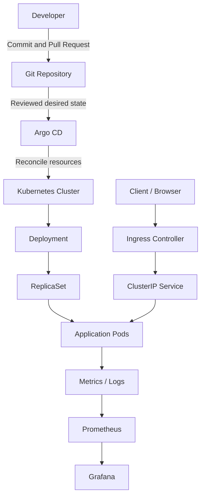

# 🚀 PROJECT 03 — Production-Style Kubernetes Deployment & GitOps


### 🐳 Kubernetes + Helm + Argo CD + GitOps + Ingress + Monitoring

**A hands-on DevOps portfolio project to learn how teams deploy, manage, observe, and roll back applications on Kubernetes.**


**Project Level:** Intermediate → Advanced  
**Main Goal:** Learn a GitOps-based Kubernetes deployment workflow using a local cluster first, then adapt it to managed Kubernetes such as Amazon EKS.

</div>

---

## 📌 Table of Contents

- [🎯 Project Overview](#-project-overview)
- [🏢 Real-Time Business Scenario](#-real-time-business-scenario)
- [🧠 Concepts You Will Learn](#-concepts-you-will-learn)
- [🏗️ Architecture](#️-architecture)
- [🧰 Tools and Responsibilities](#-tools-and-responsibilities)
- [📁 Repository Structure](#-repository-structure)
- [✅ Prerequisites](#-prerequisites)
- [🚦 Implementation Roadmap](#-implementation-roadmap)
- [1️⃣ Create a Local Kubernetes Cluster](#1️⃣-create-a-local-kubernetes-cluster)
- [2️⃣ Create a Sample Application](#2️⃣-create-a-sample-application)
- [3️⃣ Build and Test the Docker Image](#3️⃣-build-and-test-the-docker-image)
- [4️⃣ Create Kubernetes Manifests](#4️⃣-create-kubernetes-manifests)
- [5️⃣ Package the App with Helm](#5️⃣-package-the-app-with-helm)
- [6️⃣ Install and Configure Argo CD](#6️⃣-install-and-configure-argo-cd)
- [7️⃣ Enable GitOps Reconciliation](#7️⃣-enable-gitops-reconciliation)
- [8️⃣ Add Ingress Routing](#8️⃣-add-ingress-routing)
- [9️⃣ Health Checks and Rollout Safety](#9️⃣-health-checks-and-rollout-safety)
- [🔟 Monitoring and Observability](#-monitoring-and-observability)
- [🔐 Security Best Practices](#-security-best-practices)
- [🧪 Validation and Demo Scenarios](#-validation-and-demo-scenarios)
- [🛠️ Troubleshooting](#️-troubleshooting)
- [🔄 Rollback and Recovery](#-rollback-and-recovery)
- [📸 Screenshot Evidence Checklist](#-screenshot-evidence-checklist)
- [💰 Cost and Cleanup](#-cost-and-cleanup)
- [🎤 Interview Preparation](#-interview-preparation)
- [📚 Official Documentation](#-official-documentation)
- [🏁 Final Checklist](#-final-checklist)

---

## 🎯 Project Overview

In this project, you will deploy a small web API to Kubernetes and manage its desired state through Git.

You will use:

- **Docker** to package the application.
- **Kubernetes** to run and recover application containers.
- **Helm** to package reusable Kubernetes configuration.
- **Argo CD** to continuously compare Git configuration with the cluster and reconcile differences.
- **Ingress** to route HTTP traffic to the application.
- **Prometheus and Grafana** as an optional monitoring extension.

> **Important:** This README is a guided implementation plan and contains starter examples. Do not claim a stage is complete until you have run it and verified the result in your own environment. A local cluster is not the same as a production EKS cluster.

### 🎓 What will you be able to explain after completing it?

1. Why Kubernetes uses Deployments, ReplicaSets, Pods, Services, and probes.
2. How Helm templates and values work.
3. How Argo CD uses Git as the desired-state source.
4. What happens when a live cluster drifts from Git.
5. How rolling updates, readiness checks, and rollbacks work.
6. How to troubleshoot common Kubernetes deployment failures.
7. How this local learning project can be adapted to Amazon EKS.

---

## 🏢 Real-Time Business Scenario

Imagine an e-commerce company called **ShopSmart**.

The development team updates its product API. A DevOps engineer needs a repeatable way to deploy the application without manually running commands against production every time.

### Without GitOps ❌

- Someone changes Kubernetes resources manually.
- The Git repository and live cluster can become different.
- It may be unclear who changed what.
- Rollbacks and environment consistency become harder.

### With GitOps ✅

1. The engineer updates application or deployment configuration in Git.
2. A reviewed commit is merged into the deployment branch.
3. Argo CD detects the desired-state change.
4. Argo CD applies the approved configuration to Kubernetes.
5. Kubernetes gradually replaces old Pods when the Deployment changes.
6. Probes and rollout status help confirm whether the application becomes healthy.
7. Monitoring and logs help diagnose failures.

**Key principle:** Git stores the declared desired state; Kubernetes runs the workload; Argo CD continuously works to make the cluster match the configured desired state.

---

## 🧠 Concepts You Will Learn

| Concept | Simple meaning | Why it matters |
|---|---|---|
| Cluster | Kubernetes control plane and worker capacity | Runs and manages workloads |
| Pod | Smallest deployable Kubernetes unit | Runs one or more closely related containers |
| Deployment | Declares the desired number and version of Pods | Manages ReplicaSets and rolling updates |
| ReplicaSet | Maintains a target number of matching Pods | Helps keep the desired replica count |
| Service | Stable network endpoint for matching Pods | Pod IP addresses can change |
| ConfigMap | Stores non-secret configuration | Separates configuration from image builds |
| Secret | Kubernetes object intended for sensitive values | Requires careful access and encryption controls |
| Namespace | Logical boundary for names and resources | Helps organize environments and teams |
| Requests and limits | CPU/memory scheduling and runtime constraints | Supports scheduling and resource protection |
| Liveness probe | Checks whether a container should be restarted | Can recover from certain stuck processes |
| Readiness probe | Checks whether a Pod should receive traffic | Keeps unready Pods out of normal Service traffic |
| Startup probe | Gives slow-starting applications time to initialize | Prevents premature liveness failures |
| Helm chart | Reusable package of Kubernetes templates | Helps standardize deployments |
| GitOps | Manages infrastructure/application desired state from Git | Improves reviewability and repeatability |
| Argo CD | GitOps continuous delivery controller | Detects and reconciles drift |
| Ingress | HTTP/HTTPS routing rules into the cluster | Provides host/path-based entry when an ingress controller is installed |
| Observability | Metrics, logs, traces, and alerts | Helps explain system behaviour |

---

## 🏗️ Architecture

### High-level workflow



### Request path

```text
Client / Browser
      |
      v
Ingress Controller  (only after installed and configured)
      |
      v
Kubernetes Service
      |
      v
Ready Application Pod(s)
      |
      v
Container running the API
```

### GitOps reconciliation path

```text
Engineer changes Git
        |
        v
Pull Request review and merge
        |
        v
Argo CD reads the declared state
        |
        v
Argo CD compares Git state with live cluster state
        |
        +---- In Sync ----> No change required
        |
        +---- OutOfSync --> Reconciliation, if sync policy/approval permits
                                  |
                                  v
                            Kubernetes resources
```

**Important distinction:** Argo CD does not automatically build Docker images just because it watches a repository. Image build/publish is normally handled by a CI workflow; GitOps then updates the desired deployment configuration to refer to the intended image.

---

## 🧰 Tools and Responsibilities

| Tool | Responsibility | Used in this project |
|---|---|---|
| Git + GitHub | Version control and review | Yes |
| Docker | Package application | Yes |
| kind or minikube | Local Kubernetes cluster | Yes — choose one |
| kubectl | Inspect and manage cluster resources | Yes |
| Helm | Package and configure deployment | Yes |
| Argo CD | GitOps reconciliation | Yes |
| Ingress controller | Route HTTP traffic | Optional extension |
| Prometheus | Collect metrics | Optional extension |
| Grafana | Visualize metrics | Optional extension |
| Amazon EKS | Managed Kubernetes on AWS | Optional later migration |

---

## 📁 Repository Structure

Create a repository with a structure similar to this:

```text
kubernetes-gitops-shop/
├── app/
│   ├── app.py
│   └── requirements.txt
├── tests/
│   └── test_app.py
├── Dockerfile
├── .dockerignore
├── k8s/
│   ├── namespace.yaml
│   ├── deployment.yaml
│   └── service.yaml
├── helm/
│   └── shopsmart/
│       ├── Chart.yaml
│       ├── values.yaml
│       └── templates/
│           ├── deployment.yaml
│           ├── service.yaml
│           └── ingress.yaml
├── argocd/
│   └── application.yaml
├── .github/
│   └── workflows/
│       └── ci.yml
└── README.md
```

This is a suggested layout, not a requirement imposed by Kubernetes. You can change it if you update the paths in your commands and Argo CD Application.

---

## ✅ Prerequisites

Use a local Kubernetes cluster first to reduce the chance of unexpected cloud costs.

Install and verify:

- Git
- Docker Desktop or Docker Engine
- `kubectl`
- Helm 3
- **One** local Kubernetes option: kind or minikube
- A Git hosting account/repository for Argo CD to read
- Optional: Python 3.11+ for local tests

Check versions:

```bash
git --version
docker --version
kubectl version --client
helm version
python --version
```

If you choose **kind**, verify that the cluster tool is installed:

```bash
kind version
```

If you choose **minikube** instead:

```bash
minikube version
```

> Commands vary slightly by operating system. On Windows, use PowerShell or a terminal in VS Code. Run Docker Desktop before creating a kind cluster if Docker is your container runtime.

---

## 🚦 Implementation Roadmap

| Stage | Outcome | Verification |
|---|---|---|
| 1 | Local Kubernetes cluster | `kubectl get nodes` |
| 2 | Simple API and tests | `pytest -q` |
| 3 | Docker image | `docker run` and HTTP health check |
| 4 | Raw Kubernetes manifests | `kubectl rollout status` |
| 5 | Helm chart | `helm lint` and `helm template` |
| 6 | Argo CD installed | Argo CD Pods are Ready |
| 7 | GitOps Application | Application is Synced and Healthy |
| 8 | Ingress routing | Host/path request reaches API |
| 9 | Health and rollout checks | Readiness/liveness behaviour validated |
| 10 | Monitoring extension | Dashboard shows cluster/application metrics |

---

## 1️⃣ Create a Local Kubernetes Cluster

### Option A: kind

Create a local cluster:

```bash
kind create cluster --name shopsmart
kubectl cluster-info
kubectl get nodes
kubectl get namespaces
```

Expected outcome: a Kubernetes node is listed and its status becomes `Ready`.

Check the current context:

```bash
kubectl config current-context
```

It should refer to your kind cluster. Confirm the context before applying manifests to avoid changing the wrong cluster.

### Option B: minikube

Use this instead of kind if you prefer minikube:

```bash
minikube start
kubectl get nodes
kubectl config current-context
```

Do not create both clusters unless you intentionally want to compare them.

### Create a project namespace

```bash
kubectl create namespace shopsmart
kubectl get namespace shopsmart
```

A namespace is a useful logical boundary, but **it is not a strong security boundary by itself**. Use RBAC, NetworkPolicies, Pod Security settings, and other controls as appropriate.

---

## 2️⃣ Create a Sample Application

The sample API uses Flask. It exposes a health endpoint and a small product endpoint.

### `app/app.py`

```python
from flask import Flask, jsonify
import os

app = Flask(__name__)

APP_VERSION = os.getenv("APP_VERSION", "1.0.0")


@app.get("/health")
def health():
    return jsonify({
        "status": "ok",
        "version": APP_VERSION
    }), 200


@app.get("/api/products")
def products():
    return jsonify([
        {"id": 1, "name": "Laptop", "price": 65000},
        {"id": 2, "name": "Keyboard", "price": 1800},
        {"id": 3, "name": "Mouse", "price": 700}
    ]), 200


@app.get("/")
def home():
    return jsonify({
        "application": "ShopSmart Product API",
        "version": APP_VERSION,
        "message": "Kubernetes + Helm + Argo CD GitOps demo"
    }), 200


if __name__ == "__main__":
    # The container runs as a non-root user in the Dockerfile.
    # Flask's development server is for this learning demo only.
    app.run(host="0.0.0.0", port=8080)
```

### `app/requirements.txt`

```text
Flask>=3.0,<4.0
gunicorn>=22.0,<24.0
```

### `tests/test_app.py`

```python
import os
import sys
from pathlib import Path

sys.path.insert(0, str(Path(__file__).resolve().parents[1] / "app"))

from app import app


def test_health_returns_ok():
    client = app.test_client()
    response = client.get("/health")

    assert response.status_code == 200
    assert response.get_json()["status"] == "ok"


def test_products_returns_list():
    client = app.test_client()
    response = client.get("/api/products")

    assert response.status_code == 200
    assert isinstance(response.get_json(), list)
    assert len(response.get_json()) >= 1


def test_home_contains_application_name():
    client = app.test_client()
    response = client.get("/")

    assert response.status_code == 200
    assert response.get_json()["application"] == "ShopSmart Product API"
```

Install dependencies and run tests locally:

```bash
python -m pip install -r app/requirements.txt
python -m pip install pytest
python -m pytest -q
```

Expected result: all three tests pass.

---

## 3️⃣ Build and Test the Docker Image

### `Dockerfile`

```dockerfile
FROM python:3.12-slim

ENV PYTHONDONTWRITEBYTECODE=1 \
    PYTHONUNBUFFERED=1 \
    PORT=8080

WORKDIR /app

COPY app/requirements.txt ./requirements.txt
RUN pip install --no-cache-dir -r requirements.txt \
    && groupadd --system appgroup \
    && useradd --system --gid appgroup --home-dir /app appuser

COPY app/ ./

USER appuser

EXPOSE 8080

CMD ["gunicorn", "--bind", "0.0.0.0:8080", "--workers", "2", "--threads", "4", "--timeout", "30", "app:app"]
```

### `.dockerignore`

```text
.git
.github
.venv
venv
__pycache__
*.py[cod]
.pytest_cache
.env
.env.*
tests
README.md
```

Build the image:

```bash
docker build -t shopsmart-api:1.0.0 .
```

Run the container:

```bash
docker run --rm -d --name shopsmart-api -p 8080:8080 shopsmart-api:1.0.0
```

Test the API from another terminal:

```bash
curl http://localhost:8080/health
curl http://localhost:8080/api/products
```

On PowerShell, `curl` may be an alias depending on your environment. If needed, use:

```powershell
Invoke-RestMethod http://localhost:8080/health
Invoke-RestMethod http://localhost:8080/api/products
```

Stop the container:

```bash
docker stop shopsmart-api
```

### Image naming note

The local tag `shopsmart-api:1.0.0` works on your computer. Kubernetes nodes need to be able to access the image. For a local kind cluster, load the image:

```bash
kind load docker-image shopsmart-api:1.0.0 --name shopsmart
```

For minikube, either build inside its Docker environment or load the image using the appropriate minikube command. For remote clusters, push the image to a registry such as Amazon ECR or another approved registry and use the full image name.

---

## 4️⃣ Create Kubernetes Manifests

These raw manifests help you understand Kubernetes primitives before moving to Helm.

### `k8s/namespace.yaml`

```yaml
apiVersion: v1
kind: Namespace
metadata:
  name: shopsmart
  labels:
    app.kubernetes.io/part-of: shopsmart
```

### `k8s/deployment.yaml`

```yaml
apiVersion: apps/v1
kind: Deployment
metadata:
  name: shopsmart-api
  namespace: shopsmart
  labels:
    app.kubernetes.io/name: shopsmart-api
spec:
  replicas: 2
  strategy:
    type: RollingUpdate
    rollingUpdate:
      maxSurge: 1
      maxUnavailable: 0
  selector:
    matchLabels:
      app.kubernetes.io/name: shopsmart-api
  template:
    metadata:
      labels:
        app.kubernetes.io/name: shopsmart-api
    spec:
      automountServiceAccountToken: false
      securityContext:
        runAsNonRoot: true
        runAsUser: 10001
        runAsGroup: 10001
        seccompProfile:
          type: RuntimeDefault
      containers:
        - name: api
          image: shopsmart-api:1.0.0
          imagePullPolicy: IfNotPresent
          ports:
            - name: http
              containerPort: 8080
          env:
            - name: APP_VERSION
              value: "1.0.0"
          resources:
            requests:
              cpu: 100m
              memory: 64Mi
            limits:
              cpu: 500m
              memory: 256Mi
          startupProbe:
            httpGet:
              path: /health
              port: http
            periodSeconds: 5
            failureThreshold: 12
          readinessProbe:
            httpGet:
              path: /health
              port: http
            periodSeconds: 5
            timeoutSeconds: 2
            failureThreshold: 3
          livenessProbe:
            httpGet:
              path: /health
              port: http
            periodSeconds: 10
            timeoutSeconds: 2
            failureThreshold: 3
          securityContext:
            allowPrivilegeEscalation: false
            readOnlyRootFilesystem: true
            capabilities:
              drop:
                - ALL
```

### `k8s/service.yaml`

```yaml
apiVersion: v1
kind: Service
metadata:
  name: shopsmart-api
  namespace: shopsmart
spec:
  type: ClusterIP
  selector:
    app.kubernetes.io/name: shopsmart-api
  ports:
    - name: http
      port: 80
      targetPort: http
```

### Apply and inspect

```bash
kubectl apply -f k8s/namespace.yaml
kubectl apply -f k8s/deployment.yaml
kubectl apply -f k8s/service.yaml

kubectl -n shopsmart get all
kubectl -n shopsmart get pods -o wide
kubectl -n shopsmart rollout status deployment/shopsmart-api
```

If you are using kind, remember to run the image-load command from the previous section before creating the Deployment. If the Pods fail, inspect them instead of repeatedly applying the same YAML:

```bash
kubectl -n shopsmart describe pod <pod-name>
kubectl -n shopsmart logs deployment/shopsmart-api
kubectl -n shopsmart get events --sort-by=.lastTimestamp
```

### Test through port-forwarding

```bash
kubectl -n shopsmart port-forward service/shopsmart-api 8081:80
```

In another terminal:

```bash
curl http://localhost:8081/health
curl http://localhost:8081/api/products
```

Stop port-forwarding with `Ctrl+C`.

---

## 5️⃣ Package the App with Helm

Helm packages Kubernetes templates and values so you can manage configuration without maintaining separate copies of every manifest.

### `helm/shopsmart/Chart.yaml`

```yaml
apiVersion: v2
name: shopsmart
description: ShopSmart Product API Helm chart for Kubernetes GitOps learning
type: application
version: 0.1.0
appVersion: "1.0.0"
```

### `helm/shopsmart/values.yaml`

```yaml
replicaCount: 2

image:
  repository: shopsmart-api
  tag: "1.0.0"
  pullPolicy: IfNotPresent

service:
  type: ClusterIP
  port: 80
  targetPort: 8080

containerPort: 8080
appVersion: "1.0.0"

resources:
  requests:
    cpu: 100m
    memory: 64Mi
  limits:
    cpu: 500m
    memory: 256Mi

probes:
  startup:
    periodSeconds: 5
    failureThreshold: 12
  readiness:
    periodSeconds: 5
    failureThreshold: 3
  liveness:
    periodSeconds: 10
    failureThreshold: 3

ingress:
  enabled: false
  className: nginx
  host: shopsmart.local
  path: /
  pathType: Prefix
```

### `helm/shopsmart/templates/deployment.yaml`

```yaml
apiVersion: apps/v1
kind: Deployment
metadata:
  name: {{ .Release.Name }}-api
  labels:
    app.kubernetes.io/name: shopsmart-api
    app.kubernetes.io/instance: {{ .Release.Name }}
spec:
  replicas: {{ .Values.replicaCount }}
  strategy:
    type: RollingUpdate
    rollingUpdate:
      maxSurge: 1
      maxUnavailable: 0
  selector:
    matchLabels:
      app.kubernetes.io/name: shopsmart-api
      app.kubernetes.io/instance: {{ .Release.Name }}
  template:
    metadata:
      labels:
        app.kubernetes.io/name: shopsmart-api
        app.kubernetes.io/instance: {{ .Release.Name }}
    spec:
      automountServiceAccountToken: false
      securityContext:
        runAsNonRoot: true
        runAsUser: 10001
        runAsGroup: 10001
        seccompProfile:
          type: RuntimeDefault
      containers:
        - name: api
          image: "{{ .Values.image.repository }}:{{ .Values.image.tag }}"
          imagePullPolicy: {{ .Values.image.pullPolicy }}
          ports:
            - name: http
              containerPort: {{ .Values.containerPort }}
          env:
            - name: APP_VERSION
              value: {{ .Values.appVersion | quote }}
          resources:
            {{- toYaml .Values.resources | nindent 12 }}
          startupProbe:
            httpGet:
              path: /health
              port: http
            periodSeconds: {{ .Values.probes.startup.periodSeconds }}
            failureThreshold: {{ .Values.probes.startup.failureThreshold }}
          readinessProbe:
            httpGet:
              path: /health
              port: http
            periodSeconds: {{ .Values.probes.readiness.periodSeconds }}
            failureThreshold: {{ .Values.probes.readiness.failureThreshold }}
          livenessProbe:
            httpGet:
              path: /health
              port: http
            periodSeconds: {{ .Values.probes.liveness.periodSeconds }}
            failureThreshold: {{ .Values.probes.liveness.failureThreshold }}
          securityContext:
            allowPrivilegeEscalation: false
            readOnlyRootFilesystem: true
            capabilities:
              drop: ["ALL"]
```

### `helm/shopsmart/templates/service.yaml`

```yaml
apiVersion: v1
kind: Service
metadata:
  name: {{ .Release.Name }}-api
  labels:
    app.kubernetes.io/name: shopsmart-api
    app.kubernetes.io/instance: {{ .Release.Name }}
spec:
  type: {{ .Values.service.type }}
  selector:
    app.kubernetes.io/name: shopsmart-api
    app.kubernetes.io/instance: {{ .Release.Name }}
  ports:
    - name: http
      port: {{ .Values.service.port }}
      targetPort: http
```

### `helm/shopsmart/templates/ingress.yaml`

```yaml
{{- if .Values.ingress.enabled }}
apiVersion: networking.k8s.io/v1
kind: Ingress
metadata:
  name: {{ .Release.Name }}-api
  labels:
    app.kubernetes.io/name: shopsmart-api
    app.kubernetes.io/instance: {{ .Release.Name }}
spec:
  ingressClassName: {{ .Values.ingress.className | quote }}
  rules:
    - host: {{ .Values.ingress.host | quote }}
      http:
        paths:
          - path: {{ .Values.ingress.path | quote }}
            pathType: {{ .Values.ingress.pathType }}
            backend:
              service:
                name: {{ .Release.Name }}-api
                port:
                  number: {{ .Values.service.port }}
{{- end }}
```

### Validate and render the chart

```bash
helm lint ./helm/shopsmart
helm template shopsmart ./helm/shopsmart --namespace shopsmart
```

Install it manually for a Helm-only test **before switching to Argo CD**:

```bash
helm upgrade --install shopsmart ./helm/shopsmart \
  --namespace shopsmart \
  --create-namespace
```

Verify:

```bash
kubectl -n shopsmart get deployments,pods,services
kubectl -n shopsmart rollout status deployment/shopsmart-api
```

If you used raw manifests earlier, avoid having two separate owners manage the same workload. For the GitOps phase, decide which approach you are using and remove the manually managed resources or use a fresh cluster/namespace.

> **GitOps ownership rule:** Once Argo CD owns the application, make desired-state changes in Git rather than manually changing the same Helm release or resources with `kubectl`/`helm`. Manual troubleshooting reads are fine; manual writes can cause drift and confusing ownership.

---

## 6️⃣ Install and Configure Argo CD

This is a local learning installation. For production, follow the official Argo CD installation guidance, configure authentication and TLS, and restrict network exposure.

### Install into its own namespace

```bash
kubectl create namespace argocd
kubectl apply -n argocd \
  -f https://raw.githubusercontent.com/argoproj/argo-cd/stable/manifests/install.yaml
```

Wait for the components:

```bash
kubectl -n argocd get pods
kubectl -n argocd rollout status deployment/argocd-server
```

### Open the Argo CD UI locally

```bash
kubectl -n argocd port-forward svc/argocd-server 8080:443
```

Open `https://localhost:8080` in your browser. Your browser may show a certificate warning in this local demo because a trusted certificate has not been configured. Do not ignore certificate warnings in production.

### Retrieve the initial admin password

For a standard installation that creates the initial secret:

```bash
kubectl -n argocd get secret argocd-initial-admin-secret \
  -o jsonpath="{.data.password}" | base64 -d
```

PowerShell users can use:

```powershell
$passwordBase64 = kubectl -n argocd get secret argocd-initial-admin-secret -o jsonpath="{.data.password}"
[Text.Encoding]::UTF8.GetString([Convert]::FromBase64String($passwordBase64))
```

The default username is usually `admin`. After signing in, change the initial password according to the official instructions and use secure authentication for ongoing access. Do not store passwords in Git, screenshots, README files, or shell history.

> This secret may be removed or handled differently by customized installation methods and newer setups. If it is absent, follow the current official Argo CD documentation for your installation method rather than assuming a secret exists.

### Repository access

The simplest learning path is to use a **public Git repository** containing only non-sensitive Kubernetes configuration. For a private repository, configure repository credentials using the supported Argo CD repository settings or a Secret, and follow least-privilege access. Never commit a Git personal access token or SSH private key into the repository.

---

## 7️⃣ Enable GitOps Reconciliation

Argo CD needs to know:

- Which Git repository contains the desired state.
- Which path contains the Helm chart.
- Which target cluster and namespace should receive it.
- Whether syncing is manual or automated.

### `argocd/application.yaml`

Replace `https://github.com/YOUR-USER/kubernetes-gitops-shop.git` with your actual repository URL before applying. Keep the chart path consistent with your repository.

```yaml
apiVersion: argoproj.io/v1alpha1
kind: Application
metadata:
  name: shopsmart
  namespace: argocd
spec:
  project: default
  source:
    repoURL: https://github.com/YOUR-USER/kubernetes-gitops-shop.git
    targetRevision: main
    path: helm/shopsmart
    helm:
      releaseName: shopsmart
  destination:
    server: https://kubernetes.default.svc
    namespace: shopsmart
  syncPolicy:
    syncOptions:
      - CreateNamespace=true
    automated:
      prune: false
      selfHeal: true
```

### Understand the sync policy

- `automated`: lets Argo CD apply Git changes automatically.
- `selfHeal: true`: asks Argo CD to reconcile supported live changes back toward Git.
- `prune: false`: avoids automatically deleting resources removed from Git in this learning configuration. This is a conservative starting point, but orphaned resources may remain and need deliberate cleanup.
- `CreateNamespace=true`: creates the destination namespace if it does not exist.

Automated sync is a meaningful deployment permission. Review changes in Git and protect the deployment branch. In production, choose pruning and sync settings deliberately; do not blindly copy a demo policy.

### Apply the Application

First commit and push your repository, then update the URL and branch in the manifest:

```bash
git add .
git commit -m "Add ShopSmart Kubernetes GitOps project"
git push origin main
```

Apply the Application:

```bash
kubectl apply -f argocd/application.yaml
kubectl -n argocd get applications
kubectl -n argocd describe application shopsmart
```

Watch its state:

```bash
kubectl -n argocd get application shopsmart -w
```

In the Argo CD UI, inspect the application tree and sync status.

### Expected states

| State | Meaning | Next action |
|---|---|---|
| `Synced` | Live resources match the desired state Argo CD evaluates | Continue validation |
| `OutOfSync` | Live state differs from Git | Inspect the diff and sync/reconciliation policy |
| `Healthy` | Resources meet Argo CD's health assessment | Verify application endpoint too |
| `Progressing` | A resource is still moving toward healthy | Inspect rollout and Pods |
| `Degraded` | One or more resources are unhealthy | Check events, logs, probes, and image availability |
| `Unknown` | Health cannot be determined | Inspect resource type, permissions, and controller status |

A `Synced` application is not automatically proof that the API works correctly. Always test the real endpoint.

---

## 8️⃣ Add Ingress Routing

A Kubernetes Ingress resource defines HTTP/HTTPS routing rules, but **an Ingress object alone does not route traffic**. An ingress controller must be installed and configured.

For a local cluster, choose a controller compatible with your cluster and follow its official installation instructions. For minikube, an ingress add-on may be available. For kind, use the current ingress-controller setup guidance for kind and the controller you choose.

Once an ingress controller is running, set in `values.yaml`:

```yaml
ingress:
  enabled: true
  className: nginx
  host: shopsmart.local
  path: /
  pathType: Prefix
```

Make sure the configured `className` matches the controller you installed. Commit the change and let Argo CD reconcile it.

### Local host routing

For a local demo, configure `shopsmart.local` to resolve to the appropriate local address. The exact address depends on your cluster and ingress setup. On Windows, you may need to edit the hosts file as Administrator, but first confirm the correct address from your chosen controller's instructions.

Test:

```bash
curl -H "Host: shopsmart.local" http://<INGRESS-ADDRESS>/health
```

Do not expose an unauthenticated demo API publicly. For real deployments, configure TLS, DNS, access controls, rate limits, and an appropriate ingress or gateway design.

---

## 9️⃣ Health Checks and Rollout Safety

### Why probes matter

- **Startup probe:** lets the application initialize before liveness checks begin.
- **Readiness probe:** prevents traffic from being sent to a Pod that is not ready.
- **Liveness probe:** restarts a container when Kubernetes repeatedly detects that it is unhealthy.

A probe should test the intended condition. A liveness probe that depends on a temporary external service can cause unnecessary restarts during an external outage. Design probes according to the application's architecture.

### Observe a rollout

```bash
kubectl -n shopsmart rollout status deployment/shopsmart-api
kubectl -n shopsmart rollout history deployment/shopsmart-api
kubectl -n shopsmart get pods -w
```

### Safely test a new version

Change the image tag and application version in `helm/shopsmart/values.yaml`, for example to `1.0.1`, **only after you have built and made that image available to the cluster**.

For local kind, load the image:

```bash
kind load docker-image shopsmart-api:1.0.1 --name shopsmart
```

Then commit and push the values change. Argo CD should reconcile the deployment. Confirm the new Pods become Ready before considering the rollout successful.

Do not reuse a mutable `latest` tag as the main production release identifier. Prefer immutable version tags and, for stronger supply-chain controls, image digests.

---

## 🔟 Monitoring and Observability

Monitoring is an optional extension after the deployment and GitOps path works.

### Suggested signals

| Signal | Example question |
|---|---|
| Availability | Is the API returning successful responses? |
| Latency | Are requests slower than normal? |
| Error rate | Are HTTP errors increasing? |
| Pod restarts | Is a container repeatedly restarting? |
| CPU/memory | Is the workload approaching its resource limits? |
| Deployment health | Is the latest rollout progressing or degraded? |
| Node health | Are cluster nodes ready and under pressure? |

### Basic Kubernetes inspection

```bash
kubectl -n shopsmart get pods
kubectl -n shopsmart top pods
kubectl top nodes
kubectl -n shopsmart get events --sort-by=.lastTimestamp
```

`kubectl top` requires Metrics Server to be installed and working in your cluster.

### Prometheus + Grafana extension

A common learning path is to install a maintained Prometheus/Grafana Kubernetes monitoring stack, such as the `kube-prometheus-stack` Helm chart, following the current official chart instructions.

Before installing:
1. Review the chart's current documentation and version.
2. Understand which namespaces, CRDs, and permissions it creates.
3. Use resource requests/limits appropriate for your machine.
4. Keep dashboards and credentials out of public repositories if they contain sensitive details.
5. Expose dashboards locally with port-forwarding for a learning environment rather than opening them to the internet.

Example of local-only port-forwarding after the stack is installed (adjust the Service name to match the release you chose):

```bash
kubectl -n monitoring get services
kubectl -n monitoring port-forward svc/<GRAFANA-SERVICE-NAME> 3000:80
```

Then open `http://localhost:3000`. Retrieve the initial credentials according to the chart's current documentation and change them. Do not assume a username, password, or service name without checking your actual installation.

---

## 🔐 Security Best Practices

Use this section as a review checklist, not as proof that the project is production-secure.

### Container security

- Run as a non-root user.
- Drop Linux capabilities not required by the application.
- Disable privilege escalation.
- Use a read-only root filesystem where compatible.
- Pin and update base images deliberately.
- Scan images for vulnerabilities.
- Do not bake passwords, cloud credentials, or API keys into an image.
- Prefer trusted registries and immutable image references.

### Kubernetes security

- Use namespace-scoped permissions where possible.
- Apply least-privilege RBAC.
- Do not mount the ServiceAccount token unless the app needs it.
- Configure CPU/memory requests and limits.
- Use NetworkPolicies where the CNI supports them.
- Enforce suitable Pod Security standards.
- Encrypt sensitive data at rest where supported and restrict Secret access.
- Keep Kubernetes and add-on versions patched.
- Avoid exposing the Kubernetes API or Argo CD UI publicly without appropriate protections.

### GitOps security

- Protect the main/deployment branch with reviews.
- Require CI checks before merge.
- Restrict who can change production manifests.
- Use a separate deployment repository or directories for environment-specific configuration when appropriate.
- Review Argo CD project permissions and repository access.
- Use explicit sync/prune policies.
- Audit changes and avoid committing secret values.
- Separate development, staging, and production permissions.

### Supply-chain security extensions

Later, add:
- Trivy or another approved image scanner.
- SBOM generation.
- Image signing and verification.
- Policy enforcement (for example, Kyverno or Gatekeeper).
- Secret scanning in CI.
- Dependency scanning.

These are extensions, not automatically enabled by the sample manifests.

---

## 🧪 Validation and Demo Scenarios

Run these checks and record actual results.

### Scenario 1 — Application responds

```bash
kubectl -n shopsmart port-forward service/shopsmart-api 8081:80
```

Then:

```bash
curl -i http://localhost:8081/health
curl -i http://localhost:8081/api/products
```

**Success condition:** expected HTTP status and JSON response are returned.

### Scenario 2 — Desired replicas are maintained

```bash
kubectl -n shopsmart get deployment shopsmart-api
kubectl -n shopsmart get pods
```

For a deliberate recovery test, delete one Pod:

```bash
kubectl -n shopsmart delete pod <pod-name>
```

Observe the Deployment creating a replacement. Do not delete resources in a shared or production cluster for practice.

### Scenario 3 — GitOps change

1. Change `replicaCount` from `2` to `3` in `values.yaml`.
2. Commit and push the change.
3. Watch the Argo CD Application.
4. Verify the Deployment and Pod count.

```bash
kubectl -n shopsmart get deployment shopsmart-api
kubectl -n shopsmart get pods
```

**Success condition:** the desired replica count becomes three after reconciliation.

### Scenario 4 — Observe drift

Only in the disposable learning cluster, manually scale the Deployment:

```bash
kubectl -n shopsmart scale deployment/shopsmart-api --replicas=1
```

If Argo CD self-heal is enabled and the field is managed by the Application, observe whether it restores the Git-declared value. Exact behaviour can depend on sync configuration and ownership.

**Lesson:** manual changes to GitOps-managed resources may be temporary and can be overwritten.

### Scenario 5 — Bad image tag

In a disposable test branch or environment, set an invalid image tag and observe the rollout. Inspect:

```bash
kubectl -n shopsmart get pods
kubectl -n shopsmart describe pod <pod-name>
kubectl -n shopsmart get events --sort-by=.lastTimestamp
```

You may see `ImagePullBackOff` or a related image-pull failure. Restore the correct tag in Git and verify recovery.

### Scenario 6 — Rollout status

```bash
kubectl -n shopsmart rollout status deployment/shopsmart-api
kubectl -n shopsmart rollout history deployment/shopsmart-api
```

A successful command is useful evidence, but it does not replace API tests and log inspection.

---

## 🛠️ Troubleshooting

| Problem | Likely causes | What to check / do |
|---|---|---|
| `kubectl` cannot connect | Cluster is stopped or wrong context selected | Check `kubectl config current-context`, then start the intended cluster |
| Pod is `Pending` | Insufficient resources, scheduling constraints, or storage issue | Run `kubectl describe pod`; inspect events and resource requests |
| `ImagePullBackOff` | Image name/tag wrong, image not loaded/published, registry auth issue | Check Pod events, image reference, registry access; load local image for kind |
| `CrashLoopBackOff` | App exits, bad config, permission issue, or failing startup | Inspect `kubectl logs` and `kubectl logs --previous`; check probes and filesystem needs |
| `0/2` Pods Ready | App not listening on expected port, failing probe, or startup issue | Check logs, Pod description, probe path/port, and Service target port |
| Service has no endpoints | Selector does not match Pod labels or Pods are not Ready | Compare `kubectl get pods --show-labels` and Service selector |
| Port-forward fails | Wrong Service/port or Pod is not ready | Inspect Service and endpoints; retry the correct local port mapping |
| Helm lint fails | YAML indentation or invalid chart/template syntax | Run `helm lint`, then `helm template` to locate the issue |
| Argo CD `OutOfSync` | Git differs from live state or sync is pending | Inspect the diff, source path/branch, and sync policy |
| Argo CD cannot fetch repo | Wrong URL/branch/path or missing private-repo credentials | Verify repository URL, target revision, path, and repo connection status |
| Argo CD Application is degraded | Failed rollout, unavailable image, bad probes, or resource constraints | Inspect the workload and Pod events; fix the desired state in Git |
| Ingress returns 404 | Host/path mismatch or wrong ingress class | Check Ingress rules, controller, host header, and controller logs |
| Ingress returns 502/503 | Backend Service has no healthy endpoints or wrong target port | Check Service selectors, endpoints, Pods, and container port |
| `kubectl top` fails | Metrics Server missing or not ready | Install/configure Metrics Server following your cluster's documentation |
| Read-only filesystem breaks app | App writes to a path inside the container | Configure a suitable writable volume or change app behaviour; keep root FS read-only if feasible |
| Argo CD keeps reverting manual edits | GitOps reconciliation is working as configured | Make intended changes in Git and commit them instead of manually editing live resources |

### Useful diagnostic commands

```bash
kubectl -n shopsmart get all
kubectl -n shopsmart get pods -o wide
kubectl -n shopsmart describe deployment shopsmart-api
kubectl -n shopsmart describe pod <pod-name>
kubectl -n shopsmart logs deployment/shopsmart-api
kubectl -n shopsmart logs <pod-name> --previous
kubectl -n shopsmart get events --sort-by=.lastTimestamp

helm lint ./helm/shopsmart
helm template shopsmart ./helm/shopsmart --namespace shopsmart

kubectl -n argocd get applications
kubectl -n argocd describe application shopsmart
kubectl -n argocd logs deployment/argocd-application-controller
```

Use the last command only if the named deployment exists in your installation; check `kubectl -n argocd get deployments` first. Avoid pasting logs containing tokens, private endpoints, or other secrets into public issues.

---

## 🔄 Rollback and Recovery

### Kubernetes Deployment rollback

For a manually managed Deployment, Kubernetes can roll back to a previous ReplicaSet revision:

```bash
kubectl -n shopsmart rollout history deployment/shopsmart-api
kubectl -n shopsmart rollout undo deployment/shopsmart-api
kubectl -n shopsmart rollout status deployment/shopsmart-api
```

### GitOps rollback

When Argo CD manages the workload, the preferred recovery process is usually:

1. Revert the faulty Git commit or change the values back to the last known-good image/version.
2. Push the reviewed change.
3. Let Argo CD reconcile the desired state.
4. Verify sync/health, rollout status, logs, and the API endpoint.

A manual `kubectl rollout undo` on a GitOps-managed Deployment may be reverted by Argo CD because Git still declares the newer version. The Git repository should remain the source of truth.

### Recovery checklist

- [ ] Identify the failed change and affected environment.
- [ ] Check Argo CD diff and sync status.
- [ ] Check Deployment rollout and Pod events.
- [ ] Restore the known-good image/configuration in Git.
- [ ] Verify the Application is Synced and Healthy.
- [ ] Verify HTTP health and application functionality.
- [ ] Document the root cause and preventive action.

---

## 📸 Screenshot Evidence Checklist

Capture real screenshots from your own working environment. Do not use mock screenshots or present a diagram as evidence that a deployment succeeded.

Suggested portfolio evidence:

1. `kubectl get nodes` showing the local cluster is Ready.
2. Helm lint output showing the chart passes validation.
3. `kubectl get pods -n shopsmart` showing healthy application Pods.
4. API `/health` response from curl or browser.
5. Argo CD UI showing the Application and its actual sync/health status.
6. Git commit showing a change to replica count or image version.
7. Kubernetes rollout output after the change.
8. Optional Grafana dashboard with actual collected metrics.
9. Optional Ingress request succeeding against your configured host.

Before publishing screenshots, hide tokens, passwords, private repository details, internal IPs where sensitive, and personal account information.

---

## 💰 Cost and Cleanup

### Local cluster

kind and minikube usually run on your own machine, so the main costs are local compute, memory, disk, and electricity. Monitoring stacks can consume significant RAM and CPU; start with the core deployment before adding them.

### If you later use Amazon EKS

EKS and related AWS resources can incur charges, including cluster, worker compute, load balancers, storage, NAT gateways, and data transfer. Confirm current prices before creating resources. Do not create EKS resources unless you understand the billing impact and have permission to use the AWS account.

### Clean up local resources

If you used Argo CD and want to remove only this demo Application:

```bash
kubectl delete -f argocd/application.yaml
```

Inspect resources before deleting the namespace:

```bash
kubectl -n shopsmart get all
```

When you are sure this is a disposable project namespace:

```bash
kubectl delete namespace shopsmart
```

If you installed Argo CD solely for this project and do not need it for other apps:

```bash
kubectl delete namespace argocd
```

Delete the local cluster only if you no longer need it.

For kind:

```bash
kind delete cluster --name shopsmart
```

For minikube:

```bash
minikube delete
```

These commands are destructive to the specified local cluster/namespace. Confirm the active context and the resources first.

---

## 🎤 Interview Preparation

### 1. What is Kubernetes?

Kubernetes is a container orchestration platform. It manages deployment, scheduling, service discovery, scaling, and recovery of containerized workloads.

### 2. What is the difference between a Pod and a Deployment?

A Pod is the smallest deployable unit. A Deployment declares the desired replica count and Pod template, and manages ReplicaSets to support rollout and replacement.

### 3. What is a Service?

A Service gives a stable network endpoint to a group of Pods selected by labels. It avoids depending on individual Pod IP addresses.

### 4. What is Helm?

Helm is a Kubernetes package manager. A chart contains templates and default values that can be configured for different environments and releases.

### 5. What is GitOps?

GitOps is an operational approach in which a version-controlled repository describes the desired system state. A controller compares that state with the live system and reconciles differences.

### 6. What is Argo CD?

Argo CD is a declarative GitOps continuous delivery tool for Kubernetes. It monitors configured sources and applications, shows sync/health status, and can reconcile resources according to its policies.

### 7. What is the difference between CI and GitOps CD?

CI normally builds and tests code, and may publish an image. GitOps CD applies the declared deployment configuration from Git to the cluster. They are complementary but separate responsibilities.

### 8. What is the difference between readiness and liveness probes?

Readiness determines whether a Pod should receive normal Service traffic. Liveness detects a container that should be restarted. Startup probes give applications extra time to initialize.

### 9. What is `ImagePullBackOff`?

It indicates Kubernetes is having trouble retrieving the requested image. Common causes include an incorrect image/tag, registry access problems, missing credentials, or an image not being available to the node.

### 10. What is configuration drift?

Drift occurs when live resources differ from the declared desired state. GitOps tools can detect it and, when configured, reconcile it.

### 11. How do you roll back a failed GitOps deployment?

I identify the failing version and symptoms, revert the deployment configuration or image reference in Git, push the change, let Argo CD reconcile, and verify Pod readiness and application behaviour.

### 12. Why are resource requests and limits useful?

Requests help the scheduler decide where a Pod can run. Limits constrain resource consumption for supported resources and help protect the cluster, though poor values can cause throttling or out-of-memory terminations.

### 13. Does creating an Ingress resource expose the app automatically?

No. An Ingress resource defines routing rules; a compatible Ingress controller must be installed and configured, and DNS/networking must point traffic appropriately.

### 14. Why should production deployment images use immutable versions?

Immutable tags or image digests make the deployed artifact identifiable and reduce uncertainty caused by a tag being changed to point to different image content.

### 15. How would you improve this project for production?

I would add a managed cluster, private networking, RBAC, network policies, TLS, secret management, image scanning/signing, environment promotion, policy checks, monitoring/alerts, backup/recovery planning, and documented operational procedures.

### Sample interview explanation

> “I built a Kubernetes GitOps learning project for a sample product API. I containerized the application with Docker, deployed it with Kubernetes Deployments and Services, and packaged the resources using Helm. I configured Argo CD to track a Git repository and reconcile the desired state into the cluster. I validated health probes, rollout behaviour, image-pull failures, and drift recovery, and documented monitoring and security improvements. The project was first tested on a local cluster; I would validate the cloud networking, access controls, and operational requirements separately before using it in production.”

Only say you completed a stage if you actually implemented and tested it.

---

## 📚 Official Documentation

- [Kubernetes documentation](https://kubernetes.io/docs/)
- [Kubernetes Deployments](https://kubernetes.io/docs/concepts/workloads/controllers/deployment/)
- [Kubernetes Services](https://kubernetes.io/docs/concepts/services-networking/service/)
- [Kubernetes probes](https://kubernetes.io/docs/concepts/configuration/liveness-readiness-startup-probes/)
- [Kubernetes Ingress](https://kubernetes.io/docs/concepts/services-networking/ingress/)
- [kind documentation](https://kind.sigs.k8s.io/)
- [minikube documentation](https://minikube.sigs.k8s.io/docs/)
- [kubectl reference](https://kubernetes.io/docs/reference/kubectl/)
- [Helm documentation](https://helm.sh/docs/)
- [Argo CD documentation](https://argo-cd.readthedocs.io/en/stable/)
- [Argo CD Getting Started](https://argo-cd.readthedocs.io/en/stable/getting_started/)
- [Docker documentation](https://docs.docker.com/)
- [Prometheus documentation](https://prometheus.io/docs/)
- [Grafana documentation](https://grafana.com/docs/)
- [Amazon EKS documentation](https://docs.aws.amazon.com/eks/latest/userguide/what-is-eks.html)

Always consult the current official documentation for installation instructions and version-specific details.

---

## 🏁 Final Checklist

### Core deployment
- [ ] Local cluster is Ready.
- [ ] Sample API tests pass.
- [ ] Docker image builds and runs.
- [ ] Image is available to the Kubernetes nodes.
- [ ] Deployment and Service are healthy.
- [ ] Health endpoint returns the expected response.
- [ ] Helm chart passes `helm lint`.
- [ ] Helm templates render as expected.

### GitOps
- [ ] Argo CD is installed and healthy.
- [ ] The correct Git repository, branch, and chart path are configured.
- [ ] Argo CD Application reaches the expected sync and health states.
- [ ] A Git change updates the live deployment.
- [ ] Drift and recovery behaviour are understood.
- [ ] No secrets are committed to Git.

### Operations and portfolio
- [ ] Probes and resource settings are reviewed.
- [ ] Troubleshooting commands are practised.
- [ ] Rollback is tested in a disposable environment.
- [ ] Actual screenshots are captured safely.
- [ ] Cloud costs are understood before creating AWS resources.
- [ ] README is updated with your actual environment, results, and limitations.

---

<div align="center">

## 🌟 Project 03 Complete — Your Next Step

**Build → Containerize → Deploy → Package with Helm → Reconcile with Argo CD → Observe → Recover**

If this project is part of your portfolio, include the Git repository URL, a real architecture diagram, verified command output, screenshots, and a short explanation of what you personally implemented.

**Keep learning. Test every change. Never claim production readiness without production-level validation.**


