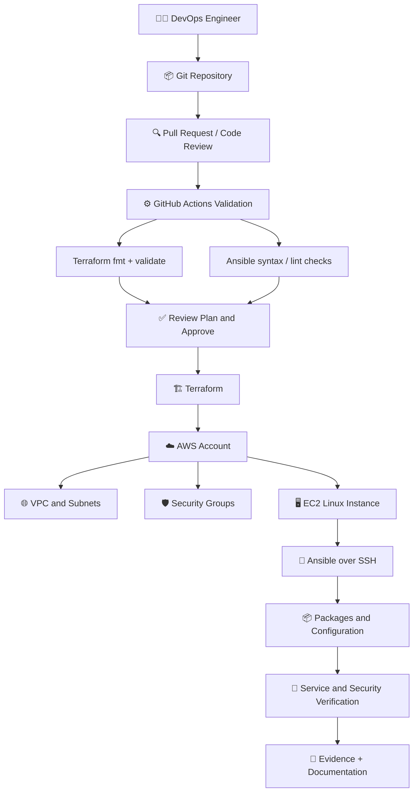
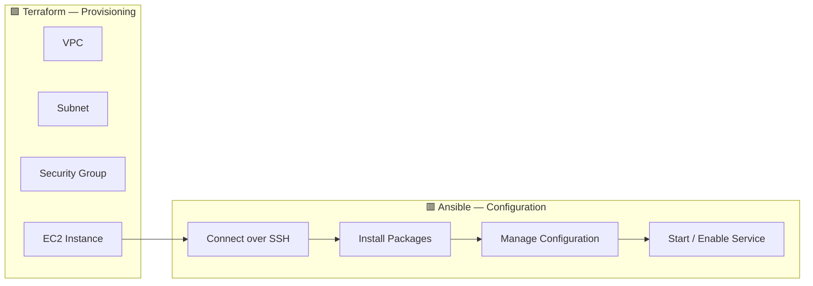

# 🌍🚀 PROJECT 04 — AWS Infrastructure Automation with Terraform + Ansible


### 🧱 Infrastructure as Code • Configuration Management • CI Validation • Secure AWS Foundations


**Level:** Intermediate → Advanced  
**Project Type:** Practical DevOps / Cloud Automation Portfolio  
**Main Stack:** Terraform + AWS + Ansible + Git + GitHub Actions

> 🟦 **Project goal:** Define cloud infrastructure with Terraform, configure Linux servers with Ansible, validate changes through CI, and document how to verify, operate, and safely clean up the environment.

</div>

---

# 🧭 1. Project Overview

In this project, you will learn to automate two different layers of infrastructure work:

- **Terraform** creates and manages cloud resources such as a VPC, subnets, security groups, and EC2 instances.
- **Ansible** configures operating-system-level settings and software on reachable Linux hosts.
- **Git** stores the source code and records changes.
- **GitHub Actions** can run formatting, syntax, and static validation checks before code is merged.
- **AWS IAM** controls which identities can perform cloud actions.

The project starts with code review and validation. Creating AWS resources is a separate, intentional step that can incur charges. You can inspect and validate much of the repository without connecting to AWS.

## 🎯 Learning outcomes

By the end, you should be able to explain:

1. What Infrastructure as Code (IaC) means and why teams use it.
2. The difference between Terraform provisioning and Ansible configuration management.
3. How VPCs, public/private subnets, route tables, and security groups fit together.
4. How Terraform state works and why it must be protected.
5. How an Ansible inventory connects playbooks to hosts.
6. How to validate changes before applying them.
7. How to reduce accidental exposure and cloud costs.
8. How to troubleshoot common Terraform, AWS, SSH, and Ansible failures.

---

# 🏢 2. Real-Time Business Scenario

Imagine a company named **CloudKart** needs a small Linux application environment in AWS.

The team wants a repeatable process. A new environment should not depend on someone manually clicking through the AWS Console and remembering every setting.

### ❌ Manual approach

- An engineer creates a VPC by clicking through the console.
- Another engineer creates a security group with slightly different rules.
- Server setup commands are copied and pasted manually.
- Documentation gets out of date.
- Rebuilding the environment after a failure takes too long.

### ✅ Automated approach

1. Engineers update Terraform files in Git.
2. CI checks formatting and validates the configuration.
3. An authorized engineer reviews the plan.
4. Terraform provisions the approved AWS resources.
5. Ansible configures the reachable Linux host.
6. The engineer verifies the result and records the evidence.
7. Changes are reviewed, versioned, and repeatable.

> 🟨 **Important distinction:** Terraform is mainly responsible for provisioning infrastructure. Ansible is mainly responsible for configuring systems and applications on that infrastructure. They complement each other; they are not interchangeable tools.

---

# 🎨 3. Architecture — Colourful Diagrams

## 3.1 End-to-end architecture



## 3.2 Terraform vs Ansible — responsibility boundary



## 3.3 Change lifecycle

```text
📝 Edit code
    ↓
🔍 Format and validate
    ↓
👀 Review Terraform plan
    ↓
✅ Approve intended change
    ↓
☁️ Terraform apply (only when authorized)
    ↓
🖥️ Confirm host is reachable
    ↓
🔧 Run Ansible playbook
    ↓
🧪 Verify service, ports, logs, and permissions
    ↓
📚 Save evidence and update README
```

### 📦 Diagram legend

| Symbol / box | Meaning |
|---|---|
| 🟪 Terraform | Cloud resource definitions and lifecycle |
| 🟥 Ansible | Host configuration and repeatable tasks |
| 🟦 CI | Automated checks before merge |
| 🟩 Review/approval | Human review before a potentially costly change |
| 🛡️ Security | Identity, network access, and secrets controls |
| 📸 Evidence | Actual command output or screenshots from your run |

---

# 🧰 4. Tools and Their Responsibilities

| Tool | What it does | Where you use it |
|---|---|---|
| AWS | Cloud provider | VPC, subnets, EC2, security groups, IAM |
| Terraform | Infrastructure as Code | Declare and provision AWS resources |
| Ansible | Configuration management | Install packages and configure a Linux host |
| Git | Version control | Track changes and collaborate |
| GitHub | Repository and code review | Pull requests, branches, project documentation |
| GitHub Actions | CI automation | Run formatting, validation, syntax checks |
| SSH | Secure remote shell | Connect to Linux hosts for Ansible |
| Python | Ansible runtime dependency in common setups | Run Ansible on the control machine |
| AWS CLI | AWS command-line access | Inspect identity and resources |
| Checkov / tfsec or equivalent | IaC security scanning | Find potentially risky configuration |
| `terraform plan` | Change preview | Review proposed resource changes |

> 🟧 Tool versions and installation steps change. Pin or document versions used in your own run, and check the official documentation before installing.

---

# 🗂️ 5. Detailed Project Structure

Create a repository similar to the following:

```text
aws-terraform-ansible-automation/
│
├── README.md
├── .gitignore
├── .editorconfig
│
├── terraform/
│   ├── versions.tf
│   ├── providers.tf
│   ├── variables.tf
│   ├── locals.tf
│   ├── network.tf
│   ├── security_groups.tf
│   ├── compute.tf
│   ├── outputs.tf
│   ├── terraform.tfvars.example
│   └── README.md
│
├── ansible/
│   ├── ansible.cfg
│   ├── requirements.yml
│   ├── inventory/
│   │   ├── hosts.ini.example
│   │   └── group_vars/
│   │       └── webservers.yml
│   ├── playbooks/
│   │   └── configure_web.yml
│   └── templates/
│       └── index.html.j2
│
├── scripts/
│   ├── validate.sh
│   └── validate.ps1
│
├── .github/
│   └── workflows/
│       └── validate.yml
│
└── docs/
    ├── architecture.md
    ├── operations-runbook.md
    └── screenshots/
        └── README.md
```

## 📂 Folder explanation

| Path | Purpose |
|---|---|
| `terraform/versions.tf` | Declare required Terraform and provider version constraints |
| `terraform/providers.tf` | Configure AWS provider region |
| `terraform/variables.tf` | Define configurable inputs |
| `terraform/network.tf` | Define VPC, subnet, and routing resources |
| `terraform/security_groups.tf` | Define inbound/outbound network rules |
| `terraform/compute.tf` | Define EC2 instance |
| `terraform/outputs.tf` | Display useful non-secret values after apply |
| `terraform.tfvars.example` | Example input values; no credentials |
| `ansible/ansible.cfg` | Project-specific Ansible defaults |
| `ansible/inventory/` | Hosts and group configuration |
| `ansible/playbooks/` | Repeatable host configuration tasks |
| `ansible/templates/` | Jinja2 templates rendered by Ansible |
| `.github/workflows/` | Automated CI validation |
| `docs/` | Architecture, runbooks, and real project evidence |

---

# ⚠️ 6. Before You Start — AWS Cost and Safety

You can create the repository, read the code, format Terraform, render a plan with suitable local setup, and validate Ansible without creating an EC2 instance. Some Terraform validation steps may need provider plugins to be downloaded.

## 🔐 Safety rules

- Do not commit AWS access keys, SSH private keys, passwords, or Terraform state.
- Do not use the AWS root account for routine automation.
- Use an IAM identity with only the permissions needed for the exercise.
- Review every plan before applying.
- Do not open SSH (`22`) to the entire internet (`0.0.0.0/0`) as a default.
- Prefer private networking and controlled access for real workloads.
- Do not create NAT gateways, load balancers, or multiple instances unless the project needs them; they may add cost.
- Set a budget alert, but remember that alerts do not automatically stop charges.
- Confirm the AWS region and active account before running commands.
- Run cleanup only after verifying that resources belong to this project.

## 💸 Cost awareness

AWS charges depend on region, resource type, storage, networking, and usage. An EC2 instance, public IPv4 address, EBS volume, NAT gateway, and data transfer may have separate costs. Check current pricing before provisioning. A resource being small or used for a short time does not guarantee it is free.

---

# 🧩 7. Prerequisites and Version Checks

Install the tools on your local machine or a suitable development environment.

```bash
git --version
terraform version
ansible --version
aws --version
ssh -V
```

For GitHub Actions, CI can run code checks without AWS credentials if it only formats and validates the repository. Do not add cloud credentials merely to make a basic validation workflow pass.

## 7.1 Confirm AWS identity (only if AWS access is configured)

```bash
aws sts get-caller-identity
aws configure list
```

Check the returned account and identity before making changes. Never paste credential values into the repository or public issue.

## 7.2 Choose a region

For example, you might use `ap-south-1` (Mumbai) if that is suitable for your use case. Availability and pricing vary. Use one region consistently throughout this exercise.

---

# 🟪 8. Terraform — Build the Infrastructure Layer

## 8.1 `terraform/versions.tf`

```hcl
terraform {
  required_version = ">= 1.6.0, < 2.0.0"

  required_providers {
    aws = {
      source  = "hashicorp/aws"
      version = "~> 5.0"
    }
  }
}
```

This declares compatible version constraints. In a real team repository, use a reviewed provider version and commit `.terraform.lock.hcl` to improve reproducibility.

## 8.2 `terraform/providers.tf`

```hcl
provider "aws" {
  region = var.aws_region

  default_tags {
    tags = {
      Project     = var.project_name
      Environment = var.environment
      ManagedBy   = "Terraform"
    }
  }
}
```

## 8.3 `terraform/variables.tf`

```hcl
variable "aws_region" {
  description = "AWS region for this environment"
  type        = string
  default     = "ap-south-1"
}

variable "project_name" {
  description = "Short project name used in resource naming and tags"
  type        = string
  default     = "cloudkart"
}

variable "environment" {
  description = "Environment name"
  type        = string
  default     = "dev"
}

variable "vpc_cidr" {
  description = "CIDR range for the project VPC"
  type        = string
  default     = "10.20.0.0/16"
}

variable "public_subnet_cidr" {
  description = "CIDR range for the demo public subnet"
  type        = string
  default     = "10.20.1.0/24"
}

variable "ssh_allowed_cidr" {
  description = "Your trusted public IP in CIDR notation, e.g. 203.0.113.10/32"
  type        = string

  validation {
    condition     = can(cidrhost(var.ssh_allowed_cidr, 0)) && !contains(["0.0.0.0/0"], var.ssh_allowed_cidr)
    error_message = "Provide a valid, restricted CIDR. Do not use 0.0.0.0/0 for SSH."
  }
}

variable "instance_type" {
  description = "EC2 instance type for the learning environment"
  type        = string
  default     = "t3.micro"
}

variable "ami_id" {
  description = "A valid Linux AMI ID for the selected region"
  type        = string
}
```

The `ami_id` is deliberately an input because AMI IDs differ by region and are updated over time. Supply a verified ID for the chosen Linux distribution and region. Do not assume an AMI ID works everywhere.

## 8.4 `terraform/network.tf`

```hcl
resource "aws_vpc" "main" {
  cidr_block           = var.vpc_cidr
  enable_dns_support   = true
  enable_dns_hostnames = true

  tags = {
    Name = "${var.project_name}-${var.environment}-vpc"
  }
}

resource "aws_internet_gateway" "main" {
  vpc_id = aws_vpc.main.id

  tags = {
    Name = "${var.project_name}-${var.environment}-igw"
  }
}

resource "aws_subnet" "public" {
  vpc_id                  = aws_vpc.main.id
  cidr_block              = var.public_subnet_cidr
  map_public_ip_on_launch = true

  tags = {
    Name = "${var.project_name}-${var.environment}-public-subnet"
  }
}

resource "aws_route_table" "public" {
  vpc_id = aws_vpc.main.id

  route {
    cidr_block = "0.0.0.0/0"
    gateway_id = aws_internet_gateway.main.id
  }

  tags = {
    Name = "${var.project_name}-${var.environment}-public-rt"
  }
}

resource "aws_route_table_association" "public" {
  subnet_id      = aws_subnet.public.id
  route_table_id = aws_route_table.public.id
}
```

> 🟥 **Learning environment warning:** This is a deliberately simple public-subnet demonstration. A production architecture should assess whether servers can remain private, how administrators connect, and which controlled egress path is appropriate. A public IP alone does not guarantee reachability; routing and security rules also matter.

## 8.5 `terraform/security_groups.tf`

```hcl
resource "aws_security_group" "web" {
  name        = "${var.project_name}-${var.environment}-web-sg"
  description = "Restricted SSH and HTTP access for the demo"
  vpc_id      = aws_vpc.main.id

  ingress {
    description = "SSH from trusted administrator CIDR only"
    from_port   = 22
    to_port     = 22
    protocol    = "tcp"
    cidr_blocks = [var.ssh_allowed_cidr]
  }

  ingress {
    description = "HTTP demo endpoint"
    from_port   = 80
    to_port     = 80
    protocol    = "tcp"
    cidr_blocks = ["0.0.0.0/0"]
  }

  egress {
    description = "Outbound IPv4 for package download in this demo"
    from_port   = 0
    to_port     = 0
    protocol    = "-1"
    cidr_blocks = ["0.0.0.0/0"]
  }

  tags = {
    Name = "${var.project_name}-${var.environment}-web-sg"
  }
}
```

The HTTP rule is public for a simple demonstration. For production, put a suitable edge layer in front, use HTTPS, and restrict access as required. Security-group egress is broad in this learning example; tighten it where the architecture supports explicit destinations.

## 8.6 `terraform/compute.tf`

```hcl
resource "aws_instance" "web" {
  ami                         = var.ami_id
  instance_type               = var.instance_type
  subnet_id                   = aws_subnet.public.id
  vpc_security_group_ids      = [aws_security_group.web.id]
  associate_public_ip_address = true

  metadata_options {
    http_tokens = "required"
  }

  root_block_device {
    encrypted             = true
    delete_on_termination = true
    volume_size           = 8
    volume_type           = "gp3"
  }

  tags = {
    Name = "${var.project_name}-${var.environment}-web"
    Role = "web"
  }
}
```

This instance resource does not specify an SSH key pair. To use SSH/Ansible, you must configure a secure access method for the selected AMI and environment. Options include a preconfigured key pair or AWS Systems Manager where supported and configured. Do not place a private key in Terraform code or Git.

## 8.7 `terraform/outputs.tf`

```hcl
output "vpc_id" {
  description = "ID of the project VPC"
  value       = aws_vpc.main.id
}

output "public_subnet_id" {
  description = "ID of the public subnet"
  value       = aws_subnet.public.id
}

output "instance_id" {
  description = "EC2 instance ID"
  value       = aws_instance.web.id
}

output "instance_public_ip" {
  description = "Public IPv4 address of the demo instance"
  value       = aws_instance.web.public_ip
}
```

Outputs are useful for later steps, but avoid outputting credentials, private keys, or sensitive values. Treat Terraform state as sensitive even if your declared outputs look harmless.

## 8.8 `terraform/terraform.tfvars.example`

```hcl
aws_region          = "ap-south-1"
project_name        = "cloudkart"
environment         = "dev"
vpc_cidr            = "10.20.0.0/16"
public_subnet_cidr  = "10.20.1.0/24"
ssh_allowed_cidr    = "REPLACE_WITH_YOUR_PUBLIC_IP/32"
instance_type       = "t3.micro"
ami_id              = "REPLACE_WITH_VALID_AMI_ID"
```

Copy this file to `terraform.tfvars` and replace the placeholders locally. Do not commit your personal `terraform.tfvars` if it contains environment-specific or sensitive data. The example file should never contain secrets.

## 8.9 `terraform/README.md`

Document:
- Required Terraform version.
- Required AWS permissions.
- Region and AMI selection process.
- How to run `fmt`, `validate`, and `plan`.
- Who is allowed to apply changes.
- How state is stored and protected.
- How to clean up resources.

---

# 🧪 9. Terraform Validation Workflow

Run these commands from the `terraform/` directory.

```bash
terraform fmt -recursive
terraform init
terraform validate
terraform plan
```

### What each command does

| Command | Purpose | Does it create AWS resources? |
|---|---|---|
| `terraform fmt` | Standardizes HCL formatting | No |
| `terraform init` | Downloads providers and initializes the working directory | No infrastructure creation |
| `terraform validate` | Checks configuration structure and internal consistency | No |
| `terraform plan` | Shows proposed infrastructure changes | No, it previews |
| `terraform apply` | Applies an approved plan | **Yes, it can create or modify billable resources** |
| `terraform destroy` | Requests removal of managed resources | **Yes, it is destructive** |

`terraform validate` may need provider initialization. `terraform plan` usually needs working AWS credentials and access to read relevant cloud information.

## 🛑 Before `terraform apply`

- [ ] Confirm the AWS account and region.
- [ ] Confirm the intended Terraform workspace and state.
- [ ] Review the entire plan.
- [ ] Check expected resource count and changes.
- [ ] Confirm security-group rules.
- [ ] Confirm you have permission to create the resources.
- [ ] Understand the possible charges.
- [ ] Ensure no unrelated resources are in the same state.

Only apply if you intentionally want to create the environment and are authorized to do so:

```bash
terraform apply
```

Review the plan shown and confirm only if it matches your intention.

---

# 🟥 10. Ansible — Configure the Linux Host

Terraform provisions the EC2 instance. Ansible then connects to a reachable host and configures software.

## 10.1 `ansible/ansible.cfg`

```ini
[defaults]
inventory = ./inventory/hosts.ini
host_key_checking = True
retry_files_enabled = False
interpreter_python = auto_silent
timeout = 30

[privilege_escalation]
become = False
```

Keep SSH host-key checking enabled. Do not disable it just to silence connection warnings. Set `become` at play/task level only where privileged operations are required.

## 10.2 `ansible/inventory/hosts.ini.example`

```ini
[webservers]
cloudkart-web ansible_host=REPLACE_WITH_INSTANCE_ADDRESS

[webservers:vars]
ansible_user=REPLACE_WITH_AMI_DEFAULT_USER
```

The default SSH user varies by AMI family. Replace the placeholders after confirming the selected image's documentation. Copy the example to `hosts.ini` locally and do not commit private connection details.

If using a private key, provide it through your SSH agent or a secure local path. Never commit the private key.

## 10.3 `ansible/requirements.yml`

```yaml
---
collections:
  - name: ansible.posix
```

Install required collections when needed:

```bash
ansible-galaxy collection install -r requirements.yml
```

Run from the `ansible/` directory.

## 10.4 `ansible/inventory/group_vars/webservers.yml`

```yaml
---
web_package_name: nginx
web_service_name: nginx
web_document_root: /var/www/html
web_page_title: "CloudKart Infrastructure Automation"
web_page_message: "Configured by Ansible"
```

Package and service names can vary by Linux distribution. The example below uses a common Nginx package/service naming pattern. Confirm the package manager and service names for your selected AMI.

## 10.5 `ansible/templates/index.html.j2`

```html
<!doctype html>
<html lang="en">
<head>
  <meta charset="utf-8">
  <meta name="viewport" content="width=device-width, initial-scale=1">
  <title>{{ web_page_title }}</title>
</head>
<body>
  <h1>{{ web_page_title }}</h1>
  <p>{{ web_page_message }}</p>
  <p>Host configured with Infrastructure as Code.</p>
</body>
</html>
```

## 10.6 `ansible/playbooks/configure_web.yml`

```yaml
---
- name: Configure the CloudKart web server
  hosts: webservers
  become: true
  gather_facts: true

  tasks:
    - name: Install Nginx on Debian-based systems
      ansible.builtin.apt:
        name: "{{ web_package_name }}"
        state: present
        update_cache: true
      when: ansible_os_family == "Debian"

    - name: Install Nginx on Red Hat-based systems
      ansible.builtin.package:
        name: "{{ web_package_name }}"
        state: present
      when: ansible_os_family == "RedHat"

    - name: Ensure the web document root exists
      ansible.builtin.file:
        path: "{{ web_document_root }}"
        state: directory
        owner: root
        group: root
        mode: "0755"

    - name: Deploy the home page
      ansible.builtin.template:
        src: ../templates/index.html.j2
        dest: "{{ web_document_root }}/index.html"
        owner: root
        group: root
        mode: "0644"
      notify: Restart web service

    - name: Ensure Nginx is enabled and running
      ansible.builtin.service:
        name: "{{ web_service_name }}"
        state: started
        enabled: true

  handlers:
    - name: Restart web service
      ansible.builtin.service:
        name: "{{ web_service_name }}"
        state: restarted
```

> 🟨 **Before running:** Validate this playbook against your actual AMI. Package names, service names, package manager behaviour, and default users vary. For an environment using Amazon Linux, confirm that your chosen Ansible modules and package naming match that version.

## 10.7 Validate Ansible

From the `ansible/` directory:

```bash
ansible-inventory -i inventory/hosts.ini --list
ansible-playbook -i inventory/hosts.ini playbooks/configure_web.yml --syntax-check
ansible-playbook -i inventory/hosts.ini playbooks/configure_web.yml --check --diff
```

The `--check` mode is a preview, not a guarantee that every task behaves exactly as it will during a real run. Some tasks and modules cannot fully simulate changes.

After confirming network access, SSH access, inventory, and permissions, run the playbook intentionally:

```bash
ansible-playbook -i inventory/hosts.ini playbooks/configure_web.yml
```

Verify the result by requesting the HTTP endpoint and checking service status/logs on the host.

---

# 🔗 11. How Terraform and Ansible Work Together

## Sequence

```text
Terraform files
    |
    v
terraform plan / review
    |
    v
terraform apply
    |
    +--> VPC
    +--> Subnet
    +--> Route table
    +--> Security group
    +--> EC2 instance
              |
              v
      Confirm host access
              |
              v
        Ansible inventory
              |
              v
       Ansible playbook
              |
              +--> Install Nginx
              +--> Deploy HTML template
              +--> Enable service
              |
              v
       HTTP and service tests
```

### Why not do everything in Terraform?

Terraform can provision cloud resources, and providers can sometimes configure resources beyond the cloud layer. However, Ansible is designed for repeatable host configuration and is often easier to maintain for packages, files, services, and operating-system tasks. Keep responsibilities clear and avoid creating two tools that fight over the same setting.

---

# ⚙️ 12. GitHub Actions — Validate Before Merge

This workflow runs repository checks. It intentionally does **not** apply Terraform or require AWS credentials.

Create `.github/workflows/validate.yml`:

```yaml
name: Validate Infrastructure Code

on:
  pull_request:
    paths:
      - "terraform/**"
      - "ansible/**"
      - ".github/workflows/validate.yml"
  push:
    branches:
      - main
    paths:
      - "terraform/**"
      - "ansible/**"
      - ".github/workflows/validate.yml"
  workflow_dispatch:

permissions:
  contents: read

jobs:
  terraform:
    name: Terraform Format and Validate
    runs-on: ubuntu-latest
    defaults:
      run:
        working-directory: terraform

    steps:
      - name: Checkout repository
        uses: actions/checkout@v4

      - name: Setup Terraform
        uses: hashicorp/setup-terraform@v3
        with:
          terraform_version: "1.9.8"

      - name: Check formatting
        run: terraform fmt -check -recursive

      - name: Initialize providers without a backend
        run: terraform init -backend=false

      - name: Validate configuration
        run: terraform validate

  ansible:
    name: Ansible Syntax Check
    runs-on: ubuntu-latest

    steps:
      - name: Checkout repository
        uses: actions/checkout@v4

      - name: Setup Python
        uses: actions/setup-python@v5
        with:
          python-version: "3.12"

      - name: Install Ansible
        run: python -m pip install ansible

      - name: Install Ansible collections
        working-directory: ansible
        run: ansible-galaxy collection install -r requirements.yml

      - name: Syntax check
        working-directory: ansible
        run: |
          ansible-playbook \
            -i inventory/hosts.ini.example \
            playbooks/configure_web.yml \
            --syntax-check
```

### CI workflow notes

- Pinning action references to reviewed commit SHAs can improve supply-chain security compared with floating tags.
- The Terraform version shown is an example; align it with the version you test locally.
- `terraform init -backend=false` avoids configuring a remote state backend during this validation job.
- The Ansible syntax check does not connect to EC2.
- CI does not prove that the AWS deployment will succeed. A separate controlled integration/deployment stage would be needed.
- Do not add `terraform apply` to an ordinary pull-request workflow.
- If a repository uses different folder names, update the workflow paths accordingly.

---

# 🛡️ 13. Security Review Checklist

## AWS and identity

- [ ] Routine automation uses a dedicated, least-privilege IAM identity.
- [ ] Root credentials are not used for routine tasks.
- [ ] CI has no long-lived AWS keys for basic validation.
- [ ] If cloud deployment is later automated, prefer short-lived credentials and a reviewed OIDC trust configuration where supported.
- [ ] AWS account and region are confirmed before applying.
- [ ] Logs and screenshots do not reveal credentials.

## Network

- [ ] SSH ingress is restricted to a trusted source CIDR or replaced by a controlled management solution.
- [ ] HTTP exposure is intentional and suitable for the demo.
- [ ] Production traffic uses a reviewed HTTPS architecture.
- [ ] Public IP assignment is necessary, not accidental.
- [ ] Security-group egress is reviewed.
- [ ] Production hosts are private when feasible.

## Terraform state

- [ ] State is not committed to Git.
- [ ] State access is restricted.
- [ ] A team setup uses an appropriate remote backend and state locking strategy supported by the selected backend/version.
- [ ] State backups and recovery are considered.
- [ ] Sensitive state is treated as confidential even if outputs look safe.

## Ansible

- [ ] SSH host-key checking is enabled.
- [ ] Private keys are never committed.
- [ ] `become` is used only where required.
- [ ] Inventory files with environment-specific details are ignored by Git.
- [ ] Playbooks are reviewed for idempotence.
- [ ] Secrets use an approved secret-management method rather than plain-text variables.

---

# 🖥️ 14. Real-Work Screenshots — What to Capture

**Real screenshots must come from your own execution.** This README does not pretend that infrastructure was deployed or that command output was captured. Use the following checklist to create genuine portfolio evidence after running the project.

| Screenshot | What it should prove | Suggested source |
|---|---|---|
| `01-repository-structure.png` | Project folders and files exist | VS Code Explorer |
| `02-terraform-fmt-validate.png` | Terraform formatting/validation completed | VS Code terminal |
| `03-terraform-plan.png` | Actual proposed infrastructure changes | Terminal, with account details hidden |
| `04-aws-vpc-subnet.png` | VPC and subnet were created | AWS Console, VPC dashboard |
| `05-aws-ec2-instance.png` | EC2 instance state and tags | AWS Console, EC2 dashboard |
| `06-security-group.png` | Actual inbound/outbound rules | AWS Console, security group details |
| `07-ansible-playbook.png` | Actual Ansible play recap | Terminal |
| `08-webpage-result.png` | Configured HTTP page responds | Browser or `curl` output |
| `09-github-actions.png` | Validation workflow actually passed | GitHub Actions run |
| `10-cleanup-proof.png` | Project resources were checked after cleanup | AWS Console/CLI, no sensitive data |

## 📸 Evidence folder

Create `docs/screenshots/README.md`:

```markdown
# Project Evidence

Store only genuine screenshots captured from this project's own runs.

Suggested files:
- 01-repository-structure.png
- 02-terraform-fmt-validate.png
- 03-terraform-plan.png
- 04-aws-vpc-subnet.png
- 05-aws-ec2-instance.png
- 06-security-group.png
- 07-ansible-playbook.png
- 08-webpage-result.png
- 09-github-actions.png
- 10-cleanup-proof.png

Before publishing, redact credentials, account identifiers where appropriate,
private IPs/hostnames if sensitive, tokens, and other confidential information.
Do not fabricate command output or claim a screenshot proves more than it shows.
```

### 🧾 Example evidence caption format

Use this format under each screenshot in your GitHub README:

> **What I did:** Ran Terraform validation from the `terraform/` directory.  
> **Expected result:** The configuration passes validation.  
> **Actual result:** Add the result observed during your own run.  
> **Troubleshooting/learning:** Document any issue you encountered and how you resolved it.

---

# 📊 15. Validation and Acceptance Criteria

| Test | Command / action | Pass condition |
|---|---|---|
| Terraform formatting | `terraform fmt -check -recursive` | No formatting changes required |
| Terraform initialization | `terraform init` | Required providers initialize successfully |
| Terraform validation | `terraform validate` | Configuration is valid |
| Terraform plan | `terraform plan` | Proposed changes match the intended architecture |
| Ansible inventory | `ansible-inventory -i inventory/hosts.ini --list` | Intended hosts/groups are parsed |
| Ansible syntax | `ansible-playbook ... --syntax-check` | Playbook syntax is valid |
| Ansible preview | `ansible-playbook ... --check --diff` | Reviewable preview; unsupported tasks considered |
| Provisioning | Apply reviewed Terraform plan | Intended resources exist in the correct account/region |
| Host access | SSH or approved management path | Authorized host access succeeds |
| Configuration | Run Ansible | Tasks complete without unexpected failures |
| Application test | Request the web endpoint | Expected page/content is returned |
| CI | Inspect the workflow run | Relevant jobs pass |
| Cleanup | Inspect AWS resources after destroy | No unintended project resources remain |

---

# 🛠️ 16. Troubleshooting Guide

| Error / symptom | Common reason | How to investigate |
|---|---|---|
| `terraform: command not found` | Terraform not installed or PATH not updated | Verify installation and terminal PATH |
| Provider initialization fails | Network issue, provider constraint, or registry problem | Review `terraform init` output and version constraints |
| `terraform validate` fails | Invalid HCL, missing required value, or incompatible block | Read the first error carefully; validate again after fixing |
| `No valid credential sources found` | AWS credentials/profile not configured | Check `aws configure list` and `aws sts get-caller-identity` |
| `AccessDenied` | IAM permissions insufficient or explicit deny | Identify the denied action and request only the required permission |
| Invalid AMI | AMI ID is wrong for the region or no longer available | Confirm AMI ID, region, architecture, and owner |
| EC2 cannot be reached | Route, public IP, security group, NACL, or host issue | Check route table, address, security group, instance status, and OS firewall |
| SSH timeout | Source IP not allowed or network route blocked | Verify current public IP/CIDR and ingress rule |
| SSH permission denied | Wrong user/key or unsupported auth setup | Confirm AMI default username, key pair, file permissions, and access method |
| Ansible host unreachable | Inventory address or SSH connectivity is wrong | Run `ansible-inventory` and test SSH separately |
| Ansible `sudo` failure | User cannot escalate privileges | Confirm the intended user and become configuration |
| Package task fails | Distribution/package manager differs | Check OS facts and package/service names |
| Nginx not running | Package/configuration error or service name mismatch | Inspect `systemctl status nginx` and journal logs on the host |
| Webpage not reachable | Nginx, security group, route, or target IP issue | Check service status, port 80 rule, address, and local curl |
| GitHub Actions fails on `fmt` | Files not formatted | Run `terraform fmt -recursive`, commit changes |
| GitHub Actions cannot find inventory | Wrong file path | Check the working directory and relative inventory path |
| Terraform shows unexpected destroy | State/config mismatch or changed resource settings | Stop; review plan and state carefully before applying |
| Resource still costs money after cleanup | An attached/related resource remains or another environment exists | Check EC2, EBS, public IP, load balancer, NAT, and other resource pages |

### Useful commands

```bash
# Terraform
terraform fmt -recursive
terraform validate
terraform plan
terraform state list
terraform output

# AWS identity and EC2 inspection
aws sts get-caller-identity
aws ec2 describe-instances --region ap-south-1

# Ansible
ansible-inventory -i inventory/hosts.ini --list
ansible webservers -m ansible.builtin.ping
ansible-playbook -i inventory/hosts.ini playbooks/configure_web.yml --syntax-check
```

`terraform state list` and `terraform output` can reveal resource names or infrastructure details. Review their output before sharing it. Do not use `terraform state rm` as a routine troubleshooting command; it changes Terraform's tracking and does not delete the actual resource.

---

# 🧹 17. Cleanup — Avoid Unwanted Charges

If you intentionally created resources for this project, remove them when finished.

## Step 1 — Stop configuration activity

Do not run Ansible while the target host is being destroyed. Make sure no teammate or workflow is using the same environment.

## Step 2 — Review the destroy plan

Run from the same Terraform directory and with the correct state, workspace, AWS account, and region:

```bash
terraform plan -destroy
```

Review every proposed deletion. If unrelated resources appear, stop and investigate.

## Step 3 — Destroy only the intended project resources

```bash
terraform destroy
```

Confirm only after verifying the proposed resources and understanding the consequences.

## Step 4 — Verify in AWS

Inspect the relevant services for leftovers, including:
- EC2 instances
- EBS volumes and snapshots
- Elastic/public IP allocations
- VPC and subnets
- Internet gateways and route tables
- Security groups
- Any additional resources you created

Terraform may not manage manually created or separately managed resources. Do not assume `terraform destroy` removes every resource in an AWS account.

> 🛑 Never run destroy against a shared or production state without an approved change process, a verified backup/recovery plan, and explicit authorization.

---

# 🎤 18. DevOps Interview Questions and Answers

### Q1. What is Infrastructure as Code?

Infrastructure as Code means describing infrastructure in version-controlled configuration files so it can be reviewed, repeated, and managed systematically rather than relying entirely on manual console steps.

### Q2. What is Terraform?

Terraform is an IaC tool that compares declared configuration with tracked and observed infrastructure to propose and apply changes through providers.

### Q3. What is Ansible?

Ansible is an automation and configuration-management tool that uses inventories and playbooks to perform repeatable tasks on managed hosts.

### Q4. Terraform vs Ansible?

Terraform is commonly used to provision cloud infrastructure. Ansible is commonly used to configure operating systems, packages, files, and services. They can be combined in one workflow.

### Q5. What is Terraform state?

State records Terraform's mapping between configuration and managed objects, along with resource attributes needed to plan changes. It can contain sensitive data, so it must be protected and access-controlled.

### Q6. What is the difference between `plan` and `apply`?

`plan` previews proposed changes. `apply` executes changes after confirmation or according to the configured automation. Apply can create, modify, or delete billable resources.

### Q7. What is a VPC?

A Virtual Private Cloud is a logically isolated network in AWS where you define IP ranges, subnets, routes, and network controls.

### Q8. What is a subnet?

A subnet is an IP range within a VPC associated with an Availability Zone. Its routing and related configuration influence whether resources have public or private connectivity.

### Q9. What is a security group?

A security group is a stateful virtual firewall associated with supported AWS resources. Its rules control allowed inbound and outbound traffic.

### Q10. What is an Ansible inventory?

An inventory identifies the hosts or groups that Ansible should target and can include connection details and variables.

### Q11. What does idempotence mean in Ansible?

An idempotent task converges the system to a declared state and, when run again without relevant drift, generally makes no additional change.

### Q12. Why is SSH open to the internet risky?

A public SSH endpoint increases exposure to scanning and attack attempts. Restrict the source, use strong key-based or approved managed access, keep systems updated, and avoid broad access rules.

### Q13. What is the purpose of GitHub Actions in this project?

It automatically checks formatting and configuration syntax/validity on code changes. The sample workflow does not provision infrastructure or prove that a live deployment is healthy.

### Q14. How do you troubleshoot Terraform when the plan wants to destroy a resource?

I stop before applying, inspect the plan, verify the current workspace/backend and resource addresses, check configuration changes and state, and only proceed once I understand the intended impact.

### Q15. How would you improve this project for production?

I would evaluate private subnets, managed access, remote state with locking and encryption, least-privilege IAM, short-lived CI credentials, policy checks, image/application deployment automation, monitoring, backup/recovery, environment separation, and an approved change process.

## 🗣️ Sample project explanation

> “I created a Terraform and Ansible infrastructure automation project. Terraform defines the AWS network, security group, and EC2 resources as code. Ansible configures a Linux web server through a controlled management connection. GitHub Actions checks Terraform formatting and validation plus Ansible syntax on changes. I documented state protection, IAM least privilege, network restrictions, troubleshooting, real execution evidence, and cleanup. I validate and review the plan before creating billable AWS resources.”

Use this explanation only for the parts you actually implemented and verified. Be transparent if you completed validation locally but did not deploy to AWS.

---

# 📚 19. Official Documentation and Logos

- [Terraform documentation](https://developer.hashicorp.com/terraform/docs)
- [Terraform AWS provider](https://registry.terraform.io/providers/hashicorp/aws/latest/docs)
- [Terraform state](https://developer.hashicorp.com/terraform/language/state)
- [Ansible documentation](https://docs.ansible.com/)
- [Ansible playbooks](https://docs.ansible.com/ansible/latest/playbook_guide/playbooks_intro.html)
- [Ansible inventory](https://docs.ansible.com/ansible/latest/inventory_guide/intro_inventory.html)
- [AWS VPC documentation](https://docs.aws.amazon.com/vpc/latest/userguide/what-is-amazon-vpc.html)
- [Amazon EC2 documentation](https://docs.aws.amazon.com/AWSEC2/latest/UserGuide/concepts.html)
- [AWS IAM best practices](https://docs.aws.amazon.com/IAM/latest/UserGuide/best-practices.html)
- [AWS CLI documentation](https://docs.aws.amazon.com/cli/latest/userguide/cli-chap-welcome.html)
- [GitHub Actions documentation](https://docs.github.com/actions)
- [GitHub Actions security hardening](https://docs.github.com/actions/security-for-github-actions/security-guides/security-hardening-for-github-actions)
- [Checkov documentation](https://www.checkov.io/)
- [OpenTofu documentation](https://opentofu.org/docs/)

The badges at the top use Shields.io and official product logos where supported. Diagrams are Mermaid text diagrams, so GitHub can render them in supported Markdown views.

---

# 🏁 20. Final Project Completion Checklist

## 🧱 Infrastructure as Code
- [ ] Repository has the planned structure.
- [ ] Terraform code is formatted.
- [ ] Terraform validates successfully.
- [ ] Plan has been reviewed before any apply.
- [ ] State and credentials are not committed.
- [ ] Resource tags and region are documented.

## 🔧 Configuration management
- [ ] Ansible inventory is parsed correctly.
- [ ] Playbook passes syntax validation.
- [ ] Host access method is secure and works.
- [ ] Packages and service names match the chosen OS.
- [ ] Playbook completes and the service is verified.
- [ ] Re-running the playbook has been tested for idempotence.

## ⚙️ CI and security
- [ ] GitHub Actions validation workflow runs.
- [ ] IAM permissions are appropriate.
- [ ] SSH is not open to every IPv4 address.
- [ ] HTTP exposure is intentional.
- [ ] Terraform state and Ansible secrets are protected.
- [ ] No credentials are present in Git history.

## 📸 Portfolio and operations
- [ ] Real screenshots are captured after execution.
- [ ] Screenshots are redacted where needed.
- [ ] README explains actual outcomes and limitations.
- [ ] Troubleshooting notes reflect issues actually encountered.
- [ ] Cleanup plan is understood.
- [ ] AWS resources and possible remaining charges are checked.

---

<div align="center">

## 🌟 PROJECT 04 — Build It, Validate It, Verify It

### 🟪 Terraform provisions • 🟥 Ansible configures • 🟦 CI validates • 🛡️ Security protects

**Your portfolio is strongest when it shows real code, real command output, real troubleshooting, and honest evidence of what you tested.**

