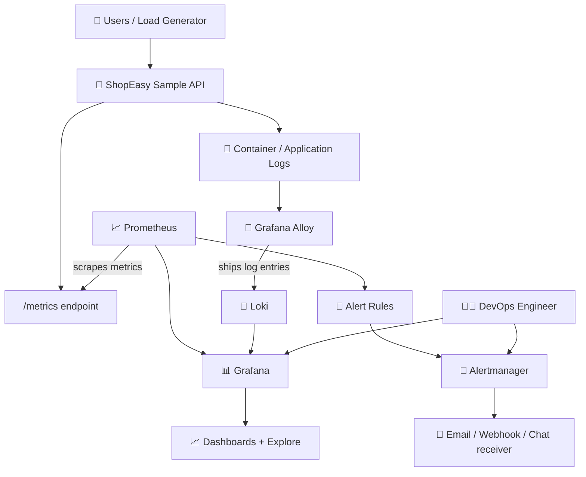
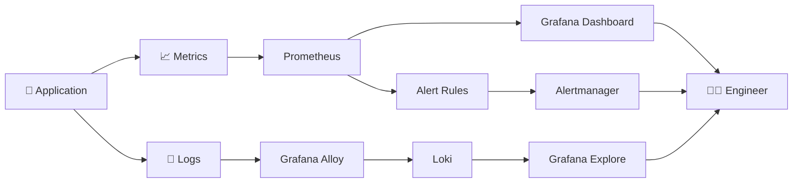
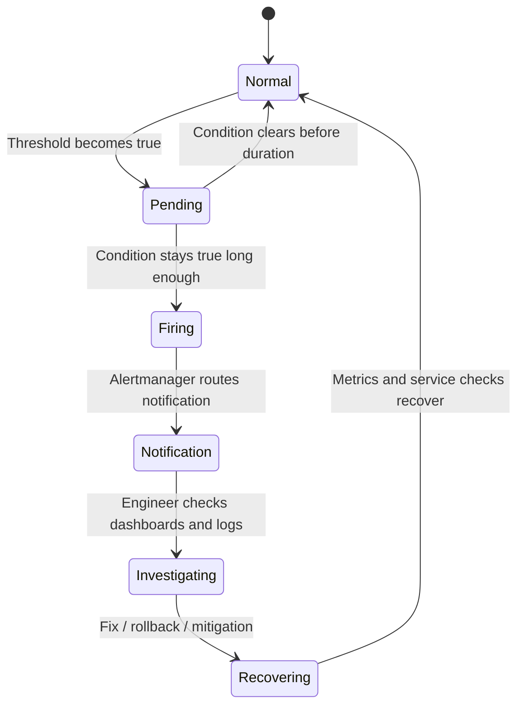

# 🚀📊 PROJECT 05 — Production Monitoring, Logging & Alerting Platform


## 🔭 Prometheus + Grafana + Loki + Alertmanager + Docker


### 🏢 Real-World DevOps • Observability • Incident Response • Production Operations


**Level:** Beginner → Intermediate → Advanced  
**Project type:** Practical DevOps observability lab  
**Build order:** Local Docker lab first → verified monitoring → optional cloud/Kubernetes extension

> 🟦 **Project mission:** Build a small observability platform that tells a DevOps engineer what is happening inside an application, helps find why something went wrong, and alerts the team when a defined problem occurs.

</div>

---

# 🌈 1. First Understand the Project — Simple Words

Imagine a company named **ShopEasy**. It has an online shopping application. Customers open the website, search products, add items to their cart, and place orders.

The application may look fine one minute and become slow the next minute. The database may become unreachable. The server may run out of memory. A container may stop. Users may start receiving HTTP 500 errors.

**The DevOps Engineer's job is not only to deploy the application. The engineer also needs to understand whether it is healthy, notice problems quickly, investigate the cause, and help restore the service.**

This project builds the tools that help do that.

## 🧠 The simplest analogy

Think of an application like a human body:

| Human body | Software system | What it tells us |
|---|---|---|
| 🌡️ Temperature | CPU usage / latency | Is the system under stress? |
| ❤️ Pulse | Request rate | How much traffic is arriving? |
| 🩺 Blood test | Metrics and health checks | What measurements are abnormal? |
| 🗣️ Patient describing pain | Application logs | What happened and what error appeared? |
| 🚨 Hospital alarm | Alerting system | Who should be notified about a serious problem? |
| 👨‍⚕️ Doctor investigating | DevOps / SRE incident response | What is the root cause and how do we recover? |

The analogy is not exact, but it helps explain the idea: **metrics show patterns, logs give event details, alerts call attention to a condition, and dashboards bring useful information together.**

---

# 🏢 2. Real-Time Company Scenario — The Story of an Incident

## 📦 Company situation

ShopEasy has a web application running in Docker containers. Customers complain that the product page sometimes takes 8–10 seconds to load. Some users receive `500 Internal Server Error`.

Before monitoring is implemented, the team may only discover the issue when customers complain.

After this project is implemented, the team can see metrics, search logs, and receive an alert when an agreed threshold is exceeded.

### 🔴 10:00 AM — Application is healthy

- Requests are completing normally.
- CPU and memory usage are within the expected range.
- The application returns successful responses.
- Grafana dashboards show normal trends.

### 🟠 10:15 AM — Traffic increases

A promotion starts. More users open the product page.

- Request rate increases.
- CPU usage begins to rise.
- Request latency becomes higher.
- Prometheus collects the measurements at regular intervals.

### 🔴 10:17 AM — Errors begin

A dependency used by the application starts timing out.

- The application's error count rises.
- Logs show timeout messages.
- The error-rate alert condition becomes true and remains true for the configured duration.
- Alertmanager routes the alert to the configured receiver.

### 🧑‍💻 10:18 AM — DevOps Engineer investigates

The engineer does **not** randomly restart everything. The engineer follows evidence:

1. Open Grafana and check the application error-rate and latency panels.
2. Check whether CPU or memory pressure is also increasing.
3. Search the application logs around the incident time.
4. Compare the time of the errors with a recent deployment or configuration change.
5. Check whether the application or a dependency is unhealthy.
6. Apply the approved recovery action—for example, roll back a bad release or restore a failed dependency.
7. Verify that error rate and latency return to normal.
8. Record the incident, root cause, impact, and prevention steps.

### 🟢 10:30 AM — Service recovered

The dashboards return toward normal. The team confirms recovery with measurements rather than assuming that the problem is fixed simply because the alert stopped.

> 🟨 **Important:** This is a realistic example of how a monitored incident can unfold. The times and symptoms above are illustrative, not evidence of a real production incident.

---

# 🎯 3. What Exactly Will We Build?

We will create a local learning environment with several services running together using Docker Compose.

| Component | Responsibility | Simple explanation |
|---|---|---|
| 🛒 Sample application | Serves HTTP requests and exposes application metrics | The service being monitored |
| 📈 Prometheus | Scrapes and stores time-series metrics | Collects numerical measurements over time |
| 📊 Grafana | Dashboards and exploration UI | Displays metrics and logs in useful views |
| 📝 Loki | Stores and queries application logs | Makes it easier to search events and errors |
| 🚚 Grafana Alloy | Collects and forwards logs to Loki | Log collector/forwarder; preferred over starting a new Promtail deployment |
| 🚨 Alertmanager | Groups, routes, and manages Prometheus alerts | Sends alerts to configured destinations |
| 🧪 Load generator | Produces sample requests | Helps demonstrate traffic, latency, and errors |
| 🧰 Docker Compose | Starts and connects the local services | Runs the lab as a group |

**Version note:** Observability components evolve. For a real implementation, choose compatible versions and follow their current official documentation. This project uses a conceptual architecture and example configuration patterns; test the exact image tags, metric names, and configuration against the versions you pin.

---

# 🗺️ 4. Colourful Architecture Diagrams

## 4.1 Full system view



## 4.2 Metrics, logs, and alerts — what is the difference?



## 4.3 Alert lifecycle



## 4.4 Service communication

```text
Browser / Load Generator
        |
        v
  Sample Application -----------------> Application Logs
        |                                      |
        | /metrics                             v
        v                               Grafana Alloy
   Prometheus                                  |
        |                                      v
        |                                   Loki
        |                                      |
        +---------------> Grafana <------------+
        |
        v
   Alert Rules
        |
        v
  Alertmanager
        |
        v
 Configured notification receiver
```

### 📦 Architecture boxes explained

| Box | What goes inside it? | Why does it exist? |
|---|---|---|
| Sample application | HTTP routes, metrics endpoint, structured logs | Gives us a service to monitor |
| Prometheus | Scrape targets, time-series data, alert rules | Measures behaviour over time |
| Grafana | Data sources, dashboards, Explore | Lets engineers understand the system visually |
| Loki | Log streams and labels | Centralizes log search |
| Grafana Alloy | Log collection and forwarding configuration | Ships logs from the container/runtime to Loki |
| Alertmanager | Routing, grouping, silencing, receivers | Controls how alerts reach the team |
| Docker Compose | Service definitions, networks, volumes | Starts the lab consistently |
| Load generator | Repeated requests or controlled error scenarios | Makes dashboard and alert behaviour observable |

---

# 🧠 5. Observability — The Main Concept

Three terms are commonly discussed together: **metrics, logs, and traces**.

## 📈 Metrics

Metrics are numerical measurements collected over time.

Examples:
- Requests per second.
- Number of HTTP 500 responses.
- CPU and memory usage.
- Request duration.
- Number of active connections.

Example:

```text
http_requests_total{method="GET",status="200"} 1250
http_requests_total{method="GET",status="500"} 18
```

These are illustrative metric samples. The actual metric names and labels depend on the application instrumentation.

**Why metrics matter:** They help identify patterns and answer questions like “When did errors increase?” or “Is latency getting worse?”

## 📝 Logs

Logs are event records written by the application or platform.

Example:

```text
2026-10-25T10:17:42Z level=ERROR
service=shopeasy
message="Inventory dependency timed out"
request_id="demo-123"
```

This is an illustrative log line, not a real captured event.

**Why logs matter:** Metrics may tell you that errors increased, while logs may show the error message and affected operation.

Avoid logging passwords, tokens, session cookies, personal information, or other secrets.

## 🧵 Traces

A distributed trace follows one request across multiple services. Traces are useful when one user action passes through an API, inventory service, payment service, and database.

This project's core implementation focuses on metrics and logs. Distributed tracing with OpenTelemetry can be a future extension.

## 🚨 Alerts

An alert is a rule-based signal that a condition needs attention.

For example:
- Error rate stays above an agreed threshold.
- A monitored target is unavailable.
- CPU stays unusually high for a sustained period.

An alert is not automatically a fix. It notifies the right person or system so investigation can start.

---

# 🔍 6. Tool-by-Tool Deep Explanation

## 📈 6.1 Prometheus — Metrics Collector

### What is Prometheus?

Prometheus is a monitoring and time-series database system. It typically pulls metrics from targets by scraping their HTTP metrics endpoints at configured intervals.

### How does it work?

1. The application exposes metrics at `/metrics`.
2. Prometheus reads its configuration.
3. Prometheus connects to the configured target at the scrape interval.
4. It records timestamped samples.
5. PromQL queries those samples.
6. Grafana can query Prometheus to draw panels.
7. Alert rules can evaluate conditions based on those measurements.

### What does a DevOps Engineer do with it?

- Add or update scrape targets.
- Check why a target is `DOWN`.
- Build or review PromQL queries.
- Create alert rules based on service objectives.
- Investigate metric changes after a deployment.
- Manage retention, storage, and resource usage.

### Example PromQL queries

Request rate, if the application exposes a counter named `http_requests_total`:

```promql
sum(rate(http_requests_total[5m]))
```

Approximate HTTP 5xx fraction, if the same counter has a `status` label:

```promql
sum(rate(http_requests_total{status=~"5.."}[5m]))
/
clamp_min(sum(rate(http_requests_total[5m])), 1)
```

The query returns a fraction between 0 and 1 when the metric and labels match this example. Multiply by `100` to display a percentage. It is only as accurate as the application's instrumentation and label design.

Check whether a target is up:

```promql
up
```

**Why use `rate()`?** A counter generally increases over time. `rate()` estimates the per-second rate of increase over a time window, making it useful for request-rate calculations.

---

## 📊 6.2 Grafana — Dashboards and Investigation

### What is Grafana?

Grafana is an observability and visualization platform. It can query supported data sources and show the results in dashboards, tables, charts, and logs views.

### What will our dashboard show?

| Panel | What it tells the engineer |
|---|---|
| Request rate | How many requests are being served |
| 5xx error rate | Whether server-side errors are rising |
| Latency | Whether requests are taking longer |
| Target health | Whether monitored endpoints are reachable |
| Container CPU | Whether containers are using substantial CPU |
| Container memory | Whether memory use is growing |
| Application logs | Which error messages appear around the incident |

### Real-time DevOps workflow

1. Open the dashboard after receiving a report or alert.
2. Select the relevant time range.
3. Compare the error and latency panels.
4. Look at CPU/memory and target health.
5. Open Explore to query logs in the same time window.
6. Note the first abnormal timestamp.
7. Compare it with deployment or configuration changes.

### Important distinction

A dashboard is not the same as monitoring coverage. A beautiful dashboard with missing metrics, bad labels, or no useful alert rules can still fail to detect a serious issue.

---

## 📝 6.3 Loki — Centralized Log Storage and Query

### What is Loki?

Loki is a log aggregation system in the Grafana ecosystem. It indexes labels associated with log streams and supports queries using LogQL.

### Why not just use `docker logs`?

`docker logs` is useful for a quick check on one container. In a larger environment, engineers may need to search multiple services, compare events across hosts, and investigate a time range from one place.

Centralized logging makes that easier.

### Example LogQL queries

Show logs with a `service` label:

```logql
{service="shopeasy"}
```

Filter log lines containing an error word:

```logql
{service="shopeasy"} |= "ERROR"
```

Search for timeout-related lines:

```logql
{service="shopeasy"} |= "timeout"
```

These queries require the corresponding labels and text to exist in the ingested logs.

### What does a DevOps Engineer do?

- Configure log collection and labels.
- Check whether logs are reaching Loki.
- Search for error patterns.
- Correlate logs with an alert's timestamp.
- Prevent high-cardinality labels from causing unnecessary load.
- Apply retention and access controls.
- Ensure secrets and personal data are not exposed in logs.

**Label design matters:** Avoid using a unique request ID, user ID, or arbitrary URL as a Loki stream label. Those can create a very large number of streams. Keep such values in the log content when appropriate and safe.

---

## 🚚 6.4 Grafana Alloy — Log Collection

Grafana Alloy is an observability collector that can receive, process, and forward telemetry, depending on its configured components.

In this learning architecture, Alloy is used to collect log data and send it to Loki.

**Why use a collector?** The application writes logs, but the log backend needs a way to receive them. A collector connects the source to the backend and can apply processing or filtering.

Promtail was a widely used Loki log collector, but it reached end of life in 2026. For new learning work, follow current Grafana guidance and use Alloy or another currently supported collection method. Verify the current support status and configuration in the official documentation before building a production system.

---

## 🚨 6.5 Alertmanager — Notification Routing

Prometheus alert rules decide when an alert condition is active. Alertmanager handles grouping, routing, silencing, and notification delivery.

### Example alert flow

```text
Prometheus evaluates a rule
          |
          v
Condition remains true for configured duration
          |
          v
Alert enters Firing state
          |
          v
Prometheus sends alert to Alertmanager
          |
          v
Alertmanager matches routing rules
          |
          v
Configured email / webhook / receiver gets notification
          |
          v
Engineer investigates
```

### What does a DevOps Engineer configure?

- Alert severity and ownership.
- Notification receiver.
- Grouping of related alerts.
- Repeat interval and timing.
- Maintenance silences.
- Links to dashboards and runbooks.
- Avoiding noisy or duplicate notifications.

A receiver must be configured correctly for real delivery. A sample alert in a dashboard does not prove that email, Slack, Teams, or another notification was actually delivered.

---

## 🐳 6.6 Docker Compose — Running the Lab

Docker Compose defines multiple containers, their configuration, networks, and persistent volumes in one YAML file.

Instead of starting each component with separate manual commands, an engineer can use a compose file to describe the lab consistently.

Common commands:

```bash
docker compose config
docker compose up -d
docker compose ps
docker compose logs --tail=100
docker compose down
```

- `config` checks and renders the Compose configuration.
- `up -d` starts the services in the background.
- `ps` shows service/container status.
- `logs` helps diagnose startup or runtime errors.
- `down` stops and removes Compose-managed containers and networks; named volumes generally remain unless explicitly removed.

Do not publish every monitoring port to the public internet. For a local lab, bind web interfaces to localhost where practical. Grafana and Prometheus are not automatically secure just because they are used for monitoring.

---

# 🗂️ 7. Complete Repository Structure

Create a repository named:

`production-observability-platform`

```text
production-observability-platform/
│
├── README.md
├── .gitignore
├── .env.example
├── compose.yaml
│
├── app/
│   ├── Dockerfile
│   ├── requirements.txt
│   ├── app.py
│   └── tests/
│       └── test_app.py
│
├── prometheus/
│   ├── prometheus.yml
│   ├── alert-rules.yml
│   └── README.md
│
├── alertmanager/
│   ├── alertmanager.yml.example
│   └── README.md
│
├── grafana/
│   ├── provisioning/
│   │   ├── datasources/
│   │   │   └── datasources.yml
│   │   └── dashboards/
│   │       └── dashboards.yml
│   └── dashboards/
│       └── shopeasy-overview.json
│
├── alloy/
│   └── config.alloy
│
├── load-test/
│   └── generate_traffic.py
│
├── runbooks/
│   ├── high-error-rate.md
│   ├── high-latency.md
│   ├── target-down.md
│   └── missing-logs.md
│
├── scripts/
│   ├── validate.sh
│   └── validate.ps1
│
├── .github/
│   └── workflows/
│       └── validate.yml
│
└── docs/
    ├── architecture.md
    ├── incident-example.md
    └── screenshots/
        └── README.md
```

## 📂 Folder-by-folder explanation

| Folder/file | What belongs there? | Why do we need it? |
|---|---|---|
| `app/` | Sample application, Dockerfile, tests | Creates a service we can measure |
| `compose.yaml` | Service definitions and networks | Runs the lab consistently |
| `prometheus/` | Scrape config and alert rules | Defines what to monitor and when to alert |
| `alertmanager/` | Routing and receiver configuration | Determines where alerts go |
| `grafana/provisioning/` | Data sources and dashboard provisioning | Makes Grafana setup repeatable |
| `grafana/dashboards/` | Dashboard JSON | Stores dashboard definitions in Git |
| `alloy/` | Log collector configuration | Defines how logs reach Loki |
| `load-test/` | Controlled traffic generator | Helps demonstrate normal and abnormal patterns |
| `runbooks/` | Investigation steps for common alerts | Gives engineers a repeatable response |
| `.github/workflows/` | CI validation | Catches configuration errors before merge |
| `docs/screenshots/` | Genuine evidence from your run | Shows what was tested and observed |

---

# 🧑‍💻 8. The Sample Application — What Are We Monitoring?

We need a small service to generate requests, metrics, and logs. This example uses Python Flask and `prometheus-client`.

## `app/requirements.txt`

```text
Flask
prometheus-client
gunicorn
pytest
```

For a reproducible project, pin tested dependency versions in your own repository or use a lock file. The short list above shows package names, not a fully locked production dependency set.

## `app/app.py`

```python
import logging
import os
import time

from flask import Flask, jsonify, request
from prometheus_client import Counter, Histogram, generate_latest, CONTENT_TYPE_LATEST

app = Flask(__name__)

logging.basicConfig(
    level=os.getenv("LOG_LEVEL", "INFO"),
    format="%(asctime)s level=%(levelname)s service=shopeasy message=%(message)s",
)
logger = logging.getLogger("shopeasy")

REQUESTS = Counter(
    "shopeasy_http_requests_total",
    "Total HTTP requests",
    ["method", "endpoint", "status"],
)

LATENCY = Histogram(
    "shopeasy_http_request_duration_seconds",
    "HTTP request duration in seconds",
    ["method", "endpoint"],
)

@app.before_request
def start_timer():
    request.start_time = time.perf_counter()

@app.after_request
def record_metrics(response):
    elapsed = time.perf_counter() - getattr(request, "start_time", time.perf_counter())
    endpoint = request.endpoint or "unknown"

    REQUESTS.labels(
        request.method,
        endpoint,
        str(response.status_code),
    ).inc()

    LATENCY.labels(request.method, endpoint).observe(elapsed)

    logger.info(
        "request method=%s endpoint=%s status=%s duration_seconds=%.4f",
        request.method,
        endpoint,
        response.status_code,
        elapsed,
    )
    return response

@app.get("/")
def home():
    return jsonify(service="shopeasy", status="ok")

@app.get("/health")
def health():
    return jsonify(status="healthy"), 200

@app.get("/products")
def products():
    return jsonify(
        products=[
            {"id": 1, "name": "Keyboard"},
            {"id": 2, "name": "Mouse"},
        ]
    )

@app.get("/simulate-error")
def simulate_error():
    # Learning-only route: deliberately produces a server error.
    logger.error("simulated_error route_used=true")
    return jsonify(error="simulated learning error"), 500

@app.get("/metrics")
def metrics():
    body = generate_latest()
    return body, 200, {"Content-Type": CONTENT_TYPE_LATEST}

if __name__ == "__main__":
    app.run(host="0.0.0.0", port=8000)
```

### ⚠️ Application code notes

- `/health` provides a simple health response.
- `/metrics` exposes Prometheus metrics.
- `/simulate-error` deliberately returns an error for the learning lab. Do not expose this route in a real public application.
- This minimal example records metrics after the request, so a scrape occurring before the first request to an endpoint may not show that endpoint's series yet.
- The example uses the Flask development server only for simple local experimentation. Use a suitable production WSGI server such as Gunicorn in the container.
- This sample demonstrates observability patterns, not a complete secure shopping application.

## `app/Dockerfile`

```dockerfile
FROM python:3.12-slim

ENV PYTHONDONTWRITEBYTECODE=1 \
    PYTHONUNBUFFERED=1

WORKDIR /app

COPY requirements.txt .
RUN pip install --no-cache-dir -r requirements.txt

COPY app.py .

RUN useradd --create-home --uid 10001 appuser
USER 10001

EXPOSE 8000

CMD ["gunicorn", "--bind", "0.0.0.0:8000", "--workers", "2", "--access-logfile", "-", "app:app"]
```

For stronger supply-chain controls, use reviewed and pinned image digests and dependencies, scan the image, and rebuild regularly.

---

# 📈 9. Prometheus Configuration

## `prometheus/prometheus.yml`

A simplified example:

```yaml
global:
  scrape_interval: 15s
  evaluation_interval: 15s

rule_files:
  - /etc/prometheus/alert-rules.yml

scrape_configs:
  - job_name: "prometheus"
    static_configs:
      - targets: ["prometheus:9090"]

  - job_name: "shopeasy"
    metrics_path: /metrics
    static_configs:
      - targets: ["app:8000"]
```

### Explanation

| Setting | Meaning |
|---|---|
| `scrape_interval` | How often Prometheus tries to collect metrics |
| `evaluation_interval` | How often alert rules are evaluated |
| `rule_files` | Where alert rule definitions are loaded from |
| `job_name` | A label grouping a set of scrape targets |
| `targets` | Hostnames and ports Prometheus tries to scrape |
| `metrics_path` | HTTP path containing metrics |

Because the services share a Docker Compose network, the application can be addressed by its Compose service name `app`. The same name must match the actual service definition.

---

# 🚨 10. Alert Rules — Detect Problems Early

## `prometheus/alert-rules.yml`

These are example rules. Tune thresholds and durations to your application's normal behaviour and service objectives.

```yaml
groups:
  - name: shopeasy-alerts
    rules:
      - alert: ShopEasyTargetDown
        expr: up{job="shopeasy"} == 0
        for: 2m
        labels:
          severity: critical
          service: shopeasy
        annotations:
          summary: "ShopEasy metrics target is down"
          description: "Prometheus has been unable to scrape the ShopEasy target for 2 minutes."
          runbook_url: "https://example.invalid/runbooks/target-down"

      - alert: ShopEasyHigh5xxRate
        expr: |
          (
            sum(rate(shopeasy_http_requests_total{status=~"5.."}[5m]))
            /
            clamp_min(sum(rate(shopeasy_http_requests_total[5m])), 1)
          ) > 0.05
        for: 3m
        labels:
          severity: warning
          service: shopeasy
        annotations:
          summary: "ShopEasy 5xx error fraction is high"
          description: "The sample application 5xx fraction is above 5% for 3 minutes."
          runbook_url: "https://example.invalid/runbooks/high-error-rate"
```

### How to understand the rule

- `expr` is the PromQL expression being evaluated.
- `for: 3m` means the expression must remain true for the configured duration before the alert becomes firing.
- `labels` help categorize and route alerts.
- `annotations` provide a human-readable summary and troubleshooting hints.

**Do not treat the example `runbook_url` as a working site.** Replace it with your real repository URL or an internal runbook location when you publish the project.

The 5% threshold is illustrative. Real alert thresholds should be based on service-level objectives, traffic levels, and the cost of false alarms.

---

# 📨 11. Alertmanager Routing — A Safe Example

Create `alertmanager/alertmanager.yml.example`:

```yaml
route:
  receiver: "local-webhook-placeholder"
  group_by: ["alertname", "service", "severity"]
  group_wait: 30s
  group_interval: 5m
  repeat_interval: 4h

receivers:
  - name: "local-webhook-placeholder"
    # Add a real, secured receiver configuration before expecting notifications.
    # Do not put webhook tokens or credentials into Git.
```

This file illustrates routing structure only. It intentionally does not claim to deliver a real notification. Alertmanager's configuration must contain a valid receiver for the notification destination you choose.

For the first local exercise, you can inspect alert state in Prometheus and Alertmanager. Then configure and test an approved email or webhook receiver, keeping credentials outside version control.

---

# 📝 12. Grafana — Data Sources and Dashboard

Grafana can be configured through its provisioning directory so the setup is repeatable.

## `grafana/provisioning/datasources/datasources.yml`

```yaml
apiVersion: 1

datasources:
  - name: Prometheus
    type: prometheus
    access: proxy
    url: http://prometheus:9090
    isDefault: true

  - name: Loki
    type: loki
    access: proxy
    url: http://loki:3100
```

This assumes the Compose service names are `prometheus` and `loki` and that all services share a network. Match the URLs to your actual Compose configuration.

## Dashboard panels to build

1. **Request rate:** `sum(rate(shopeasy_http_requests_total[5m]))`
2. **5xx error rate:** a ratio based on `status=~"5.."`.
3. **Request duration:** a histogram-based latency query appropriate to the metrics produced by your library version.
4. **Prometheus target health:** `up{job="shopeasy"}`.
5. **Logs:** use Grafana Explore with the Loki data source.
6. **Alert status:** show relevant alert state or link to the alerting UI.

### Histogram caution

The exact histogram series produced by the Python Prometheus client include bucket, sum, and count series. To calculate percentiles, use a histogram query that matches the actual metric names and bucket labels exported by your running application. Do not copy a percentile query blindly without checking `/metrics`.

---

# 📝 13. Log Collection with Loki and Alloy

Loki needs a supported ingestion path. For this lab, configure Grafana Alloy to read the relevant container logs and forward them to Loki, following the current official Alloy and Loki documentation.

A conceptual pipeline is:

```text
Docker container logs
        |
        v
Alloy discovery / log source
        |
        v
Optional parsing and label processing
        |
        v
Loki write endpoint
        |
        v
Grafana Explore (LogQL)
```

### What must be verified?

- Alloy starts without configuration errors.
- Alloy can access the intended log source.
- The Loki endpoint is reachable from Alloy.
- Logs arrive in Loki.
- Labels are useful and not excessively high-cardinality.
- Log retention and disk usage are understood.
- Sensitive values are not being ingested.

Because Docker logging-driver behaviour and Alloy source components can differ across environments, implement the exact source configuration from the current official documentation for your Docker host. Do not assume a generic config works on every Windows, Linux, or Docker Desktop setup.

---

# 🧩 14. Docker Compose — Putting the Services Together

The final `compose.yaml` connects the application, Prometheus, Grafana, Loki, Alloy, and Alertmanager. The service list below is the intended architecture; complete the pinned image versions and collector-specific configuration according to the versions you select.

```yaml
services:
  app:
    build: ./app
    container_name: shopeasy-app
    ports:
      - "127.0.0.1:8000:8000"
    restart: unless-stopped

  prometheus:
    image: prom/prometheus:PIN_A_TESTED_VERSION
    container_name: shopeasy-prometheus
    command:
      - "--config.file=/etc/prometheus/prometheus.yml"
      - "--storage.tsdb.path=/prometheus"
    volumes:
      - ./prometheus/prometheus.yml:/etc/prometheus/prometheus.yml:ro
      - ./prometheus/alert-rules.yml:/etc/prometheus/alert-rules.yml:ro
      - prometheus-data:/prometheus
    ports:
      - "127.0.0.1:9090:9090"
    depends_on:
      - app
    restart: unless-stopped

  grafana:
    image: grafana/grafana:PIN_A_TESTED_VERSION
    container_name: shopeasy-grafana
    volumes:
      - grafana-data:/var/lib/grafana
      - ./grafana/provisioning:/etc/grafana/provisioning:ro
      - ./grafana/dashboards:/var/lib/grafana/dashboards:ro
    ports:
      - "127.0.0.1:3000:3000"
    depends_on:
      - prometheus
      - loki
    restart: unless-stopped

  loki:
    image: grafana/loki:PIN_A_TESTED_VERSION
    container_name: shopeasy-loki
    command: ["-config.file=/etc/loki/local-config.yaml"]
    ports:
      - "127.0.0.1:3100:3100"
    volumes:
      - loki-data:/loki
    restart: unless-stopped

  alertmanager:
    image: prom/alertmanager:PIN_A_TESTED_VERSION
    container_name: shopeasy-alertmanager
    command:
      - "--config.file=/etc/alertmanager/alertmanager.yml"
    volumes:
      - ./alertmanager/alertmanager.yml:/etc/alertmanager/alertmanager.yml:ro
    ports:
      - "127.0.0.1:9093:9093"
    restart: unless-stopped

  alloy:
    image: grafana/alloy:PIN_A_TESTED_VERSION
    container_name: shopeasy-alloy
    # Add the current, tested Alloy configuration and required read-only log-source mounts.
    # The exact mounts depend on your host OS and chosen collection method.
    volumes:
      - ./alloy/config.alloy:/etc/alloy/config.alloy:ro
    command: ["run", "/etc/alloy/config.alloy"]
    depends_on:
      - loki
    restart: unless-stopped

volumes:
  prometheus-data:
  grafana-data:
  loki-data:
```

### ⚠️ Important: this is a Compose scaffold, not a ready-to-run stack as pasted

Replace every `PIN_A_TESTED_VERSION` with a real version you have selected and verified. You must also create valid Loki and Alloy configurations and a valid Alertmanager configuration before starting the full stack. The Alloy service needs a log source and appropriate mounts or another supported ingestion path. A scaffold is not proof of a successful deployment.

This README keeps the component responsibilities visible rather than pretending that untested configuration is production-ready.

---

# 🧪 15. Run the Project — Step by Step

## Step 1 — Check the tools

```bash
docker --version
docker compose version
git --version
```

If Docker commands fail, first ensure Docker Desktop or the Docker Engine is running.

## Step 2 — Validate the Compose file

After you replace placeholder image tags and complete the required configs:

```bash
docker compose config
```

This validates and renders the Compose model. It does not guarantee every service will start or that the configuration is operational.

## Step 3 — Build and start the services

```bash
docker compose up -d --build
docker compose ps
```

Inspect the service status. If a service exits, check its logs:

```bash
docker compose logs --tail=100 app
docker compose logs --tail=100 prometheus
docker compose logs --tail=100 grafana
docker compose logs --tail=100 loki
docker compose logs --tail=100 alloy
docker compose logs --tail=100 alertmanager
```

## Step 4 — Test the application

```bash
curl http://localhost:8000/health
curl http://localhost:8000/
curl http://localhost:8000/metrics
```

Expected `/health` response resembles:

```json
{"status":"healthy"}
```

Exact output and metrics will depend on the running version and requests made.

## Step 5 — Generate an intentional error

In a test-only local environment:

```bash
curl -i http://localhost:8000/simulate-error
```

This route deliberately returns HTTP 500. Never deploy this test route as an unprotected endpoint in a real production application.

## Step 6 — Open local UIs

| Service | Local address | What to inspect |
|---|---|---|
| Sample app | `http://localhost:8000` | Health and API responses |
| Prometheus | `http://localhost:9090` | Targets, queries, alert rule state |
| Grafana | `http://localhost:3000` | Dashboards and Explore |
| Loki API | `http://localhost:3100` | Service reachability; normally query through Grafana |
| Alertmanager | `http://localhost:9093` | Active alerts, groups, silences |

The ports are bound to localhost in the example Compose file. That limits remote access through those published bindings, but you should still use appropriate authentication and host security.

Grafana's initial setup behaviour and default credentials can vary by version and configuration. Set a secure local admin password through the supported configuration or secret mechanism. Do not commit passwords to Git.

## Step 7 — Verify metrics reach Prometheus

Open Prometheus Targets and confirm the `shopeasy` target is `UP`.

Then query:

```promql
up{job="shopeasy"}
```

Generate a few requests and check:

```promql
sum(rate(shopeasy_http_requests_total[5m]))
```

If the metric does not appear, check whether the application was scraped, whether the route was requested, and whether the exported metric name matches the query.

## Step 8 — Verify logs reach Loki

Open Grafana → Explore → choose Loki. Query the labels configured by your Alloy pipeline.

If no logs appear, check Alloy logs, source mounts, permissions, Loki reachability, and label configuration.

## Step 9 — Verify alert behaviour

- Inspect the alert rule in Prometheus.
- Generate test traffic and the deliberate error.
- Wait for the configured evaluation and `for` duration.
- Check whether the alert becomes pending and then firing.
- Confirm Alertmanager receives it.
- Test a real receiver only after configuring it safely.

A successful rule evaluation does not mean a notification was delivered. Verify each stage separately.

---

# 👨‍💻 16. What DevOps Engineers Actually Do in This Project

A real DevOps Engineer's work is more than installing Prometheus and opening Grafana.

| Responsibility | Daily task | Why it matters |
|---|---|---|
| Monitoring design | Choose service indicators and useful metrics | Prevents blind spots |
| Instrumentation | Ensure applications expose useful measurements | Prometheus needs reliable data |
| Dashboard engineering | Create panels with meaningful units and time ranges | Helps teams understand service health |
| Alert engineering | Set thresholds, durations, severity, and ownership | Reduces missed incidents and alert fatigue |
| Log pipelines | Ensure logs are collected, searchable, and safe | Makes root-cause investigation faster |
| Incident response | Triage alerts and coordinate recovery | Reduces user impact |
| Runbook writing | Document repeatable investigation steps | Avoids relying on memory during incidents |
| Capacity analysis | Review CPU, memory, traffic, and latency trends | Supports scaling decisions |
| Deployment validation | Compare health before and after release | Helps catch regressions |
| Cost control | Tune retention, scrape intervals, storage, and resources | Avoids unnecessary infrastructure cost |
| Security | Protect dashboards, logs, endpoints, and credentials | Prevents monitoring from becoming an attack path |
| Reliability improvement | Review recurring incidents and add prevention | Improves future service stability |

## Example: an alert fires at 2:00 AM

A good first response is structured:

1. **Acknowledge:** Is the alert real, and is the service affected?
2. **Scope:** One endpoint, one instance, or the whole application?
3. **Impact:** Are users receiving errors or experiencing high latency?
4. **Evidence:** What do metrics and logs show around the same time?
5. **Recent changes:** Was there a deployment, config change, or infrastructure event?
6. **Mitigation:** Follow the approved runbook—rollback, scale, restart, or restore a dependency only when evidence supports it.
7. **Verification:** Confirm the service is healthy with actual signals.
8. **Communication:** Update the incident channel or ticket.
9. **Post-incident:** Record root cause and preventive actions.

**Never restart a service automatically just because CPU is high unless that action is part of a tested, approved recovery strategy.** Restarting can hide evidence, worsen load, or cause a larger outage.

---

# 🧯 17. Runbook Example — High Error Rate

Create `runbooks/high-error-rate.md`:

```markdown
# Runbook: High HTTP 5xx Error Rate

## Goal
Identify and mitigate a sustained increase in server-side HTTP errors.

## 1. Confirm impact
- Check the alert's service, environment, start time, and severity.
- Check the dashboard's 5xx rate, request rate, and latency.
- Determine whether the issue affects all requests or one route.

## 2. Inspect logs
- Open Grafana Explore.
- Select the application log stream.
- Search the alert's time range for ERROR, timeout, connection, or dependency failures.
- Do not copy secrets or personal data into the incident ticket.

## 3. Check recent changes
- Review recent deployments and configuration changes.
- Compare the first abnormal timestamp with release history.
- Check dependencies and infrastructure health.

## 4. Mitigate
- Follow the approved service-specific recovery procedure.
- Roll back only when a release is implicated and rollback is safe.
- Escalate if the root cause is outside the team's ownership.

## 5. Verify recovery
- Confirm the 5xx rate falls.
- Confirm latency and target health recover.
- Check logs for continued errors.
- Confirm the alert resolves.

## 6. Record
- Impact and timeline.
- Root cause or current hypothesis.
- Mitigation performed.
- Follow-up prevention actions.
```

A runbook is a guide, not a replacement for judgement or authorization. Adapt it to the real service and your organization's incident process.

---

# 🧰 18. Troubleshooting — Common Problems

| Symptom | Possible cause | What to check |
|---|---|---|
| Container exits immediately | Invalid config, image, permissions, or startup command | `docker compose ps` and service logs |
| Prometheus target is `DOWN` | Wrong target hostname/port, app unavailable, network mismatch | Targets page, app health, Compose service names |
| Metrics are missing | Wrong endpoint, no requests yet, incorrect metric name | `curl /metrics`, scrape config, query name |
| Grafana shows no data | Wrong data-source URL, time range, or query | Data-source test, service names, query |
| Loki has no logs | Collector source not configured, mount inaccessible, or push failure | Alloy logs, source permissions, Loki endpoint |
| Alert never fires | Expression false, metric absent, `for` duration not elapsed | Query expression directly and inspect alert state |
| Alert is firing but no notification | Receiver or route misconfigured | Alertmanager configuration and logs |
| Lots of duplicate alerts | Missing grouping, overly broad rules, unstable labels | Alert labels, grouping, rule conditions |
| Grafana page inaccessible | Container not running, port conflict, bad bind | `docker compose ps`, port mapping, logs |
| Docker port already in use | Another process uses the same port | Change the local host port or stop the conflicting service |
| Compose configuration invalid | Placeholder image tags or missing files | Complete the scaffold, then run `docker compose config` |
| High disk usage | Retention/storage not planned, excessive logs or metrics | Volume usage, retention settings, label design |
| Dashboard is slow | Expensive queries, too much data, poor panel design | Query range, resolution, scrape interval, cardinality |
| Alert too noisy | Threshold too sensitive or normal behaviour not understood | Baseline traffic, `for` duration, severity, SLO |
| Secrets appear in logs | Unsafe logging or missing redaction | Fix source logging, restrict access, follow incident policy |

### Useful commands

```bash
docker compose ps
docker compose config
docker compose logs --tail=100
docker stats
docker inspect shopeasy-app
```

Use `docker inspect` carefully before sharing output because it may contain environment values or infrastructure details.

---

# 🔐 19. Security and Production Readiness

This is a local learning lab, not a production-ready monitoring platform by itself.

## Security checklist

- [ ] Bind local lab UIs to localhost unless remote access is deliberately secured.
- [ ] Change default credentials and use supported secret management.
- [ ] Do not commit `.env` files, tokens, passwords, or webhook URLs containing secrets.
- [ ] Restrict access to dashboards and logs by role.
- [ ] Do not log credentials, access tokens, payment details, or unnecessary personal data.
- [ ] Set appropriate retention and disk limits.
- [ ] Pin and regularly update container images.
- [ ] Scan images and dependencies.
- [ ] Restrict alert receivers and protect notification credentials.
- [ ] Monitor the monitoring stack itself.
- [ ] Back up dashboard/configuration definitions in Git and protect any stateful data as required.
- [ ] Test recovery and alert delivery rather than assuming they work.

## What changes in production?

| Local lab | Production consideration |
|---|---|
| One Docker host | Highly available or appropriately resilient architecture |
| Local named volumes | Planned persistence, backup, retention, and recovery |
| Basic application metrics | Service-level indicators and objectives |
| Example thresholds | Thresholds based on SLOs, baselines, and user impact |
| Local-only dashboards | Authentication, authorization, TLS, and controlled network access |
| Manual test errors | Safe synthetic checks and controlled test environments |
| Single collector | Resilient collection and ingestion design |
| Minimal log retention | Defined retention, privacy, and compliance requirements |
| No tracing | Add distributed tracing where it improves diagnosis |
| Local Docker | Optional extension to cloud infrastructure or Kubernetes |

---

# 📸 20. Real-Work Screenshots — Genuine Portfolio Evidence

**Capture screenshots from your own machine after the corresponding steps actually work.** Do not use sample images from the internet as if they prove your deployment succeeded.

| Screenshot filename | What to capture | What it proves |
|---|---|---|
| `01-project-structure.png` | VS Code Explorer showing folders | Repository structure |
| `02-compose-status.png` | `docker compose ps` | Actual container status at capture time |
| `03-app-health.png` | Browser/curl health response | Application health endpoint response |
| `04-prometheus-targets.png` | Prometheus Targets page | Actual scrape target state |
| `05-prometheus-query.png` | A successful query result | Metrics are available |
| `06-grafana-dashboard.png` | Dashboard with populated panels | Visualized measurements |
| `07-loki-explore.png` | Search results in Grafana Explore | Logs are ingested and searchable |
| `08-alert-rule.png` | Actual alert rule state | Rule evaluation status |
| `09-alertmanager.png` | Alert group/route view | Alert reached Alertmanager |
| `10-incident-investigation.png` | Sanitized metrics/log evidence | Investigation workflow |
| `11-github-actions.png` | CI workflow result | Automated checks ran |
| `12-cleanup.png` | Containers stopped and resources reviewed | Cleanup step was performed |

## `docs/screenshots/README.md`

```markdown
# Project Screenshot Evidence

Store genuine screenshots from this project's own execution.

Each screenshot should include:
- What command or action was performed
- What the result actually showed
- Any relevant error or troubleshooting note
- What the screenshot does and does not prove

Before publishing, redact passwords, tokens, webhook secrets, private data,
and any organization-sensitive information. Do not invent results.
```

### Screenshot caption template

> **Action:** Opened Prometheus Targets after starting the Compose stack.  
> **Expected result:** The `shopeasy` scrape target is reachable.  
> **Observed result:** Record the actual `UP` or `DOWN` state.  
> **Next step:** If down, inspect the target URL, app status, and Compose network.

---

# ⚙️ 21. CI Validation — GitHub Actions

CI should catch configuration and application errors before changes are merged. It does not need AWS credentials to run basic tests or validate YAML and application code.

A sensible first CI stage can:
- Check Python syntax.
- Install test dependencies.
- Run unit tests.
- Parse `compose.yaml`.
- Check YAML configuration.
- Check Dockerfile or container image security using approved scanners.
- Run the app tests before a new image is published.

Example workflow skeleton:

```yaml
name: Validate Observability Lab

on:
  pull_request:
  push:
    branches: ["main"]
  workflow_dispatch:

permissions:
  contents: read

jobs:
  python-tests:
    runs-on: ubuntu-latest
    steps:
      - name: Checkout
        uses: actions/checkout@v4

      - name: Set up Python
        uses: actions/setup-python@v5
        with:
          python-version: "3.12"

      - name: Install app dependencies
        run: |
          python -m pip install --upgrade pip
          python -m pip install -r app/requirements.txt

      - name: Run tests
        working-directory: app
        run: pytest -q

  compose-validation:
    runs-on: ubuntu-latest
    steps:
      - name: Checkout
        uses: actions/checkout@v4

      - name: Validate Compose model
        run: docker compose config
```

This skeleton assumes the Compose file and all referenced configuration files exist and are valid. GitHub Actions action versions should be reviewed and, for stronger supply-chain controls, pinned to verified commit SHAs. Add integration tests only after the stack configuration is complete and can be run safely in CI.

---

# 📊 22. Acceptance Criteria — How Do We Know It Works?

| Test | How to verify | Success condition |
|---|---|---|
| App starts | `docker compose ps` and app logs | Application container is healthy/running |
| Health endpoint works | `curl http://localhost:8000/health` | Returns expected successful response |
| Metrics endpoint works | Request `/metrics` | Application metrics are exposed |
| Prometheus scrapes app | Targets page and `up` query | Target is `UP` |
| Grafana data source works | Test data source | Connection succeeds |
| Dashboard has data | Run queries and generate requests | Panels show actual samples |
| Logs reach Loki | Grafana Explore query | Actual app log lines appear |
| Error scenario is visible | Call test-only error route | HTTP 500 and corresponding metric/log appear |
| Alert rule evaluates | Prometheus alert UI | Rule is loaded and state changes as expected |
| Alertmanager receives alert | Alertmanager UI/logs | Alert group appears |
| Notification delivery works | Test configured receiver | The actual receiver gets the test notification |
| CI runs | GitHub Actions tab | Expected jobs complete successfully |
| Cleanup is complete | Compose status and volume review | No unwanted lab containers/resources remain |

**Do not claim the whole platform is complete just because containers start.** Verify metrics, logs, dashboards, alerts, notification delivery, and cleanup as separate acceptance tests.

---

# 🧹 23. Cleanup — Stop the Lab Safely

To stop and remove Compose-managed containers and networks:

```bash
docker compose down
```

Named volumes such as Prometheus, Grafana, and Loki data are normally retained. This can be useful if you want to restart the lab later.

To delete the lab's named volumes as well, only if you intentionally want to erase the stored monitoring data:

```bash
docker compose down --volumes
```

This is destructive to the data in those Compose-managed volumes. Verify that you are in the correct project directory and that you do not need the saved data first.

If you later deploy this project to AWS or Kubernetes, local `docker compose down` will not remove those cloud resources. Follow the cleanup procedure for the actual environment you created.

---

# 🎤 24. DevOps Interview Questions — With Clear Answers

## Q1. What is monitoring?

Monitoring collects measurements and checks that help determine whether a system is healthy and meeting expectations. It helps engineers detect and investigate problems.

## Q2. What is observability?

Observability is the ability to infer the internal state of a system from the signals it produces, commonly metrics, logs, and traces. It is broader than simply displaying a dashboard.

## Q3. What is Prometheus?

Prometheus is a metrics monitoring system that collects time-series data from configured targets and supports queries through PromQL.

## Q4. What is Grafana?

Grafana is a visualization and exploration platform that can query multiple data sources and display dashboards, charts, tables, and logs.

## Q5. Prometheus vs Grafana?

Prometheus collects and stores metrics and evaluates alert rules. Grafana visualizes data from Prometheus and other supported sources. Grafana does not replace the metrics collector.

## Q6. What is Loki?

Loki is a log aggregation system in the Grafana ecosystem. It stores log streams and supports querying logs using LogQL.

## Q7. What is Alertmanager?

Alertmanager handles alerts sent by Prometheus, including grouping, routing, silencing, and notifications.

## Q8. What is the difference between metrics and logs?

Metrics are numerical measurements over time, such as request rate or latency. Logs are individual event records that can contain messages, errors, and contextual details.

## Q9. What does `up == 0` mean in Prometheus?

For a configured scrape target, `up` is generally `1` when the scrape succeeds and `0` when the scrape fails. A failed scrape does not automatically prove the whole application is down; it can also indicate a network, endpoint, or configuration problem.

## Q10. What is alert fatigue?

Alert fatigue happens when engineers receive too many low-value, duplicate, or false alerts and become less responsive to them. Good thresholds, grouping, ownership, and runbooks help reduce it.

## Q11. What is an incident runbook?

A runbook is a documented procedure that guides an engineer through checking impact, gathering evidence, applying approved mitigation, verifying recovery, and recording the outcome.

## Q12. What is an SLI?

A Service Level Indicator (SLI) is a measured indicator of service performance or reliability, such as the fraction of successful requests or request latency.

## Q13. What is an SLO?

A Service Level Objective (SLO) is a target for an SLI over a defined time window. For example, a team might set a target for the fraction of successful requests. The exact target should reflect the service and user expectations.

## Q14. Why should we monitor the monitoring platform itself?

If Prometheus, the log collector, Loki, or the notification path fails, the team may lose visibility exactly when it is needed. Monitoring coverage should include the health of the observability stack.

## Q15. How would you investigate a high-latency alert?

I would confirm user impact, inspect latency and traffic metrics, compare error rate and resource usage, search logs in the same time window, check recent releases and dependencies, apply the approved mitigation, and verify recovery using actual measurements.

## Q16. Why is a dashboard alone not enough?

A dashboard only helps if the underlying data is accurate and available. The team also needs useful alerts, clear ownership, logs, runbooks, access controls, and a process for responding to incidents.

## Q17. How would you prevent sensitive information from leaking through logs?

I would avoid logging secrets at the source, use structured logging and redaction where appropriate, restrict access, set retention policies, and review logs before sharing them in tickets or screenshots.

---

# 🗣️ 25. How to Explain This Project in an Interview

Use this explanation only after you have actually built and tested the corresponding parts:

> “I built a monitoring and logging lab for a sample web application using Docker Compose. The application exposes Prometheus metrics and writes application logs. Prometheus scrapes the metrics and evaluates alert rules. Grafana visualizes metrics and can query logs from Loki. Grafana Alloy collects and forwards logs, while Alertmanager routes firing alerts to a configured receiver. I documented how to investigate high error rates and target failures, added a validation workflow, and tested each component separately. I also documented security, retention, cleanup, and the limitations of the local learning environment.”

If you only validated configuration but did not run the full stack, say that honestly. If you did not configure a real notification receiver, do not claim that an email or chat alert was delivered.

---

# 📚 26. Official Documentation

- [Prometheus documentation](https://prometheus.io/docs/)
- [PromQL basics](https://prometheus.io/docs/prometheus/latest/querying/basics/)
- [Prometheus alerting rules](https://prometheus.io/docs/prometheus/latest/configuration/alerting_rules/)
- [Alertmanager documentation](https://prometheus.io/docs/alerting/latest/alertmanager/)
- [Grafana documentation](https://grafana.com/docs/grafana/latest/)
- [Loki documentation](https://grafana.com/docs/loki/latest/)
- [Grafana Alloy documentation](https://grafana.com/docs/alloy/latest/)
- [Docker Compose documentation](https://docs.docker.com/compose/)
- [Docker security](https://docs.docker.com/engine/security/)
- [Python Prometheus client](https://github.com/prometheus/client_python)
- [Flask documentation](https://flask.palletsprojects.com/)
- [GitHub Actions documentation](https://docs.github.com/actions)
- [OpenTelemetry documentation](https://opentelemetry.io/docs/)

---

# 🏁 27. Final Completion Checklist

### 🧱 Application
- [ ] Application starts.
- [ ] Health endpoint responds.
- [ ] Metrics endpoint exposes the expected series.
- [ ] Test-only error route is not exposed in production.
- [ ] Automated tests pass.

### 📈 Metrics and dashboards
- [ ] Prometheus target is `UP`.
- [ ] Queries return actual data.
- [ ] Grafana data source works.
- [ ] Dashboard panels display meaningful values.
- [ ] Metric labels and cardinality are reviewed.

### 📝 Logs
- [ ] Alloy starts with a valid configuration.
- [ ] Logs reach Loki.
- [ ] LogQL searches return actual records.
- [ ] Secrets and sensitive data are not logged.
- [ ] Retention and storage are understood.

### 🚨 Alerts
- [ ] Alert rules are loaded.
- [ ] A test condition transitions through the expected state.
- [ ] Alertmanager receives the alert.
- [ ] A real receiver is configured and tested if notifications are part of the claim.
- [ ] Runbooks explain how to investigate.

### 🔐 Operations and portfolio
- [ ] Monitoring endpoints are appropriately protected.
- [ ] CI validation passes.
- [ ] Real screenshots are captured and redacted.
- [ ] Troubleshooting steps are documented.
- [ ] Cleanup is completed or clearly described.
- [ ] README distinguishes tested results from planned extensions.

<div align="center">

# 🌟 PROJECT 05 — Observe. Investigate. Recover. Improve.

### 📈 Metrics + 📝 Logs + 🚨 Alerts + 📊 Dashboards = Better operational visibility

**A strong DevOps Engineer does not only deploy systems. They build visibility, respond with evidence, verify recovery, and use every incident to improve reliability.**


