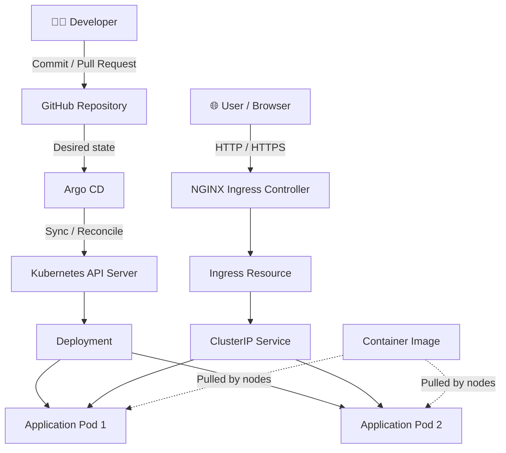
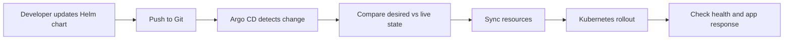

# KUBERNETES PRODUCTION DEPLOYMENT


### Kubernetes · Helm · Argo CD · NGINX Ingress

<p>
  
  
  
  
  
</p>

**A portfolio-ready project for deploying a containerized application on Kubernetes using Helm, GitOps delivery with Argo CD, and traffic routing through NGINX Ingress.**

[Architecture](#-architecture) · [Quick Start](#-quick-start) · [Deployment](#-deployment-guide) · [Troubleshooting](#-troubleshooting) · [Interview Prep](#-interview-preparation)

</div>

---

## 📌 Project Overview

This project demonstrates how to package, deploy, expose, and maintain a containerized web application on Kubernetes using a repeatable workflow.

Instead of manually applying copied YAML files for every change, this project uses:

- **Kubernetes** to run and maintain application workloads.
- **Helm** to package Kubernetes resources into a configurable chart.
- **Argo CD** to reconcile cluster resources with the desired configuration stored in Git.
- **NGINX Ingress Controller** to route HTTP/HTTPS requests to the application.
- **Docker** to package the application into a container image.

> **Project status:** This README is a runnable learning blueprint. It does not claim that the project has already been deployed to a live production cluster. Run the commands and add your own screenshots after verifying each step.

## 🎯 Objectives

- [x] Create a container image for a sample web application.
- [x] Deploy the app with Kubernetes Deployment and Service resources.
- [x] Package Kubernetes resources using Helm.
- [x] Configure readiness and liveness probes.
- [x] Route requests through NGINX Ingress.
- [x] Use Argo CD to implement GitOps reconciliation.
- [x] Practice rollout verification, rollback, and troubleshooting.
- [x] Document security and production-readiness improvements.

## 🧰 Technology Stack

| Technology | Purpose in this project | Documentation |
|---|---|---|
| Kubernetes | Schedules and maintains application Pods | [Official docs](https://kubernetes.io/docs/) |
| Docker | Builds the application container image | [Official docs](https://docs.docker.com/) |
| Helm | Packages and configures Kubernetes resources | [Official docs](https://helm.sh/docs/) |
| Argo CD | GitOps continuous delivery and reconciliation | [Official docs](https://argo-cd.readthedocs.io/) |
| NGINX Ingress Controller | Routes external HTTP/HTTPS traffic | [Official docs](https://kubernetes.github.io/ingress-nginx/) |
| kubectl | Inspects and troubleshoots cluster resources | [kubectl reference](https://kubernetes.io/docs/reference/kubectl/) |
| kind | Runs a local Kubernetes cluster for learning | [Official docs](https://kind.sigs.k8s.io/) |
| GitHub | Stores version-controlled application and deployment files | [GitHub Docs](https://docs.github.com/) |

---

## 🏗️ Architecture

### High-level architecture



### GitOps delivery flow



### Request flow

1. A user opens the application's hostname.
2. The NGINX Ingress Controller receives the HTTP/HTTPS request.
3. The Ingress rule selects the matching Kubernetes Service.
4. The Service routes traffic to ready application Pods.
5. Kubernetes replaces unhealthy Pods and manages configured rolling updates.

### Component responsibilities

| Component | Responsibility |
|---|---|
| Git repository | Source of truth for versioned deployment configuration |
| Helm chart | Templates and values used to render Kubernetes manifests |
| Argo CD | Compares Git's desired state with live cluster state |
| Deployment | Maintains replicas and manages rolling updates |
| Pod | Runs the application container |
| Service | Provides stable internal networking to selected Pods |
| Ingress | Declares HTTP routing rules |
| NGINX Ingress Controller | Implements those routing rules |

---

## 🧩 Real-World Scenario

A team has a containerized web application and wants deployments to be consistent, reviewable, and recoverable.

### Challenges

- Manual YAML changes can create configuration drift.
- Separate environments often accumulate duplicated manifests.
- Teams need to understand whether the deployed application is healthy.
- The application needs a stable route from outside the cluster.
- Failed releases need a documented recovery process.

### Solution

This project introduces Helm for reusable configuration, Argo CD for GitOps reconciliation, NGINX Ingress for routing, and Kubernetes health probes and rolling updates for workload management.

### Expected result

After completing the steps, you should be able to:

- Build and run the sample app in Docker.
- Deploy it to a local Kubernetes cluster.
- Install the application using Helm.
- Access it through port-forwarding and, once ingress networking is configured, through a hostname.
- Connect Argo CD to the Git repository and inspect sync/health status.
- Diagnose common Kubernetes and GitOps errors.

---

## 🗂️ Repository Structure

```text
project-08-kubernetes-production-deployment/
├── app/
│   ├── app.py
│   └── requirements.txt
├── Dockerfile
├── helm/
│   └── web-app/
│       ├── Chart.yaml
│       ├── values.yaml
│       └── templates/
│           ├── _helpers.tpl
│           ├── deployment.yaml
│           ├── service.yaml
│           └── ingress.yaml
├── argocd/
│   └── application.yaml
├── k8s/
│   └── namespace.yaml
├── screenshots/
│   └── .gitkeep
├── .gitignore
└── README.md
```

---

## ✅ Prerequisites

Install the following tools:

- [Docker Desktop / Docker Engine](https://docs.docker.com/get-docker/)
- [kubectl](https://kubernetes.io/docs/tasks/tools/)
- [Helm 3](https://helm.sh/docs/intro/install/)
- [kind](https://kind.sigs.k8s.io/docs/user/quick-start/)
- [Git](https://git-scm.com/downloads)
- A GitHub account and repository

Verify installations:

```bash
docker --version
kubectl version --client
helm version
kind version
git --version
```

For a managed Kubernetes cluster, you also need cluster credentials and permissions to create the required resources. Never commit kubeconfig files, tokens, passwords, or cloud credentials to Git.

---

## ⚡ Quick Start

> These commands assume Docker, kubectl, Helm, and kind are installed and working.

```bash
# 1. Create a local cluster
kind create cluster --name project-08

# 2. Confirm the cluster is available
kubectl get nodes

# 3. Build the app image from the project root
docker build -t project-08-web-app:1.0.0 .

# 4. Load the image into kind
kind load docker-image project-08-web-app:1.0.0 --name project-08

# 5. Validate the Helm chart
helm lint ./helm/web-app

# 6. Install the application
helm upgrade --install web-app ./helm/web-app \
  --namespace production \
  --create-namespace

# 7. Check the rollout
kubectl rollout status deployment/web-app -n production
kubectl get pods,svc,ingress -n production

# 8. Test the Service with port-forwarding
kubectl port-forward -n production svc/web-app 8080:80
```

In another terminal:

```bash
curl http://localhost:8080/
curl http://localhost:8080/health
```

If your chart helpers generate a different Deployment or Service name, use the actual name shown by `kubectl get deployments,services -n production`.

---

## 🐳 Step 1 — Create the Sample Application

Create `app/app.py`:

```python
from http.server import BaseHTTPRequestHandler, HTTPServer
import json
import os


class Handler(BaseHTTPRequestHandler):
    def do_GET(self):
        if self.path == "/health":
            status_code = 200
            response = {"status": "healthy"}
        else:
            status_code = 200
            response = {
                "application": "project-08-web-app",
                "message": "Running on Kubernetes",
                "environment": os.getenv("APP_ENV", "development"),
            }

        body = json.dumps(response).encode("utf-8")
        self.send_response(status_code)
        self.send_header("Content-Type", "application/json")
        self.send_header("Content-Length", str(len(body)))
        self.end_headers()
        self.wfile.write(body)

    def log_message(self, format_string, *args):
        print("%s - %s" % (self.address_string(), format_string % args))


HTTPServer(("0.0.0.0", 8080), Handler).serve_forever()
```

Create `app/requirements.txt` as an empty file; this sample uses only the Python standard library.

### Create the Dockerfile

Create `Dockerfile`:

```dockerfile
FROM python:3.12-slim

ENV PYTHONDONTWRITEBYTECODE=1 \
    PYTHONUNBUFFERED=1

WORKDIR /app
COPY app/ /app/

RUN useradd --system --uid 10001 appuser
USER 10001

EXPOSE 8080
CMD ["python", "app.py"]
```

Build and run:

```bash
docker build -t project-08-web-app:1.0.0 .
docker run --rm -p 8080:8080 project-08-web-app:1.0.0
```

Open `http://localhost:8080` and `http://localhost:8080/health`. Stop the container with `Ctrl+C`.

> **Security note:** This is a small learning image. For a production pipeline, review base-image updates, scan dependencies and images, use trusted registries, and consider pinning base images by digest.

---

## ☸️ Step 2 — Create the Kubernetes Cluster

Create a local kind cluster:

```bash
kind create cluster --name project-08
kubectl cluster-info
kubectl get nodes
```

Load the local image into kind:

```bash
kind load docker-image project-08-web-app:1.0.0 --name project-08
```

Create the namespace if needed:

```bash
kubectl create namespace production
```

If using Minikube instead, use its documented image build/load workflow so the cluster can access the image.

---

## ⛵ Step 3 — Create the Helm Chart

Create the initial chart skeleton:

```bash
helm create helm/web-app
```

Keep the `_helpers.tpl` file generated by Helm, or define equivalent helpers before using the templates below.

### `helm/web-app/Chart.yaml`

```yaml
apiVersion: v2
name: web-app
description: Helm chart for the Project 08 Kubernetes web application
type: application
version: 0.1.0
appVersion: "1.0.0"
```

### `helm/web-app/values.yaml`

```yaml
replicaCount: 2

image:
  repository: project-08-web-app
  tag: "1.0.0"
  pullPolicy: IfNotPresent

nameOverride: ""
fullnameOverride: ""

service:
  type: ClusterIP
  port: 80
  targetPort: 8080

containerPort: 8080
appEnv: production

resources:
  requests:
    cpu: 100m
    memory: 64Mi
  limits:
    cpu: 500m
    memory: 128Mi

probes:
  readiness:
    path: /health
    initialDelaySeconds: 3
    periodSeconds: 5
  liveness:
    path: /health
    initialDelaySeconds: 10
    periodSeconds: 10

ingress:
  enabled: true
  className: nginx
  host: web-app.local
  path: /
  pathType: Prefix
```

### `helm/web-app/templates/deployment.yaml`

```yaml
apiVersion: apps/v1
kind: Deployment
metadata:
  name: {{ include "web-app.fullname" . }}
  labels:
    app.kubernetes.io/name: {{ include "web-app.name" . }}
    app.kubernetes.io/instance: {{ .Release.Name }}
spec:
  replicas: {{ .Values.replicaCount }}
  strategy:
    type: RollingUpdate
    rollingUpdate:
      maxUnavailable: 0
      maxSurge: 1
  selector:
    matchLabels:
      app.kubernetes.io/name: {{ include "web-app.name" . }}
      app.kubernetes.io/instance: {{ .Release.Name }}
  template:
    metadata:
      labels:
        app.kubernetes.io/name: {{ include "web-app.name" . }}
        app.kubernetes.io/instance: {{ .Release.Name }}
    spec:
      automountServiceAccountToken: false
      securityContext:
        runAsNonRoot: true
        runAsUser: 10001
        seccompProfile:
          type: RuntimeDefault
      containers:
        - name: web-app
          image: "{{ .Values.image.repository }}:{{ .Values.image.tag }}"
          imagePullPolicy: {{ .Values.image.pullPolicy }}
          ports:
            - name: http
              containerPort: {{ .Values.containerPort }}
          env:
            - name: APP_ENV
              value: {{ .Values.appEnv | quote }}
          readinessProbe:
            httpGet:
              path: {{ .Values.probes.readiness.path }}
              port: http
            initialDelaySeconds: {{ .Values.probes.readiness.initialDelaySeconds }}
            periodSeconds: {{ .Values.probes.readiness.periodSeconds }}
          livenessProbe:
            httpGet:
              path: {{ .Values.probes.liveness.path }}
              port: http
            initialDelaySeconds: {{ .Values.probes.liveness.initialDelaySeconds }}
            periodSeconds: {{ .Values.probes.liveness.periodSeconds }}
          resources:
            {{- toYaml .Values.resources | nindent 12 }}
          securityContext:
            allowPrivilegeEscalation: false
            readOnlyRootFilesystem: true
            capabilities:
              drop:
                - ALL
```

### `helm/web-app/templates/service.yaml`

```yaml
apiVersion: v1
kind: Service
metadata:
  name: {{ include "web-app.fullname" . }}
spec:
  type: {{ .Values.service.type }}
  selector:
    app.kubernetes.io/name: {{ include "web-app.name" . }}
    app.kubernetes.io/instance: {{ .Release.Name }}
  ports:
    - name: http
      port: {{ .Values.service.port }}
      targetPort: http
      protocol: TCP
```

### `helm/web-app/templates/ingress.yaml`

```yaml
{{- if .Values.ingress.enabled }}
apiVersion: networking.k8s.io/v1
kind: Ingress
metadata:
  name: {{ include "web-app.fullname" . }}
spec:
  ingressClassName: {{ .Values.ingress.className }}
  rules:
    - host: {{ .Values.ingress.host | quote }}
      http:
        paths:
          - path: {{ .Values.ingress.path }}
            pathType: {{ .Values.ingress.pathType }}
            backend:
              service:
                name: {{ include "web-app.fullname" . }}
                port:
                  number: {{ .Values.service.port }}
{{- end }}
```

Validate and render the chart:

```bash
helm lint ./helm/web-app
helm template web-app ./helm/web-app --namespace production
```

---

## 🌐 Step 4 — Install NGINX Ingress Controller

For a local kind cluster, follow the current kind-specific instructions in the official ingress-nginx documentation. The following manifest is a commonly used kind setup:

```bash
kubectl apply -f https://raw.githubusercontent.com/kubernetes/ingress-nginx/main/deploy/static/provider/kind/deploy.yaml
kubectl get pods -n ingress-nginx
```

Wait for the controller Pods to become ready. For long-lived environments, review and pin a released manifest instead of automatically tracking the `main` branch.

Install the Helm application:

```bash
helm upgrade --install web-app ./helm/web-app \
  --namespace production \
  --create-namespace
```

Verify:

```bash
kubectl get deployments,pods,services,ingress -n production
kubectl rollout status deployment/web-app -n production
```

### Test the hostname

The chart configures `web-app.local` as an example hostname. For local testing, your kind configuration must expose ingress traffic to the host machine. If that networking is configured, add this entry to your machine's hosts file:

```text
127.0.0.1 web-app.local
```

Then test:

```bash
curl -i http://web-app.local/
curl -i http://web-app.local/health
```

If ingress networking is not configured, use the Service port-forward method from Quick Start to test the application.

---

## 🔁 Step 5 — Configure Argo CD GitOps

Install Argo CD by following the [official installation guide](https://argo-cd.readthedocs.io/en/stable/getting_started/). For a learning cluster, a standard install commonly uses the `argocd` namespace:

```bash
kubectl create namespace argocd
kubectl apply -n argocd -f https://raw.githubusercontent.com/argoproj/argo-cd/stable/manifests/install.yaml
kubectl get pods -n argocd
```

For reproducible or production use, select and review a specific released version rather than automatically tracking the `stable` manifest.

Push this project to your Git repository before creating the Argo CD Application.

### `argocd/application.yaml`

Replace `YOUR-USER` with your GitHub username or organization and ensure the repository path matches your actual project.

```yaml
apiVersion: argoproj.io/v1alpha1
kind: Application
metadata:
  name: web-app
  namespace: argocd
spec:
  project: default
  source:
    repoURL: https://github.com/YOUR-USER/project-08-kubernetes-production-deployment.git
    targetRevision: main
    path: helm/web-app
    helm:
      valueFiles:
        - values.yaml
  destination:
    server: https://kubernetes.default.svc
    namespace: production
  syncPolicy:
    automated:
      prune: true
      selfHeal: true
    syncOptions:
      - CreateNamespace=true
```

Apply and inspect:

```bash
kubectl apply -f argocd/application.yaml
kubectl get applications -n argocd
```

### What the sync policy does

| Setting | Meaning |
|---|---|
| `automated` | Allows Argo CD to sync desired configuration automatically |
| `prune: true` | Allows Argo CD to remove managed resources deleted from Git |
| `selfHeal: true` | Reconciles supported live changes back toward the declared Git state |
| `CreateNamespace=true` | Creates the destination namespace if it does not exist |

> **Important:** Pruning can delete resources. Protect production branches, use reviews and RBAC, and understand the impact of each Git change. For private repositories, configure repository access through Argo CD's supported credential mechanisms. Never commit tokens or passwords to this YAML.

---

## 🚦 Step 6 — Deployment Verification

Run:

```bash
kubectl get nodes
kubectl get pods -n production -o wide
kubectl get deployment,service,ingress -n production
kubectl rollout status deployment/web-app -n production
helm list -n production
kubectl get applications -n argocd
```

Test the app:

```bash
kubectl port-forward -n production svc/web-app 8080:80
```

In another terminal:

```bash
curl -i http://localhost:8080/
curl -i http://localhost:8080/health
```

### Expected verification

| Check | Expected outcome |
|---|---|
| Kubernetes node | Node reports `Ready` |
| Application Pods | Pods become `Running` and `Ready` |
| Deployment rollout | Command completes successfully |
| Helm release | `web-app` release appears |
| Service | ClusterIP Service has ready endpoints |
| Health endpoint | `/health` responds with HTTP 200 |
| Argo CD | Application becomes `Synced` and `Healthy` after repository access and sync succeed |

Actual results depend on your environment. Do not mark a check complete until you have run it.

---

## 🔄 Step 7 — Update and Roll Back

Make a reviewed change to `helm/web-app/values.yaml` (for example, change `replicaCount`), commit it, and push it to Git. Argo CD should detect the change and reconcile the cluster according to its sync policy.

Inspect status:

```bash
kubectl get applications -n argocd
kubectl get pods -n production
kubectl rollout status deployment/web-app -n production
kubectl describe deployment web-app -n production
helm history web-app -n production
```

For a Helm-managed release, a rollback command is:

```bash
helm rollback web-app <REVISION> -n production
```

**GitOps warning:** When Argo CD manages the same resources, a direct Helm rollback can be overwritten if Git still declares the newer version. The preferred GitOps recovery is to revert the bad Git commit or restore the previous known-good chart values, then let Argo CD reconcile.

---

## 🔐 Production Readiness & Security

- [ ] Use a trusted image registry and immutable tags or image digests.
- [ ] Run containers as non-root.
- [ ] Drop unnecessary Linux capabilities and prevent privilege escalation.
- [ ] Set resource requests and limits based on workload measurements.
- [ ] Configure readiness, liveness, and (where needed) startup probes.
- [ ] Use TLS for external traffic and plan certificate renewal.
- [ ] Store secrets in an approved secret manager; do not commit them to Git.
- [ ] Apply least-privilege Kubernetes RBAC.
- [ ] Use NetworkPolicies where supported by the cluster's network plugin.
- [ ] Scan images and dependencies and define a response process for critical findings.
- [ ] Protect Git branches and require review for production changes.
- [ ] Monitor application health, latency, errors, and resource saturation.
- [ ] Test rollback, backup, restore, and disaster-recovery procedures.
- [ ] Pin controller/tool versions and plan upgrades.
- [ ] Evaluate PodDisruptionBudgets and autoscaling for the real workload.

The included sample is a learning baseline, not a complete production security policy. Production clusters may require Pod Security Standards, additional admission controls, TLS configuration, NetworkPolicies, monitoring, and organization-specific rules.

---

## 🧯 Troubleshooting

| Problem | Diagnostic command | What to check |
|---|---|---|
| Pod is `Pending` | `kubectl describe pod <pod> -n production` | Scheduling events, CPU/memory, taints, selectors |
| `ImagePullBackOff` | `kubectl describe pod <pod> -n production` | Image name/tag, registry access, pull credentials |
| `CrashLoopBackOff` | `kubectl logs <pod> -n production --previous` | Startup errors, configuration, process exit |
| Readiness probe fails | `kubectl describe pod <pod> -n production` | Health path, port, startup delay |
| Ingress returns 404 | `kubectl get ingress,svc,endpoints -n production` | Host, path, ingress class, Service endpoints |
| Argo CD is `OutOfSync` | Inspect the Application diff/status | Git branch, chart path, values, live changes |
| Argo CD cannot sync | Inspect Application events and controller logs | Invalid manifests, RBAC, repository access |
| Service has no endpoints | `kubectl get endpoints -n production` | Service selector versus Pod labels; Pod readiness |
| Rollout stalls | `kubectl rollout status deployment/web-app -n production` | Probe failures, resources, image availability |

Useful commands:

```bash
kubectl get events -n production --sort-by=.lastTimestamp
kubectl describe deployment web-app -n production
kubectl logs deployment/web-app -n production
kubectl get pods -n production -o wide
helm status web-app -n production
```

---

## 📸 Screenshots for Your GitHub Portfolio

After you run and verify the project, add screenshots under `screenshots/` and embed them here. These are placeholders; do not claim a result you have not observed.

```markdown
## Screenshots

### Kubernetes Workloads


### Helm Release


### Argo CD Application


### Application Response

```

Recommended evidence:

1. `kubectl get nodes` showing the node is Ready.
2. `kubectl get pods,svc,ingress -n production`.
3. `helm list -n production`.
4. Argo CD Application screen showing Synced/Healthy.
5. Successful `curl` response from the app.
6. A controlled update and rollback/revert demonstration.

---

## 🧹 Cleanup

For a disposable local learning cluster:

```bash
kubectl delete -f argocd/application.yaml
helm uninstall web-app -n production
kubectl delete namespace production
kind delete cluster --name project-08
```

If you installed Argo CD and ingress-nginx only for this project, remove those components or delete the local cluster. Do not delete shared namespaces or controllers on a shared cluster without confirming ownership and impact.

---

## 💼 Interview Preparation

### 60-second project explanation

> “I deployed a containerized web application to Kubernetes using Helm for reusable configuration. I configured a Deployment with rolling updates, resource requests and limits, and health probes. I exposed the application through a Service and NGINX Ingress. I then configured Argo CD to watch the Git repository and reconcile the cluster with the declared Helm configuration. I verified the rollout, tested the health endpoint, and documented troubleshooting and GitOps recovery procedures.”

Only describe the components you have personally configured and tested.

### Interview questions

1. What problem does Kubernetes solve?
2. What is the difference between a Pod, ReplicaSet, and Deployment?
3. Compare ClusterIP, NodePort, and LoadBalancer Services.
4. What is an Ingress, and why is an Ingress Controller needed?
5. What are Helm charts, templates, and values files?
6. How does Argo CD implement GitOps?
7. What is the difference between `OutOfSync` and `Degraded`?
8. How do readiness and liveness probes differ?
9. How does a rolling update work?
10. How would you troubleshoot `ImagePullBackOff`?
11. What is configuration drift, and how can Argo CD self-heal help?
12. Why can a direct Helm rollback conflict with GitOps?
13. How do requests and limits affect Kubernetes scheduling?
14. How would you expose this app securely over HTTPS?
15. What additional controls would you implement before production?

---

## 🏁 Definition of Done

- [ ] Docker image builds and starts locally.
- [ ] Helm chart passes `helm lint` and renders valid manifests.
- [ ] Application Pods become Ready in the local cluster.
- [ ] Service responds through port-forwarding.
- [ ] NGINX Ingress routes the hostname when local ingress networking is configured.
- [ ] Argo CD can access the repository and reports the app as Synced/Healthy.
- [ ] A Git change updates the intended configuration.
- [ ] GitOps recovery/rollback is understood and documented.
- [ ] Troubleshooting commands and actual screenshots are added.
- [ ] Cleanup is completed without affecting unrelated workloads.

## 🔗 Official Documentation

- [Kubernetes Documentation](https://kubernetes.io/docs/)
- [Helm Documentation](https://helm.sh/docs/)
- [Argo CD Documentation](https://argo-cd.readthedocs.io/)
- [Ingress NGINX Documentation](https://kubernetes.github.io/ingress-nginx/)
- [Docker Documentation](https://docs.docker.com/)
- [kind Quick Start](https://kind.sigs.k8s.io/docs/user/quick-start/)
- [kubectl Cheat Sheet](https://kubernetes.io/docs/reference/kubectl/cheatsheet/)

---

<div align="center">

**PROJECT 08 — KUBERNETES PRODUCTION DEPLOYMENT**

*Kubernetes · Helm · Argo CD · NGINX Ingress*

