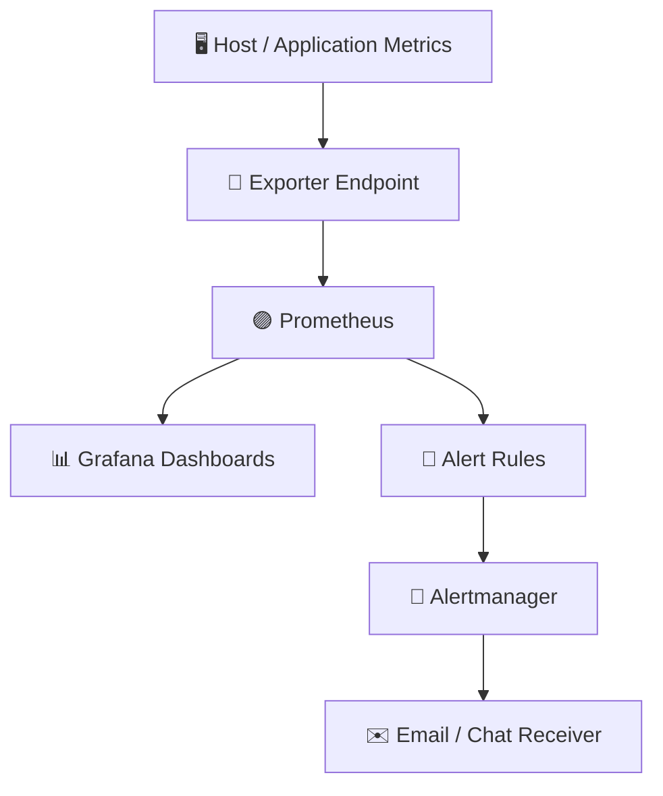

# 🚀 PROJECT 09 — REAL-TIME MONITORING & ALERTING

### 🔥 Prometheus · Grafana · Alertmanager · Docker Compose

<p>
  
  
  
  
</p>

**Build a practical monitoring stack that collects metrics, visualizes system health, and raises alerts when something goes wrong.**

[📊 Prometheus](https://prometheus.io/) · [📈 Grafana](https://grafana.com/) · [🚨 Alertmanager](https://prometheus.io/docs/alerting/latest/alertmanager/) · [🐳 Docker Compose](https://docs.docker.com/compose/)

</div>

---


## 🌈 Project at a glance

<table>
<tr>
<td width="50%" valign="top">

### 🟪 WHAT YOU BUILD
- 🔎 Metrics collection with Prometheus
- 📊 Dashboards with Grafana
- 🚨 Alert rules for service health
- 📣 Alert routing with Alertmanager
- 🐳 One-command local deployment

</td>
<td width="50%" valign="top">

### 🟦 WHAT YOU PRACTISE
- 📡 Scrape targets and exporters
- 🧠 PromQL query basics
- 🧰 Troubleshooting targets and alerts
- 🔐 Safer configuration practices
- 🏭 Production monitoring concepts

</td>
</tr>
</table>

> [!IMPORTANT]
> **Portfolio project / learning lab:** this repository is a starter blueprint. Run and validate it in your own environment before describing it as a live production deployment. Alert delivery requires you to configure a real receiver.

## 🧭 Contents

- [🎯 Scenario](#-scenario)
- [🏗️ Architecture](#️-architecture)
- [🗂️ Repository structure](#️-repository-structure)
- [⚙️ Prerequisites](#️-prerequisites)
- [🚀 Run the stack](#-run-the-stack)
- [📊 Open the dashboards](#-open-the-dashboards)
- [🚨 Alert rules](#-alert-rules)
- [🧪 Validate the setup](#-validate-the-setup)
- [🛠️ Troubleshooting](#️-troubleshooting)
- [🔐 Production hardening](#-production-hardening)
- [🧹 Cleanup](#-cleanup)
- [🎤 Interview preparation](#-interview-preparation)
- [📚 References](#-references)

---

## 🎯 Scenario

Imagine a service becomes unavailable or its CPU usage remains high. Without monitoring, the team may only discover the issue after users complain.

This project creates a basic observability stack:

- **Prometheus** scrapes metrics from configured targets.
- **Grafana** queries Prometheus and displays dashboards.
- **Alertmanager** receives alerts from Prometheus and routes notifications to configured receivers.
- **Node Exporter** exposes host-level metrics when deployed on a supported host.

### 🟩 Expected learning outcome

<details>
<summary><b>Click to expand — what success looks like</b></summary>

- Prometheus opens and reports its configured scrape targets.
- Grafana can connect to Prometheus as a data source.
- A sample PromQL query returns data when a target is available.
- Alert rules load without syntax errors.
- Alertmanager opens and displays its status.
- Notifications are sent only after you configure a valid receiver and test it.

</details>

## 🏗️ Architecture



### 🔄 How data flows

| Step | Component | Responsibility |
|---:|---|---|
| 1 | Exporter / application | Exposes metrics over HTTP |
| 2 | Prometheus | Scrapes and stores time-series metrics |
| 3 | PromQL | Queries metric data for charts and alerts |
| 4 | Grafana | Visualizes metrics in dashboards |
| 5 | Alertmanager | Groups, deduplicates, silences, and routes alerts |
| 6 | Receiver | Delivers notifications after configuration |

## 🗂️ Repository structure

```text
project-09-monitoring-alerting/
├── docker-compose.yml
├── prometheus/
│   ├── prometheus.yml
│   └── alerts.yml
├── alertmanager/
│   └── alertmanager.yml
├── grafana/
│   └── provisioning/
│       └── datasources/
│           └── datasource.yml
└── README.md
```

## ⚙️ Prerequisites

<table>
<tr><th>Tool</th><th>Purpose</th><th>Check</th></tr>
<tr><td>🐳 Docker</td><td>Run containers</td><td><code>docker --version</code></td></tr>
<tr><td>🧩 Docker Compose</td><td>Start the stack</td><td><code>docker compose version</code></td></tr>
<tr><td>📝 Git</td><td>Version control</td><td><code>git --version</code></td></tr>
</table>

## 🚀 Run the stack

### 1️⃣ Create the folders

```bash
mkdir -p project-09-monitoring-alerting/{prometheus,alertmanager,grafana/provisioning/datasources}
cd project-09-monitoring-alerting
```

On Windows PowerShell, create the folders with:

```powershell
New-Item -ItemType Directory -Force prometheus, alertmanager, grafana/provisioning/datasources
```

### 2️⃣ Create `docker-compose.yml`

```yaml
services:
  prometheus:
    image: prom/prometheus:latest
    container_name: prometheus
    command:
      - --config.file=/etc/prometheus/prometheus.yml
      - --storage.tsdb.path=/prometheus
      - --web.enable-lifecycle
    ports:
      - "9090:9090"
    volumes:
      - ./prometheus/prometheus.yml:/etc/prometheus/prometheus.yml:ro
      - ./prometheus/alerts.yml:/etc/prometheus/alerts.yml:ro
      - prometheus_data:/prometheus
    restart: unless-stopped
    networks: [monitoring]

  alertmanager:
    image: prom/alertmanager:latest
    container_name: alertmanager
    command:
      - --config.file=/etc/alertmanager/alertmanager.yml
    ports:
      - "9093:9093"
    volumes:
      - ./alertmanager/alertmanager.yml:/etc/alertmanager/alertmanager.yml:ro
    restart: unless-stopped
    networks: [monitoring]

  grafana:
    image: grafana/grafana:latest
    container_name: grafana
    ports:
      - "3000:3000"
    environment:
      GF_SECURITY_ADMIN_USER: admin
      GF_SECURITY_ADMIN_PASSWORD: change-this-local-password
      GF_USERS_ALLOW_SIGN_UP: "false"
    volumes:
      - grafana_data:/var/lib/grafana
      - ./grafana/provisioning/datasources:/etc/grafana/provisioning/datasources:ro
    restart: unless-stopped
    networks: [monitoring]

volumes:
  prometheus_data:
  grafana_data:

networks:
  monitoring:
    driver: bridge
```

> [!WARNING]
> This Compose file uses `latest` tags and a sample Grafana password for convenient local learning. Pin image versions and use secrets or an appropriate secret manager before using it beyond a disposable lab. Do not expose these ports directly to the public internet.

### 3️⃣ Create `prometheus/prometheus.yml`

```yaml
global:
  scrape_interval: 15s
  evaluation_interval: 15s

rule_files:
  - /etc/prometheus/alerts.yml

alerting:
  alertmanagers:
    - static_configs:
        - targets:
            - alertmanager:9093

scrape_configs:
  - job_name: prometheus
    static_configs:
      - targets: ["prometheus:9090"]
```

This minimal configuration monitors Prometheus itself. Add exporters or application targets when they are available on the same Docker network or reachable from the Prometheus container.

### 4️⃣ Create `prometheus/alerts.yml`

```yaml
groups:
  - name: monitoring-stack
    rules:
      - alert: PrometheusTargetMissing
        expr: up == 0
        for: 1m
        labels:
          severity: warning
        annotations:
          summary: "A Prometheus scrape target is down"
          description: "Target {{ $labels.job }} at {{ $labels.instance }} has been unreachable for more than one minute."

      - alert: PrometheusConfigReloadFailed
        expr: prometheus_config_last_reload_successful == 0
        for: 2m
        labels:
          severity: critical
        annotations:
          summary: "Prometheus configuration reload failed"
          description: "Prometheus has not successfully reloaded its configuration."
```

### 5️⃣ Create `alertmanager/alertmanager.yml`

```yaml
global:
  resolve_timeout: 5m

route:
  receiver: local-default
  group_by: ["alertname", "job"]
  group_wait: 30s
  group_interval: 5m
  repeat_interval: 4h

receivers:
  - name: local-default
```

This receiver intentionally has no external notification integration. Alerts can appear in the Prometheus and Alertmanager UIs, but email/chat delivery will not happen until you configure a supported receiver.

### 6️⃣ Create `grafana/provisioning/datasources/datasource.yml`

```yaml
apiVersion: 1

datasources:
  - name: Prometheus
    type: prometheus
    access: proxy
    url: http://prometheus:9090
    isDefault: true
    editable: true
```

### 7️⃣ Validate and start

```bash
docker compose config
docker compose up -d
docker compose ps
```

View logs if any service fails:

```bash
docker compose logs --tail=100 prometheus
docker compose logs --tail=100 grafana
docker compose logs --tail=100 alertmanager
```

## 📊 Open the dashboards

| Service | Local URL | What to check |
|---|---|---|
| 🟣 Prometheus | [http://localhost:9090](http://localhost:9090) | Status → Targets; query `up` |
| 📈 Grafana | [http://localhost:3000](http://localhost:3000) | Sign in and open Explore |
| 🚨 Alertmanager | [http://localhost:9093](http://localhost:9093) | Status and active alerts |

For the local lab, Grafana starts with username `admin` and the sample password in `docker-compose.yml`. Change it before continuing and never reuse it for a real deployment.

### 🧮 Try these PromQL queries

```promql
up
```

Shows whether configured scrape targets are reachable (`1` = up, `0` = down).

```promql
prometheus_tsdb_head_series
```

Shows the approximate number of active time series in Prometheus's head block.

```promql
rate(prometheus_tsdb_head_samples_appended_total[5m])
```

Shows the recent rate of samples appended to the head block, when this metric is available in the running version.

## 🚨 Alert rules

| Alert | Meaning | First checks |
|---|---|---|
| `PrometheusTargetMissing` | A scrape target reports `up == 0` | Target URL, DNS, port, container network, exporter logs |
| `PrometheusConfigReloadFailed` | Prometheus failed to load a configuration | Prometheus logs, YAML indentation, rule/config validation |

> 💡 **Remember:** `up == 0` only evaluates for targets Prometheus knows about. If no exporter or application target is configured, you will not get host CPU or memory alerts automatically.

## 🧪 Validate the setup

Run these checks after starting the services:

```bash
docker compose ps
docker compose logs --tail=50 prometheus
```

1. Open Prometheus and check **Status → Targets**.
2. In Prometheus, run `up`; the Prometheus target should report `1`.
3. Open Grafana and confirm the Prometheus data source is healthy.
4. Open Alertmanager and verify its status page loads.
5. For a safe alert test, add a temporary scrape target that is intentionally unreachable, validate the configuration, then remove it after observing the alert.

Optional configuration check if you have `promtool` installed:

```bash
promtool check config prometheus/prometheus.yml
promtool check rules prometheus/alerts.yml
```

## 🛠️ Troubleshooting

<details>
<summary>🔴 Prometheus target shows DOWN</summary>

- Check the exact target and error in **Status → Targets**.
- From inside the Prometheus container, verify that the hostname resolves and the target port is reachable.
- In Docker Compose, use the service name (for example, `alertmanager:9093`) rather than `localhost` to reach another container.
- Inspect logs with `docker compose logs prometheus`.

</details>

<details>
<summary>🟠 Grafana cannot connect to Prometheus</summary>

- Check that both containers are running.
- Use `http://prometheus:9090` as the data-source URL from Grafana's container network.
- Do not use `http://localhost:9090` for this container-to-container connection; `localhost` means Grafana's own container.
- Check Grafana logs and the data-source health test.

</details>

<details>
<summary>🟡 Alerts are not appearing</summary>

- Confirm `rule_files` points to `/etc/prometheus/alerts.yml`.
- Confirm the rule file is mounted and YAML indentation is valid.
- Check Prometheus **Alerts** and **Rules** pages.
- Remember the `for` duration delays firing until the expression remains true for the configured time.
- Verify Alertmanager is reachable from Prometheus.

</details>

<details>
<summary>🔵 Notifications are not being delivered</summary>

- The sample `local-default` receiver is deliberately empty.
- Configure an email, webhook, or chat receiver supported by your chosen Alertmanager version.
- Keep credentials outside Git; use environment-specific secrets or a secret manager.
- Send a test notification and inspect Alertmanager logs.

</details>

## 🔐 Production hardening checklist

- [ ] Pin tested container image versions; avoid floating `latest` tags.
- [ ] Replace the example Grafana password and manage secrets safely.
- [ ] Put UIs behind authenticated access and TLS; restrict network ingress.
- [ ] Configure a real Alertmanager receiver and test notification delivery.
- [ ] Add application metrics and suitable exporters for host/container metrics.
- [ ] Define retention, persistent storage, backup, and restore requirements.
- [ ] Monitor Prometheus, Grafana, Alertmanager, and the monitored services.
- [ ] Set alert thresholds and routing based on service-level objectives.
- [ ] Review high-cardinality labels and avoid sensitive data in labels.
- [ ] Document ownership, escalation, maintenance windows, and runbooks.

## 🧹 Cleanup

Stop and remove containers and the Compose network:

```bash
docker compose down
```

Remove containers, network, and stored Prometheus/Grafana volumes (⚠️ deletes local monitoring data):

```bash
docker compose down -v
```

## 🎤 Interview preparation

<details>
<summary><b>1. What is Prometheus?</b></summary>

Prometheus is an open-source monitoring and alerting toolkit that collects time-series metrics by scraping configured HTTP endpoints and supports querying them with PromQL.

</details>

<details>
<summary><b>2. What is Grafana?</b></summary>

Grafana is a visualization and analytics platform used to query data sources and build dashboards, charts, and alerts.

</details>

<details>
<summary><b>3. Prometheus vs Grafana?</b></summary>

Prometheus collects and stores metrics and evaluates alert rules. Grafana visualizes metrics from Prometheus and other supported data sources.

</details>

<details>
<summary><b>4. What does Alertmanager do?</b></summary>

Alertmanager handles alerts sent by Prometheus, including grouping, deduplication, silencing, inhibition, and routing to configured receivers.

</details>

<details>
<summary><b>5. What does `up == 0` mean?</b></summary>

For a configured scrape target, `up` is generally `1` when the last scrape succeeded and `0` when it failed. It does not automatically discover every host or application.

</details>

<details>
<summary><b>6. What is PromQL?</b></summary>

PromQL is Prometheus's query language for selecting, filtering, aggregating, and calculating over time-series metrics.

</details>

<details>
<summary><b>7. How would you troubleshoot missing metrics?</b></summary>

Check target configuration, DNS and network connectivity, exporter endpoint, scrape errors, Prometheus logs, metric names, and whether the expected target is configured.

</details>

## 📚 References

- [📘 Prometheus documentation](https://prometheus.io/docs/introduction/overview/)
- [📗 PromQL basics](https://prometheus.io/docs/prometheus/latest/querying/basics/)
- [📙 Alerting rules](https://prometheus.io/docs/prometheus/latest/configuration/alerting_rules/)
- [📕 Alertmanager configuration](https://prometheus.io/docs/alerting/latest/configuration/)
- [📊 Grafana documentation](https://grafana.com/docs/)
- [🐳 Docker Compose documentation](https://docs.docker.com/compose/)

---

<div align="center">

### 💜 Built for learning. Designed for a DevOps portfolio.

**Project 09 — Real-Time Monitoring & Alerting**

<sub>Before using this in production, validate versions, configuration, access controls, alert routing, and recovery procedures in your own environment.</sub>

